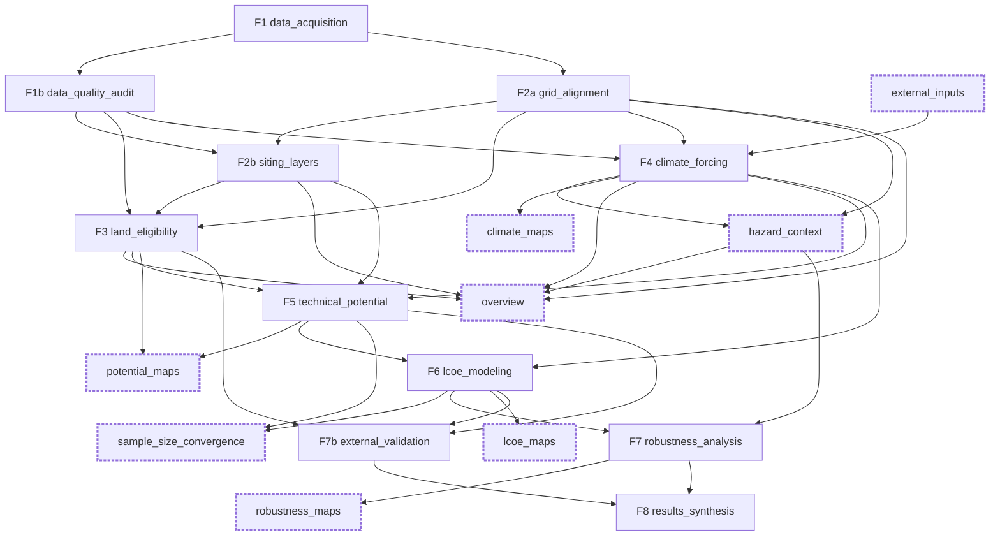

# GeoFREA pipeline guide

Living document (COMMAND 82, 2026-10-30; update it when a phase, a cache or a cost changes). Scope: what every phase does, what it reads and writes, when it runs again, what it costs per country and why, what it produces, and how to run it.
Authority: `docs/METHODOLOGY.md` (method) and `docs/phases/<phase>.md` (contract and decisions). This guide describes the code as it is; where it disagrees with either, the other one wins and this guide is the defect.
Times are **awake seconds** (wall time less the sleeps of Windows), from `GeoFREA_data/logs` and the manifests (schema 2.8); the evidence for each number is in `docs/_audit/optimization_gain_82.md`, `performance_75.md` and `profile_76.md`.

## 1. The graph

The orchestrator (`core/orchestrator.py`) builds the order from `requires` and `produces` of the 19 `PhaseSpec`s registered in `main.py`; nothing else fixes the order. The ten phases of `run.target_phases` (`config/settings.yaml`) are the **default round**;
F5 and later are named with `--phases`. A phase in a box with a thick edge is a **support phase** (a map, a check or a context table that nothing scientific reads back).



Reading the arrows: F1 produces `layer_registry`; F1b produces `audit_report`; F2a produces the aligned rasters and `reference_grid`; F2b the physical-unit layers; F3 `cells_<tech>` and `candidates_<tech>__<scenario>` (central, restrictive, permissive);
F4 `forcing`, `forcing_masked` and `members`; F5 `potential_<tech>__<scenario>`; F6 `lcoe_summary`, `supply_curve`, `lcoe_nominal`; F7 `robustness_<tech>` and the H1 to H5 tables; F7b the validation tables; F8 the thesis outputs under `outputs/thesis/`.
`external_inputs` has no upstream: it verifies the files that scripts fetched outside the graph (CMIP6, ISIMIP3b, ERA5) so a missing file stops F4 with one message (D-F4-019).
Layer order of a default round for one country: F1 -> (F1b, F2a, external_inputs) -> F2b -> F3 -> F4 -> (hazard_context, climate_maps, overview).

## 2. How a phase decides to run, resume or skip (all phases)

One rule, in `core/orchestrator.py`, applies to every phase:

1. **Resume** (log: `Phase '<name>' [ISO]: resuming — manifest status 'success' ... Skipping re-execution`) when the manifest entry is `success`, its `code_fingerprint` equals the current one (normalised AST of the modules the phase imports, `core/code_fingerprint.py`; a comment or a docstring does not change it),
   its `config_fingerprint` equals the current one (`core/config_fingerprint.py`: only the parameters the phase reads), the artifacts recorded for the phase are exactly the ones the phase produces (`StaleManifestEntryError` otherwise), and every artifact is on disk with its recorded sha256.
2. **A missing or altered artifact stops the run; it does not trigger a recompute.** `ArtifactIntegrityError: ... no longer matches its recorded sha256 ... Not recomputing`. The remedy is to name the phase: `--rerun <phase>`.
3. **Execute** otherwise, with the reason in the log: `named in rerun_phases (forced)`; `the configuration it reads changed since it ran`; `the code it runs changed since it ran`; `manifest status 'stale_upstream' (or 'failed'), does not resume`; `no manifest entry yet`.
   When a phase executes, its dependents are marked `stale_upstream` and are recomputed the next time a run needs them, without being named.
4. **Revalidate** (`--revalidate p1,p2`): a `stale_upstream` entry whose inputs are unchanged is declared valid again, after the orchestrator checks that its required artifacts exist; used once after a contract change.
5. `--rerun p1,p2` (or `run.rerun_phases`) forces exactly those phases and never their dependents.
6. The manifest is written to a temporary file and moved into place (COMMAND 80), so a killed process leaves the previous manifest, not a half file. **A killed run can still leave a half-written artifact**: the byte hash then differs and the next run stops as in item 2 (this was the state of `outputs/IND/climate_forcing/artifacts/forcing.parquet` until 2026-10-30, section 7, finding 1).

Inside a phase the **internal caches** decide what is reused when the phase does execute (section 3 gives the key of each). Every cache key contains the content of its inputs and `cache_code(name)` (the fingerprint of the code that computes the cached result, `core/cache_code.py`), so a change of the computing code is a cache miss, never a stale hit.
A change that must not change a result is proved by the canonical content hash before it is accepted (CONVENTIONS, "Changes that must not change a result"); the aligned layers of an older code are adopted only with a proof (`scripts/adopt_aligned_cache_keys.py`, D-core-044).

Robustness common to all phases: pydantic schemas on every phase output (`output_model`) and on every table (`table_schemas.py`, `schema_version` in each Parquet); fail-loud on a missing required parameter (`MissingParameterError`) and, with `--production`, on a proxy or an uncertain parameter without a range;
sanity ranges from `config/audit.yaml` (F1b) and invariants V-03 (eligible area <= cell area, cell total = pixel total) raise rather than warn; a memory guard refuses a cold audit or F2a with less than 2 GB available (exit code 75, before any phase of any country);
`keep_awake` asks Windows not to sleep during a run.

## 3. One sheet per phase

Counts and sizes are the files under `outputs/<ISO>/` for the phase (PRT / IND / BRA, 2026-10-30). Status: `ran_clean` = ran with no warning and its checks passed; `awaiting content check` = ran on the merged code and waits for the comparison with the reference manifest (PV-77, D-core-050);
`never ran` = no real-country execution (only the synthetic country ZZZ). The code is in `src/geofrea/<module>/`.

### F1 data_acquisition (`data_acquisition`)

* **Purpose.** Registers every input layer of a country with its provenance, source version and checksum, fetching what has an automated fetcher (GADM, Protected Planet, HydroSHEDS, GWA, ESA WorldCover tiles, Copernicus GLO-30 tiles) and resolving the rest from `GEOFREA_DATA_DIR/raw`. It never modifies `GEOFREA_SHARED_RAW_DIR` (M-F1-01 to M-F1-07, A-05, A-11).
* **Inputs.** `config/countries.yaml` (ISO, GADM directory, checksums), `config/parameters.json`, `raw/<source>/<ISO|_global>/` and the shared raw directory `database/raw` (read only), the network for the fetched layers.
* **Outputs.** `outputs/<ISO>/artifacts/layer_registry.json` (1 artifact: the layers of M-F1-02 and the 12 GWA entries); new files under `raw/`. PRT / IND / BRA: the registry only (about 20 KB); the raw data is shared and is not counted here.
* **Reads.** `countries.yaml`, `parameters.json` (country entry), the registries of ERA5 and CMIP6.
* **Reruns on.** Code of the fetchers, `countries.yaml` / parameters of the country, `--rerun`. Reused: files already in `raw/` whose sha256 matches (`source_sha256` per layer); GWA masks are refetched when coverage is below 99% (IND stays at 94.2%: a warning, not an error).
* **Skipped.** Resumed when the registry and its hashes are current; a run of the default round then costs 15 to 450 s of checks.
* **Checks.** sha256 of every source; GADM checksum mismatch raises (`GadmChecksumMismatchError`); coverage of each GWA product against the country mask is logged; fail-loud when a configured layer cannot be resolved.
* **Status.** PRT, IND, BRA `ran_clean`.

### F1b data_quality_audit (`data_quality_audit`)

* **Purpose.** Inspects every acquired layer (coverage, nodata share, value ranges, native resolution, CRS) against the expectations of `config/audit.yaml` and reports anomalies; it never blocks (M-F1b-01, M-F1b-02, V-04). It also builds the clip caches of the large vector layers that F2a and F3 then reuse.
* **Inputs.** `layer_registry` (F1), `config/audit.yaml`, the raw layers.
* **Outputs.** `outputs/<ISO>/artifacts/audit_report.json` and the readable reports in `outputs/<ISO>/audit/` (34 / 25 / 26 text files, 0.3 to 0.4 MB); caches under `interim/<ISO>/data_quality_audit/` (clipped roads, rivers, lakes, protected as `.gpkg` with `.key` and `.stats.json`; `raster_audit_cache/`; `land_cover_tile_cache/`): PRT 117 MB, IND 756 MB, BRA 1,025 MB for all the interim of the country.
* **Reads.** `audit.yaml` (units, sanity ranges, expected resolutions, each with a `source` or an OQ id), `geospatial.resolutions`.
* **Reruns on.** Code of the audit, the config above, a change of a raw file (sha256). Reused: the clip of each vector layer (key = content of the source, polygon, algorithm, `cache_code("clip")`; the clip made here is the one F2a and F3 read, `current_clip_cache`), per-raster statistics (`raster_audit_cache/<layer>.json`, key = input sha256), land-cover tile counts (`land_cover_tile_cache/`).
* **Skipped.** Resumed when its entry is current (73 s PRT, 636 s BRA when it executes with warm clips; seconds when resumed).
* **Checks.** The audit has no `raise` by design; it counts `alerts` and `not_audited` layers (a layer with no configured expectation). Invalid geometries are repaired before every clip (D-core-003); the repair counts and geometry types are stored beside the clip so cold and warm runs report the same.
* **Status.** PRT `ran_clean`; IND `ran_clean`; BRA `awaiting content check` (its `audit_report` differs in the count `geometry_types` against the reference; nothing computes from it).

### F2a grid_alignment (`grid_alignment`)

* **Purpose.** Puts every layer on one analysis grid (EPSG:4326, 0.01 degree pixels snapped so that 0.05 degree cells nest 5 x 5) over the contiguous territory of the country, and derives elevation, slope, slope bins and the geodesic distance rasters (M-F2a-01 to M-F2a-08, V-01).
* **Inputs.** `layer_registry`, the clip caches of F1b, the raw rasters (land cover tiles, population, GLO-30 tiles, solar PVOUT, GWA per height), the territory cache `interim/_mainland_cache/<key>.wkb`.
* **Outputs.** 26 GeoTIFFs (COG), `aligned_rasters.json`, `reference_grid.json`, and a `.cachekey` per layer: PRT 15 MB, IND 385 MB, BRA 999 MB (28 registered artifacts). The 23 `.before_adopt` files beside the layers are the keys of the revision they were adopted from; **`adopt_aligned_cache_keys.py` needs them to be run again, keep them**.
* **Reads.** `settings.yaml` `geospatial.resolutions.suitability` (0.01) and `distance_cap_km` (100, flag only); `CELL_NESTING_PIXELS`.
* **Reruns on.** The code of the aligned layers (`cache_code("aligned")`, now `c147200ba18b`) or any input hash. Reused: the clips (above), the aligned rasters by `.cachekey`. A new code that is proved equal on the PRT sample is **adopted** instead of rebuilt (6 s in IND and BRA, against 6,878 s and 18,707 s awake).
* **Skipped.** Resumed (5 to 20 s) when the keys are current.
* **Checks.** Grid is a whole number of 5 x 5 cells (raises); distances are the uncapped geodesic values with a `*_capped.tif` flag; GLO-30 is the only elevation source; population and land-cover sums per cell checked by the audit; frozen regression V-01 on ZZZ (`tests/regression`).
* **Status.** PRT, IND, BRA `ran_clean` (IND and BRA by adoption).

### F2b siting_layers (`siting_layers`)

* **Purpose.** Converts the aligned layers to physical units, one map per exclusion term E1 to E6 and per cost or resource layer, with no normalization or weighting (M-F2b-01 to M-F2b-05, U-06).
* **Inputs.** `audit_report`, `aligned/*` (grid, roads, solar PVOUT, Weibull A and k and air density at 100, 150, 200 m).
* **Outputs.** 12 COG layers (`dist_grid_km`, `dist_road_km`, PVOUT, A, k, rho per height...), 13 registered artifacts: 5.6 MB / 154 MB / 420 MB.
* **Reads.** `technologies.yaml`, `experiments.yaml` `land_availability` for the layer list.
* **Reruns on.** Code, config, aligned inputs. Reused: nothing internal (it is a derivation; 2 to 58 s).
* **Skipped.** Resumed when current.
* **Checks.** Statistics of the 12 layers against sanity ranges (PVOUT from `audit.yaml`, air density from ISO 2533 and the DEM within 5%, distances from the bounding box); 0 pixels outside the country in the three countries.
* **Status.** PRT `ran_clean`; IND and BRA `awaiting content check`.

### F3 land_eligibility (`land_eligibility`)

* **Purpose.** Computes, per technology and for three named land scenarios (central, restrictive, permissive), the eligible share of every pixel and aggregates it to 0.05 degree cells with the area excluded by each constraint, the dominant exclusion, weighted resources and distances, and the Admin1 unit of the cell (M-F3-01 to M-F3-06, M-F2b-06, U-06, U-08, V-07).
* **Inputs.** `siting_layers`, `aligned_rasters`, `layer_registry`, `audit_report`, the clips (protected areas, lakes, rivers), `experiments.yaml` `land_availability`.
* **Outputs.** 17 Parquet (`cells_<tech>`, `candidates_<tech>__<scenario>`, `cells_0p1deg_<tech>`, `admin1_units`) and 10 GeoTIFFs (eligible fraction, eligible area, dominant exclusion): 8.7 MB / 166 MB / 460 MB.
* **Reads.** The ranged parameters of E1 to E6 and `min_eligible_area_km2` (central value feeds F4 to F7), `scale` (0p05deg default or 0p1deg).
* **Reruns on.** Code, `land_availability` config, any upstream hash. Reused: the clips (shared with F1b), the shares by constraint per scenario combination (`interim/<ISO>/land_eligibility/*.npz`, key = inputs and `cache_code("land_eligibility")`).
* **Skipped.** Resumed when current; with cold shares: 17 s PRT, 470 s IND, 1,117 s BRA.
* **Checks.** V-03 invariants raise (eligible area <= cell area; cell total = pixel total); a cell with no Admin1 unit raises; ties go to the smallest id; the candidate-set stability table between scenarios.
* **Status.** PRT `ran_clean`; IND and BRA `awaiting content check`.

### external_inputs (support)

* **Purpose.** Verifies that the CMIP6 (monthly rsds, tas, sfcWind), ISIMIP3b (daily tasmax, pr) and ERA5 gust files fetched by `scripts/acquire_*.py` are on disk and intact before F4 (A-09, D-F4-019).
* **Inputs.** The registries `cmip6_registry`, `isimip3b_registry`, `era5_registry`; `experiments.yaml` (ensemble). **Outputs.** `artifacts/external_inputs.json` (0 MB).
* **Reruns on.** Code, ensemble config. Sha256 only for the small ERA5 product; the 29 GB of CMIP6 and ISIMIP3b are checked by registry status and size (`full_hash=True` hashes them, minutes). Under 1 s.
* **Checks.** One message naming every missing or altered file. **Status.** PRT, IND, BRA `ran_clean`.

### F4 climate_forcing (`climate_forcing`)

* **Purpose.** Builds the climate members `m = (gcm, ssp, window)` plus the reference member and the delta-change factors per cell (rsds ratio, sfcWind ratio, tas difference), masks implausible wind factors, and writes `members.yaml` (M-F4-01 to M-F4-07, A-11).
* **Inputs.** `reference_grid`, `audit_report`, `external_inputs`, the CMIP6 files and the ensemble of `experiments.yaml` (6 GCMs, 36 members; option C of OQ-009).
* **Outputs.** `forcing.parquet`, `forcing_masked.parquet`, `members.yaml`, QC JSON, and one map per member (45 PNG): 25 MB / 50 MB / 188 MB. (The same folder holds `hazard_context.parquet` and the PNG of `climate_maps`.)
* **Reads.** `wind_ratio_neighbourhood_cells` (3), `wind_factor_valid_range` (0.5 to 1.5, no source), reference period 1995 to 2014, the isolated-native-cell threshold.
* **Reruns on.** Code, `experiments.yaml` ensemble, new CMIP6 registry. Reused: nothing internal. 84 s PRT, 97 s IND, 112 s BRA.
* **Checks.** QC summaries of `forcing.parquet` (each member id read once); masked cell-members listed with the rejected value; a member without a wind channel (MIROC6) carries NaN, not a guess; flag `dT_isolated_native_cell`.
* **Status.** PRT `ran_clean`; IND and BRA `awaiting content check`. Open: ISIMIP3b 2071 to 2100 hazard data (not acquired), loss functions (OQ-007).

### hazard_context (support)

* **Purpose.** Per-cell, per-member context indicators for heat (`tx35_days`, `tx40_days`), wet days (`wet_p95_exceed_freq`) and wind gust; they are reported in T-R10 and tested in H5 but never enter regret (M-F4-05, D15).
* **Inputs.** `members`, `reference_grid`, ISIMIP3b daily crops, the ERA5 annual maxima. **Outputs.** `hazard_context.parquet`: 0.1 / 3.9 / 6.7 MB.
* **Reads.** `hazard_indicators` of `experiments.yaml`. **Reruns on.** Code, config, `members`. The four daily crops are read once and the indicators computed by bands of rows (a fifth of the memory). 28 s PRT, 86 s IND, 157 s BRA; peak 2.7 GB in BRA.
* **Status.** PRT `ran_clean`; IND, BRA `awaiting content check`.

### climate_maps and overview (support, figures)

* **Purpose.** Diagnostic maps: one per climate member (`climate_maps`), and the aligned-layer, hazard and eligibility overview figures with the overview table (`overview`). They change no number.
* **Inputs.** `forcing`, `forcing_masked`; `overview` also the siting, eligibility, aligned and hazard artifacts. **Outputs.** `climate_maps`: 45 PNG in `climate_forcing/`; `overview`: 22 PNG, 2 JSON, 1 Markdown: 15 / 15 / 18 MB.
* **Reads.** `figures: all | summary | none` of `settings.yaml` (development rounds use `summary`; `all` only for the thesis build), the style of `viz/mapstyle.py`. Changing `figures` reruns these figure phases and no other.
* **Reruns on.** Code of `viz`, the figures setting, the data they plot. `quiet_figure` removes the redraw after each layer. 36 s PRT / 116 s IND / 80 s BRA (climate_maps), 14 / 28 / 32 s (overview).
* **Checks.** Every map goes through `MapFigure` (a test forbids maps outside it); archetype fixtures and style hashes (`tests/fixtures/mapstyle`).
* **Status.** PRT `ran_clean`; IND, BRA `awaiting content check`.

### F5 technical_potential (`technical_potential`)

* **Purpose.** Capacity, capacity factor and annual energy per cell, technology, land scenario and climate member: solar from PVOUT corrected by the member's irradiance and temperature factors, wind by integrating the turbine power curve over the Weibull distribution of every eligible pixel (M-F5-01 to M-F5-06, M-F4-07, V-02, V-03).
* **Inputs.** `candidates_<tech>__<scenario>`, `forcing`, `forcing_masked`, `members`, the siting layers, `technologies.yaml`, the turbine curve `config/turbines/iea_3.4_130.csv`, `parameters.json` (LUF, power density, gamma, eta_loss, hub height).
* **Outputs.** `potential_<tech>__<scenario>.parquet` (cell, member, P_MW, CF, E_MWh), `potential_aggregates_<tech>`, the class flag, density and CF rasters, the 150 m wind sensitivity (and the IND cells above 3,000 m): 12 registered artifacts; 33 / 487 / 1,356 MB with the maps.
* **Reads.** `technical_potential.wind_cf_integral: table | exact` (`settings.yaml`, default `table`), hub height 100 to 200 m (outside it raises), `eta_loss`, `gamma`, 7.5 m/s class flag.
* **Reruns on.** Code, parameters, F3 or F4 hashes. Reused: the cubic-spline table of the wind integral `interim/cf_tables/cf_table_<key>.npy` (key = curve, grid of A and k, tolerance, code). 4 s PRT warm, 64 s IND, 230 s BRA cold (10,442 s CPU with the exact integral).
* **Checks.** Out-of-domain inputs raise; CF and energy closed forms (`tests/unit/test_technical_potential_functions.py`); table against exact integral: max absolute error 3.2e-9 (PRT), 6.5e-9 (1 million BRA pixels), tolerance 1e-5; density check; sanity ranges.
* **Status.** PRT `ran_clean`; IND, BRA `awaiting content check`. Four wind artifacts of BRA are expected to differ from the exact-integral reference (configuration changed on purpose).

### potential_maps (support)

* **Purpose.** Maps of potential density and capacity factor per technology (and, in `all`, per scenario and state). **Inputs.** `potential_*`, `potential_aggregates_*`, `layer_registry`. **Outputs.** 5 registered artifacts and 28 PNG (inside the F5 folder): 0.1 / 1.6 / 4.6 MB of artifacts.
* **Reruns on.** Code, `figures`, F5 hashes. 9 / 19 / 41 s. **Status.** PRT `ran_clean`; IND, BRA `awaiting content check`.

### F6 lcoe_modeling, sample_size_convergence, lcoe_maps

* **Purpose.** The LCOE kernel over cells and Latin-hypercube parameter samples (CAPEX, O&M, degradation, discount rate), nominal LCOE per scenario, supply curves, a check that the sample size is enough (U-04), and maps (M-F6-01 to M-F6-06, U-01 to U-04).
* **Inputs.** F5 potentials, F3 candidates (distances), F4 `forcing` and `members`, `experiments.yaml` `uncertain_parameters` and `sampler` (seed 42), `parameters.json`.
* **Outputs.** `lcoe_summary_<tech>`, `design_matrix_<tech>`, `supply_curve_<tech>`, `lcoe_nominal_<tech>__<scenario>`, convergence tables, maps. **Never ran for a real country**: BRA, PRT and IND fail loud for the Group 3 values (OQ-001, OQ-019: degradation, grid, substation and road costs). Blocks are sized to `memory.max_batch_gb` (1 GB) so quantiles are exact.
* **Checks.** Closed forms (`LCOE = (CAPEX*CRF + OPEX)/E`, r = 0 case), annuity factors against the explicit sum, the energy floor, convergence on the definitive MR of F7. **Status.** ZZZ only (`ran_clean`); real countries `never ran`.

### F7 robustness_analysis, robustness_maps

* **Purpose.** Evaluates every candidate cell over all climate by parameter futures: feasibility, relative regret, maximum regret (MR), satisficing robustness (SR), nominal and robust rankings, hypotheses H1 to H5 with pre-registered rules, PRIM scenario discovery (M-F7-01 to M-F7-11, V-03, V-07).
* **Inputs.** The F6 kernel and summaries, F5 potentials, F3 candidates (with `admin1_id`), `forcing`, `hazard_context`, `members`, the pre-registered rules of `experiments.yaml`. **Outputs.** `robustness_<tech>__{core,sensitivity}`, `ssp_scores`, the `h1`..`h5` tables, `prim_box`, `prim_bootstrap`, the maps (very large for BRA; sized by `scripts/size_f5_to_f8.py`).
* **Checks.** Brute-force oracle for the evaluator and for the energy floor, PRIM checked against `ema_workbench`, a null verdict is a warning, never a result. One future at a time (streaming). **Status.** ZZZ `ran_with_issues` (known); real countries `never ran`.

### F7b external_validation

* **Purpose.** Tests the exclusion set and the LCOE ranking against existing plants (GEM trackers, validation only, V-06): the capacity-weighted excluded share at the pixels of the operating units, and the enrichment of capacity in the lowest LCOE deciles (M-F7b-01 to M-F7b-04).
* **Inputs.** The aligned and siting layers, F3 candidates, `lcoe_summary`, F5 potentials, `raw/gem/<ISO>/gem_solar_wind_<ISO>.parquet`, `config/published_potential.yaml` (empty, OQ-057). **Outputs.** the validation tables under `external_validation[__scenario]`. **Status.** ZZZ only; real countries fail loud listing the missing inputs (inventory, F3, F5, F6).

### F8 results_synthesis

* **Purpose.** Builds every thesis output of METHODOLOGY section 10 (T-M1 to T-O3) into `outputs/thesis/` from persisted artifacts, in one style, one script per output, with a provenance file; it never recomputes a scientific quantity (M-F8-01, M-F8-02).
* **Inputs.** The artifacts of F4 to F7b read through the manifest with hash check. **Status.** Built and tested on ZZZ as a test build; the real build waits for the real F5 to F7b runs and the author's values (OQ-008, OQ-010, OQ-021, OQ-051).

### Not part of the graph

`scripts/acquire_*.py` fetch the large external inputs (CMIP6 resource channel, ERA5 gust and tmax, DEM, WorldCover, GEM, Natural Earth) and write their registries; `E1_explorer` is `not_started`. Fixtures (`generate_*_fixture.py`, `freeze_v01_fixtures.py`) are developer tools for `tests/`.


## 4. What each phase costs, and why

Seconds awake; "cold" is the slowest execution of the phase under its current code (the `cold_*` fields of manifest 2.8) and "last" is the last execution; CPU and peak memory (working set of the process, a lower bound; children are not counted) are those of the cold run.
"Slowest before 75" is the slowest awake execution of 2026-10-14 to 2026-10-28 (`optimization_gain_82.md`). IND and BRA were last run in one round after the work of 75 and 77, so their cold and last are equal for most phases; **a warm round of IND or BRA after 77 has not been measured**.
PRT cold F2a is 139 s; IND and BRA F2a were adopted (their cold column shows the adoption, 51 s and 32 s for the check, not a rebuild).

| Phase | PRT cold / last (s) | IND cold / last (s) | BRA cold / last (s) | CPU of the cold run PRT / IND / BRA (s) | Peak MB (cold) PRT / IND / BRA | Slowest before 75 (awake s) PRT / IND / BRA |
|---|---|---|---|---|---|---|
| data_acquisition | 16 / 15 | 1,172 / 449 | 284 / 284 | 15 / 1,080 / 272 | 319 / 983 / 829 | 168 / 2,382 / 647 |
| data_quality_audit | 73 / 73 | 2,452 / 2,452 | 636 / 636 | 34 / 3,884 / 481 | 517 / 1,247 / 1,813 | 404 / 4,334 / 6,563 |
| grid_alignment | 139 / 139 | 51 / 6 | 32 / 7 | 124 / 7 / 29 | 2,302 / 374 / 438 | 648 / 9,922 / 18,840 |
| siting_layers | 3 / 2 | 27 / 25 | 58 / 58 | 1 / 14 / 29 | 533 / 634 / 1,013 | 6 / 29 / 62 |
| land_eligibility | 17 / 17 | 470 / 470 | 1,117 / 1,117 | 15 / 452 / 1,081 | 660 / 2,316 / 3,397 | 129 / 3,437 / 4,134 |
| external_inputs | 1 / 0 | 1 / 0 | 0 / 0 | 0 / 0 / 0 | 251 / 253 / 382 | 1 / 0 / 0 |
| climate_forcing | 84 / 84 | 97 / 97 | 112 / 112 | 72 / 82 / 94 | 391 / 478 / 790 | 226 / 153 / 205 |
| hazard_context | 28 / 28 | 86 / 86 | 157 / 157 | 26 / 78 / 137 | 888 / 2,223 / 2,737 | 35 / 144 / 231 |
| climate_maps | 36 / 36 | 116 / 116 | 80 / 80 | 34 / 114 / 78 | 645 / 1,580 / 2,212 | 291 / 678 / 614 |
| overview | 14 / 14 | 28 / 28 | 32 / 32 | 14 / 25 / 28 | 683 / 1,362 / 1,609 | 90 / 273 / 247 |
| technical_potential | 14 / 4 | 250 / 63 | 230 / 230 | 12 / 216 / 196 | 608 / 1,633 / 2,369 | 210 / 2,445 / 10,721 |
| potential_maps | 9 / 9 | 19 / 19 | 41 / 41 | 8 / 19 / 39 | 604 / 1,342 / 1,753 | 462 / 2,634 / 1,258 |

Where the time goes (the profile of `profile_76.md`, 629 executions: 306 of 434 are CPU-bound, so the gains are in code, not in disk settings):

| Phase | What dominates | Evidence | Applied | Remaining opportunity (estimate, risk) |
|---|---|---|---|---|
| data_acquisition | network, sha256 of large rasters, GWA mask refetch of 12 products (IND 36 s each) | log lines per product; IND 449 to 1,172 s | none (not an optimization target) | skip the GWA refetch when the mask coverage cannot improve (IND stays 94.2%): about 400 s per IND acquisition; low risk, changes only when the fetch runs |
| data_quality_audit | the clip of roads, rivers, lakes and protected areas: read plus `shapely.intersection` (PRT roads: 98.6 of 111 s CPU); BRA land-cover tile pass 3,063 s | `profile_76.md` A.4, B.2, C3 | line shortcut for simple covered LineStrings (PRT roads 117 s to 9 s), clip shared with F2a and F3, row-block statistics (IND peak 3.0 to 1.6 GB) | polygon shortcut for protected areas and lakes: up to about 2,000 s in a cold IND audit; **not applied, it changes the hash of derived rasters (`protected_fraction_all` of IND) and needs a refreeze** |
| grid_alignment | GDAL reads: BRA cold slope 4,780 s and elevation 4,312 s (now one pass), rivers 3,141 s, land cover 3,063 s, population 1,842 s, roads 1,120 s | `profile_76.md` A.4 | one GLO-30 pass (PRT 168 to 87 s), tiles kept open (CPU 22 to 11 s PRT window), clips shared, **adoption of layers proved equal** | the BRA rebuild after 77 is unmeasured; population cost is inside GDAL (block sum rejected: grids are not nested); `Resampling.sum` peaks near 2 GB on a small window |
| siting_layers | file reads and writes of 12 rasters | 2 to 58 s | none needed | none |
| land_eligibility | `union_all` of the country polygon (47% of CPU in PRT), STRtree `dwithin` (360 calls), pixel arrays of the largest grid | `profile_76.md` B.3 | stripes of cell rows, shares reduced to the scenario combinations, only the central scenario keeps pixel arrays, union memo and mainland cache | cache the `dwithin` proximity test per country (about 5 s per phase in PRT, 90 s per round with the unions; larger countries unmeasured, identical by construction); BRA peak 3.4 GB is above the 3 GB target |
| external_inputs | existence checks | under 1 s | none | none |
| climate_forcing | reading CMIP6 NetCDF, bilinear interpolation, QC | 84 to 112 s | member ids read once in the QC | none worth the risk |
| hazard_context | reading four daily crops, indicators per cell | 28 to 157 s; BRA peak 2.7 GB | crops read once, bands of rows | smaller bands for BRA if the peak matters |
| climate_maps, overview | matplotlib `draw` (68% of CPU in climate_maps, 39% in overview), `to_crs` called 49,659 times | `profile_76.md` C5 | `quiet_figure` (no redraw per layer; PRT climate_maps 83.6 to 31.8 s CPU, 95 of 95 PNG equal), `figures: summary` | cache the rendered panel by (data hash, style version): up to about 75 s per round in PRT, more in IND and BRA; low risk (a stale figure if the key forgets the style); the PNG bytes must be checked |
| technical_potential | the exact wind integral (BRA 10,442 s CPU) | `profile_76.md`, `performance_75.md` | cubic-spline table of the integral (BRA 230 s), error 6.5e-9 against a tolerance of 1e-5 | none: what remains is I/O and the fingerprint |
| potential_maps | rendering and the code fingerprint | 9 to 41 s | `quiet_figure`, fingerprint store | the panel cache above |
| F6 to F8 | not measured on a real country | | | `scripts/size_f5_to_f8.py` estimates memory for BRA before the first run |

Two costs repeat in every round regardless of the country: the code fingerprint (3.5 to 4 s per phase, now kept per file in `interim/_code_digest_cache.json`) and the hash check of the registered artifacts at resume (minutes for BRA: the validity check of the three manifests takes about 10 minutes, `scripts/check_manifests.py`).

## 5. Results the pipeline produces today

Only F1 to F5 and their support phases have produced real-country results (PRT, IND, BRA). F6 to F8 exist and run on the synthetic country ZZZ; their products are listed in section 3 and are not claimed here.
Items cited are in `docs/METHODOLOGY.md`. Files are under `GEOFREA_DATA_DIR/outputs/<ISO>/<phase folder>/`; the phase folders are `grid_alignment`, `siting_layers`, `land_eligibility`, `climate_forcing` (also F4 context and maps), `technical_potential` (also the potential maps), `overview`, `audit` and `artifacts` (JSON registries).

| Phase | Main products | What they mean | How they are computed (2 sentences) | Where |
|---|---|---|---|---|
| F1 | `layer_registry.json` | every input with provenance, version, sha256 | Each layer is fetched or resolved from `raw/`, then hashed; the registry is the contract F1b to F4 read (M-F1-01). | `artifacts/` |
| F1b | `audit_report.json`, `audit/*.txt` | per-layer coverage, nodata share, ranges, resolution, CRS against expectations; alerts | Each layer is read once (windowed statistics) and compared with the sanity ranges and expected resolutions of `audit.yaml`; the audit reports and never blocks (M-F1b-01, M-F1b-02). | `artifacts/`, `audit/` |
| F2a | 26 aligned COG rasters on the 0.01 degree grid (land-cover class counts, slope bins, population, elevation, PVOUT, 12 wind products, distances to grid, roads, rivers and their `capped` flags), `reference_grid.json` | the common grid every later phase reads; distances are real geodesic km | Each source is reprojected into the snapped grid (sum for population, per-class sample counts for land cover); distances come from a Euclidean transform scaled to geodesic spacing and are stored uncapped, `distance_cap_km` only sets a QC flag (M-F2a-01 to M-F2a-03). | `grid_alignment/` |
| F2b | 12 physical-unit rasters (PVOUT kWh/kWp/day, Weibull A m/s, k, air density kg/m3 at 100/150/200 m, distance to grid and roads km, E1 to E6 terms) | the exclusion terms and the resource and cost drivers in physical units, with no scoring | Each exclusion term is the excluded share of a pixel in [0, 1] (protected areas, water, riparian buffer, slope, land cover, population); nothing is normalized or weighted (M-F2b-01 to M-F2b-04). | `siting_layers/` |
| F3 | `candidates_<tech>__<scenario>`, `cells_<tech>`, eligible fraction and area rasters, dominant exclusion, `admin1_units` | where a plant may be placed, per technology and for three land scenarios | The eligible share of a pixel is `valid * (1-E1)...(1-E6)`; pixels are summed in 5 x 5 cells with their excluded areas, and cells above `min_eligible_area_km2` are candidates (M-F3-01 to M-F3-05). Central eligible land: solar / wind PRT 23.8 / 31.7%, IND 4.8 / 16.2%, BRA 18.1 / 25.8%. | `land_eligibility/` |
| F4 | `forcing.parquet` (delta rsds, delta wind, dT per cell and member), `forcing_masked.parquet`, `members.yaml`, `hazard_context.parquet`, one map per member | how each of 36 climate members changes irradiance, wind and temperature against 1995 to 2014; hazard indicators as context | Delta change from monthly climatologies: `delta_rsds = mean_window/mean_ref` (ratio), `delta_wind` the same on a 3 x 3 native-cell neighbourhood, `dT = mean_window - mean_ref` (K), then bilinear to cell centres; wind factors outside 0.5 to 1.5 are masked (M-F4-03, M-F4-04, M-F4-07). | `climate_forcing/` |
| overview | 22 figures and one table of aligned layers, hazards and eligibility | a one-look check of the inputs of the country | The same artifacts plotted through `MapFigure`; no number is computed here. | `overview/` |
| F5 | `potential_<tech>__<scenario>.parquet` (cell, member, P_MW, CF, E_MWh), `potential_aggregates_<tech>`, density and CF rasters, wind class flag | the technical potential per cell and climate member | `P_MW = eligible_area_km2 * LUF * PD` (M-F5-01); solar `CF = CF0 * delta_rsds * (1 + gamma*dT)` with `CF0 = PVOUT/24` (M-F5-02); wind `CF = eta_loss * integral(P_curve/P_rated * Weibull(A_eq, k))` per pixel at hub height with density correction, averaged over the cell by eligible area (M-F5-03); `E = P * CF * 8760` (M-F5-05). | `technical_potential/` |
| potential_maps | density and CF maps | potential density (MW/km2) and capacity factor | Drawn from the F5 tables and rasters. | `technical_potential/` |
| F6 (ZZZ only) | LCOE summaries, supply curves, nominal LCOE | cost of energy per cell under parameter uncertainty | `LCOE = [CAPEX + sum OPEX_t/(1+r)^t] / [sum E_t/(1+r)^t]` with `E_t = E_m (1-d)^(t-1)`, over Latin-hypercube samples (M-F6-01, M-F6-02). | |
| F7 (ZZZ only) | regret, SR, rankings, H1 to H5, PRIM boxes | which cells stay good across futures | `MR_i = max_m P90_s r_i,(m,s)` where `r` is relative regret against the best feasible cell of the future; `SR_i` is the share of futures that are feasible and under the target (M-F7-02 to M-F7-05). | |
| F7b, F8 (ZZZ only) | excluded share at plants, enrichment; the thesis figures and tables | external validation and the thesis outputs | See section 3. | |

## 6. How to run

Always from the repository root with the project's interpreter; `GEOFREA_DATA_DIR` and the other directories come from `.env` (never commit it; it holds API credentials).

```
python main.py PRT                                  # default round (10 target phases) for one country
python main.py PRT IND BRA                          # several countries, one after the other
python main.py PRT --phases technical_potential,potential_maps   # F5 and the maps; upstream phases run if needed
python main.py PRT --phases overview --rerun overview            # rerun exactly one phase (never its dependents)
python main.py PRT --revalidate land_eligibility                 # a stale_upstream entry is still valid
python main.py PRT --production                                  # refuse proxies and uncertain parameters without a range
python main.py PRT --scale 0p1deg                                # the V-07 scale check (files under <phase>__0p1deg)
```

* **Figures.** `figures: all | summary | none` in `config/settings.yaml` (there is no flag). `summary` is the development setting; `all` only for the thesis build. Changing it reruns the figure phases and no other.
* **Autonomous round** (several countries, nothing else open; it needs about 4 GB free for IND and BRA):
  `powershell -ExecutionPolicy Bypass -File scripts\run_unattended.ps1 [-Countries IND,BRA] [-DryRun]`. It adopts the aligned layers, runs every phase with `--rerun`, compares every artifact with the saved manifest and writes `outputs/<ISO>/unattended_check.json` and `logs/unattended_rounds/unattended_round_<stamp>.json`. Exit code 0 only when every country is IDENTICO.
* **Adopt the aligned layers made by an earlier code** (once per country after a change of the code of the aligned layers; it stops unless the proof says "equal"):
  `python scripts/adopt_aligned_cache_keys.py <ISO> --revision adopt-base-75 --proof docs/_audit/proofs_75_77/cumulative_equivalence_77_PRT.json` (`--check` resolves the revision and the proof without adopting). Without it F2a is rebuilt (6,878 s awake in IND, 18,707 s in BRA).
* **Is the data still what the manifest says?** `python scripts/check_manifests.py [PRT IND BRA]` (about 10 minutes for the three; `--bytes` also compares byte hashes).
* **Tests.** `python scripts/affected_tests.py` selects the tests of the changed files; the full suite (`python -m pytest`) is the gate of a merge and runs with nothing else open.
* **The memory rule.** A cold `data_quality_audit` or `grid_alignment` does not start with less than 2 GB available (exit code 75, before any phase of any country; `core/memory_guard.py`). The machine has 5.9 GB: close the browser and the editors before a cold IND or BRA, never run two countries at once, and expect peaks of 2.3 GB (IND F3), 3.4 GB (BRA F3) and 2.7 GB (BRA hazard_context). The cold IND round died twice, silently, near 1 GB available (`profile_76.md` D).
* **Sleep.** `keep_awake: true` asks Windows not to suspend during a run; the sleep of a long run is subtracted from times with `scripts/profiling/export_power_events.ps1` and `parse_logs.py`.
* **After a killed run**: if the next run stops with `ArtifactIntegrityError`, name the phase (`--rerun <phase>`); do not delete manifest entries by hand.

## 7. The five main findings of this guide (2026-10-30)

1. **IND `forcing.parquet` was a half-written file, and was rebuilt on 2026-10-30.** The run of 2026-10-29 21:12 to 22:01 was killed while `climate_forcing` rewrote it (25.5 MB against the 69.9 MB the manifest registers), and the next `python main.py IND` would have stopped with `ArtifactIntegrityError`. `python main.py IND --phases climate_forcing --rerun climate_forcing` rebuilt it in 107 s (69,931,596 bytes, equal to the manifest) and `scripts/check_manifests.py` gives 95 of 95 artifacts valid for IND, and valid for PRT and BRA: **the three manifests are valid**. The IND manifest has all twelve phases `success`; seven phases are `PENDENTE` in the deferred check and run on the next real round of IND with the content check against the reference manifest: `siting_layers`, `land_eligibility`, `hazard_context`, `climate_maps`, `overview`, `technical_potential`, `potential_maps` (D-core-050).
2. **The aligned layers of IND and BRA are adopted, not rebuilt, and their keys live in `.before_adopt` files** next to the layers (23 per country). They must stay: `adopt_aligned_cache_keys.py` restores them to run again. A change of the code of the aligned layers without a new proof costs 6,878 s (IND) and 18,707 s (BRA) awake.
3. **A rebuild is dominated by the cold clip and by F2a, not by the daily round.** A warm default round is 252 s (PRT); the cold work of IND and BRA is 3,800 s and 2,750 s after the optimizations, 21,000 s and 41,500 s before (with F2a). The work of 75 and 77 is about 3.0x (IND) and 8.3x (BRA) with F2a left out.
4. **Only F1 to F5 have real-country results, and IND and BRA wait for the content check.** F6 to F8 never ran on a real country (the Group 3 cost values are missing: OQ-001, OQ-019). The BRA manifest marks nine phases `stale_upstream` (their artifacts exist and are registered; they will be recomputed the next time a run needs them, or revalidated).
5. **The 3 GB memory target is missed by one phase**: BRA `land_eligibility` peaks at 3,397 MB; every other phase of the three countries is under 2.8 GB. The next lever is the cell stripes of the shares of the largest grid, not a faster clip.
