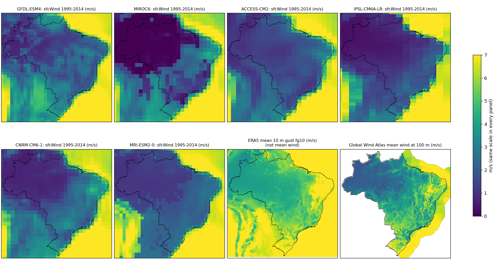
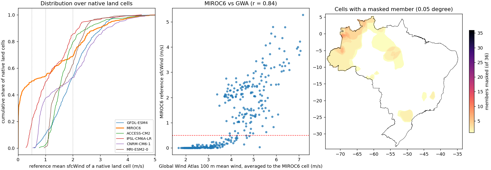
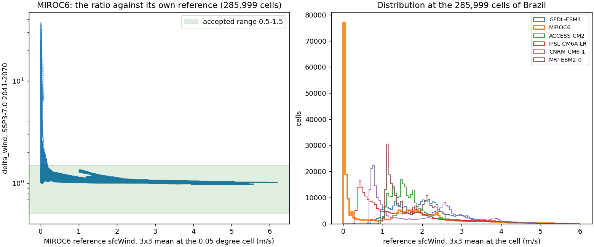
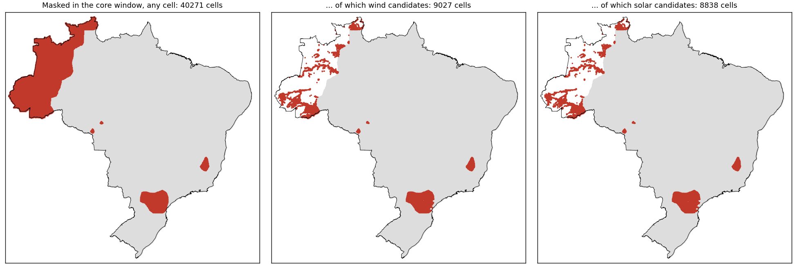
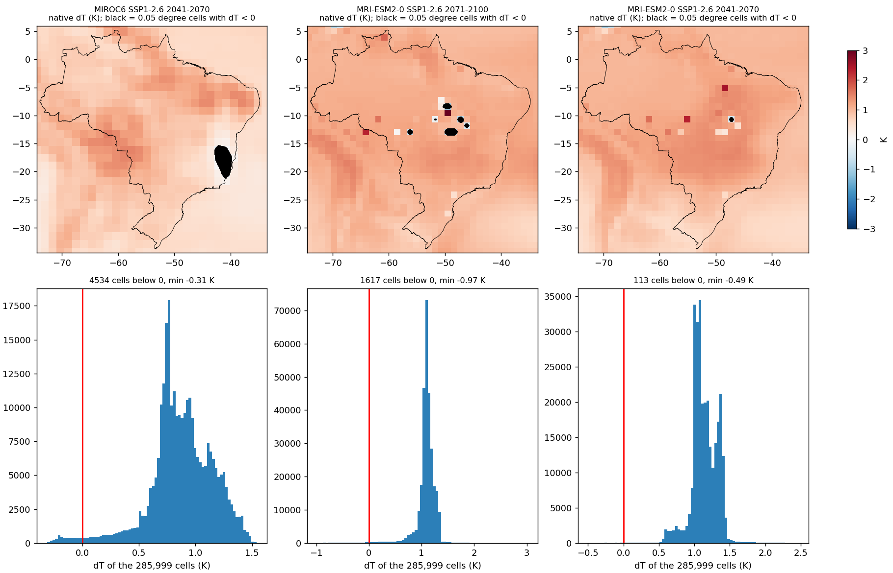
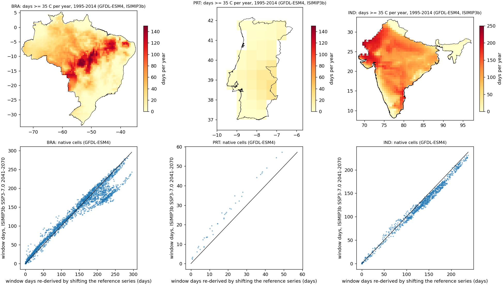
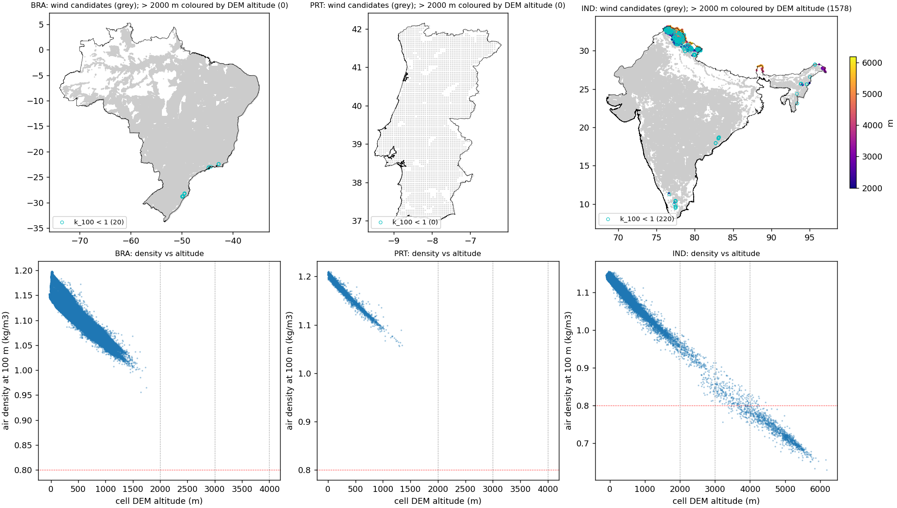

# Data diagnostics, October 2026: MIROC6 wind (B-1), wind candidates at altitude and with k < 1 (B-3), negative dT (8-2), reference heat days (8-3) and the F4 run time of India

Read-only. Nothing in `GeoFREA_data`, `config/` or `src/` was changed; every number below is computed in memory from outputs and raw files already on disk, by the scripts in `2026-10_data_diagnostics_scripts/` (caches go to a scratch directory outside the repository). The figures are in `2026-10_data_diagnostics_figures/`. The audit this follows is `2026-10_pre_research_audit.md` (sections 8 and 9).

## 0. Summary

| # | Finding | Evidence in one line | Recommendation |
|---|---|---|---|
| D-1 | **MIROC6's reference 10 m wind over Brazil is not usable.** | 50.3% of its native land cells have a 1995-2014 mean below 0.5 m/s (minimum 0.001 m/s); the other five GCMs have 0% (four of them) and 18.8% (IPSL). Its median ratio to the ERA5 mean gust is 0.09 against 0.21 to 0.37 for the others. | Take the MIROC6 wind channel out of the ensemble (option c) and declare it, as the hazard channel already is. Keep MIROC6's `rsds` and `tas`. |
| D-2 | **The output mask (`delta_wind` in 0.5-1.5) treats the symptom, and it also removes solar cells.** | Core window: 8,838 solar and 9,027 wind candidates are `climate_data_invalid` today (4.9% and 5.0%); 91,069 cells that pass the mask in every MIROC6 member still rest on a reference below 1 m/s. The wind mask drops the whole row, so solar cells are lost for a wind reason. | Option (c) brings the wind candidates to 6 (0.003%) and, with a channel-level declaration, the solar candidates to 0. Counts of all five options are in section 2.5. |
| D-3 | **Negative `dT` is real model output, not an interpolation artefact.** | 6,264 of 10,295,964 cell-members (0.06%), three members of 36. MIROC6 SSP1-2.6: six adjacent native cells on the Atlantic side (minimum -0.31 K). MRI-ESM2-0: isolated native cells that deviate 1 to 2 K from their neighbours (22 cases; no other GCM has one). | Keep the values; add a flag (not a correction) for isolated native cells in F4. The effect on a solar cell is below 0.4% of its output. |
| D-4 | **The +80 to +110 heat days are arithmetic; the reference level cannot be checked on this disk.** | Shifting the reference daily series by the mean change of `tasmax` reproduces the window count (Brazil median 142 against 142 days, GFDL-ESM4 SSP3-7.0). There is no ERA5 `Tmax` (nor ERA5 mean wind) on disk. No document of the repository gives a published count. | Accept as context until OQ-051 needs it; then acquire ERA5 daily `Tmax` for 1995-2014 (small) and compare. The remark in the audit that Brazil's reference was "high" was from memory and is withdrawn. |
| D-5 | **India has 1,578 wind candidates above 2,000 m; Brazil and Portugal have none.** | 1,277 above 3,000 m, 964 above 4,000 m, 1,041 with density below 0.8 kg/m3. Synthetic parameters: 82 of them are in the cheapest 10% of cells (1.3% of that decile). 33% overlap a protected area. | Do not drop them silently. A sourced altitude or density criterion is a methodological decision; until then run India with and without cells above 3,000 m. |
| D-6 | **k < 1 is rare and harmless for the ranking.** | India 220 cells (0.35%), Brazil 20 (0.01%), Portugal 0; none in the cheapest 10%. | No action on results; report the count as a data-quality line. |
| D-7 | **The 7 h 43 min of the India F4 is a suspended computer, not computation.** | Windows entered sleep 31 s after the phase started (00:01:11) and resumed at 07:41:34. Active time is about 141 s, in line with the three earlier India runs (122 to 141 s). | No scientific action. Keep the machine awake during runs and log CPU time next to wall-clock time. |

## 1. Data used and what is declared

| Need | On disk | Used |
|---|---|---|
| GCM `sfcWind`, `tas`, `rsds` (CMIP6, CDS) | `raw/cmip6/_global/<gcm>_<experiment>_<variable>.nc`, six GCMs, historical and three SSPs, monthly | All six GCMs on their native grids. Reference 1995-2014, windows 2041-2070 and 2071-2100, the annual mean of the 12 monthly climatologies, exactly as M-F4-03. |
| ERA5 mean 10 m wind | **Not on disk.** `raw/era5/_global` holds the hourly 10 m **gust** (`fg10`) for BRA, PRT and IND, 1995-2014 (about 20 GB); `raw/era5/<ISO3>` the same plus annual maxima. No `u10`, `v10` or `2t` file exists (searched by name under `GeoFREA_data` and `database/raw`). | **Declared substitute:** the mean of the hourly `fg10` over 1995-2014 (175,320 hours), averaged onto each GCM cell. A gust is not a mean wind, so it is used only to compare GCMs with each other and to see where a GCM is far below the others. |
| Independent mean wind | `raw/gwa/<ISO3>/<ISO3>_wind_speed_100m.tif` (Global Wind Atlas, 100 m, 0.0025 degree) | Averaged onto each GCM cell as a second reference. It is a modelled product at 100 m, so the ratio to a 10 m field is not 1; the comparison across GCMs is what counts. |
| ERA5 daily `Tmax` | **Not on disk.** | Not compared. Section 4 says what was done instead. |
| Hazard data | `raw/isimip3b/<ISO3>/<gcm>_{historical,ssp126,ssp370,ssp585}_{tasmax,tasmin,pr}_<ISO3>.nc`, daily, bias-adjusted to W5E5 v2.0 (file attribute) | Reference and 2041-2070 `tasmax`, three GCMs (GFDL-ESM4, IPSL-CM6A-LR, MRI-ESM2-0), SSP3-7.0 and SSP5-8.5. |
| Candidates, elevation | `outputs/<ISO3>/land_eligibility/artifacts/candidates_{solar,wind}__{central,permissive,restrictive}.parquet`; `outputs/<ISO3>/grid_alignment/artifacts/<ISO3>_elevation_aligned.tif` (Copernicus 30 m DEM aligned to 0.01 degree) | Cell altitude is the mean of the 5 x 5 aligned pixels of the 0.05 degree cell. |

Method notes. (1) "Native land cell" means a native cell whose centre lies inside the GADM mainland polygon; coastal cells whose centre is at sea are not counted. (2) The change factors of every member were recomputed in memory with the project's own functions (`compute_change_factor`-equivalent code, `neighbourhood_mean`, `bilinear_to_points`) at the 285,999 cells of `forcing.parquet`. **The recomputation reproduces the stored `forcing_masked.parquet` exactly**: 146,811 cell-members on both sides, none only on one side, largest difference in the rejected `delta_wind` 1.2e-7. So the option counts below are on the same footing as the stored data. (3) "Core window" is 2041-2070, the window of the F7 analysis; a candidate is `climate_data_invalid` if it is missing from any of the 18 core members (cell_set.py). "Both windows" adds 2071-2100.

## 2. B-1: MIROC6 wind over Brazil

### 2.1 Reference-period mean `sfcWind` on the native grids

Native land cells of Brazil (centre inside the polygon), 1995-2014 annual mean:

| GCM | Grid (lat x lon, deg) | Land cells | below 0.5 m/s | below 1 m/s | below 2 m/s | Min | Median | p95 |
|---|---|---|---|---|---|---|---|---|
| GFDL-ESM4 | 1.00 x 1.25 | 567 | 0 (0.0%) | 59 (10.4%) | 303 (53.4%) | 0.58 | 1.91 | 3.26 |
| **MIROC6** | 1.40 x 1.41 | 364 | **183 (50.3%)** | **197 (54.1%)** | 251 (69.0%) | **0.001** | **0.49** | 3.44 |
| ACCESS-CM2 | 1.25 x 1.88 | 302 | 0 (0.0%) | 8 (2.6%) | 239 (79.1%) | 0.77 | 1.57 | 3.07 |
| IPSL-CM6A-LR | 1.27 x 2.50 | 229 | 43 (18.8%) | 114 (49.8%) | 195 (85.2%) | 0.29 | 1.03 | 2.51 |
| CNRM-CM6-1 | 1.40 x 1.41 | 364 | 0 (0.0%) | 136 (37.4%) | 192 (52.7%) | 0.53 | 1.85 | 3.72 |
| MRI-ESM2-0 | 1.12 x 1.12 | 563 | 0 (0.0%) | 6 (1.1%) | 353 (62.7%) | 0.95 | 1.72 | 2.64 |

Two facts stand out. MIROC6 is the only GCM with values at the 0.001 m/s level (half of its land cells below 0.5 m/s, a dark area in the map covering the Amazon basin and parts of central Brazil). IPSL-CM6A-LR is the second lowest (18.8% below 0.5 m/s, minimum 0.29 m/s), so the weakness is a matter of degree across GCMs, not only of MIROC6. All six GCMs have low 10 m winds over Brazil (more than half of the land cells are below 2 m/s in every GCM), and the Global Wind Atlas map also shows the Amazon among the calmest regions at 100 m, so a low reference there is expected; the point is how low.

### 2.2 Against ERA5 and the Global Wind Atlas

Both reference fields were averaged onto each GCM's own cells (land cells only):

| GCM | Pearson r vs ERA5 gust | Pearson r vs GWA 100 m | Spearman vs GWA 100 m | Median GCM / GWA 100 m | Median GCM / ERA5 gust |
|---|---|---|---|---|---|
| GFDL-ESM4 | 0.68 | 0.75 | 0.75 | 0.49 | 0.37 |
| **MIROC6** | 0.77 | 0.84 | 0.89 | **0.11** | **0.09** |
| ACCESS-CM2 | 0.78 | 0.67 | 0.73 | 0.44 | 0.33 |
| IPSL-CM6A-LR | 0.81 | 0.87 | 0.94 | 0.26 | 0.21 |
| CNRM-CM6-1 | 0.87 | 0.93 | 0.94 | 0.43 | 0.35 |
| MRI-ESM2-0 | 0.85 | 0.86 | 0.91 | 0.46 | 0.33 |

MIROC6 reproduces the spatial pattern about as well as the others (rank correlation 0.89 with the Atlas; the others 0.73 to 0.94), but its level is wrong where it is calm: the median ratio to the Atlas is 0.11 against 0.26 to 0.49. The cells where MIROC6 is below 0.5 m/s are not calm in the independent fields:

| MIROC6 reference below | Native cells | MIROC6 mean | ERA5 mean gust (median) | GWA 100 m (median, minimum) | The other five GCMs (median of the five) |
|---|---|---|---|---|---|
| 0.5 m/s | 183 | 0.07 m/s | 4.3 m/s | 2.6 (1.7) m/s | 1.2 m/s |
| 1 m/s | 197 | 0.12 m/s | 4.3 m/s | 2.7 (1.7) m/s | 1.2 m/s |
| 2 m/s | 251 | 0.41 m/s | 4.5 m/s | 3.1 (1.7) m/s | 1.3 m/s |

MIROC6 over its calm cells is below the median of the other five by a factor of about 17 (0.07 against 1.2 m/s). Its ratio to the median of the other five over all land cells has p5 0.00, median 0.28 and p95 1.40. The pairwise correlation of the reference fields shows MIROC6 closest to CNRM-CM6-1 (0.87) and farthest from ACCESS-CM2 (0.62); a bias of level, not of pattern.

### 2.3 What the output mask lets through

The mask tests only the ratio of the window to the reference. With the 3 x 3 neighbourhood mean interpolated to the 285,999 cells:

| GCM | Cells with reference below 0.5 / 1 / 2 m/s | Pass the mask in all 6 member-windows | ... of which reference below 1 m/s |
|---|---|---|---|
| GFDL-ESM4 | 0 / 14,718 / 137,594 | 273,402 | 11,294 |
| **MIROC6** | **122,195** / 134,754 / 211,464 | 236,750 | **91,069** |
| ACCESS-CM2 | 0 / 3,356 / 208,410 | 285,999 | 3,356 |
| IPSL-CM6A-LR | 49,492 / 129,073 / 216,063 | 268,197 | 112,317 |
| CNRM-CM6-1 | 0 / 97,784 / 143,701 | 285,999 | 97,784 |
| MRI-ESM2-0 | 0 / 918 / 170,994 | 285,999 | 918 |

Of MIROC6's 122,195 cells with a reference below 0.5 m/s, 122,160 (SSP1-2.6), 89,690 (SSP3-7.0) and 113,082 (SSP5-8.5) pass the mask in the core window. Where they pass, the factor is 1.07 to 1.18 against 1.01 to 1.05 for the median of the other five (median absolute difference 0.07 to 0.15). So the mask removes the explosive tail (rejected values: median 4.2, maximum 78.2, all above 1.5, none below 0.5), and the rest still divides by a tiny reference. The ratio is applied to the Weibull scale of the Global Wind Atlas (about 2.6 to 4 m/s there), which the GCM reference does not describe.

### 2.4 Where the masked cells are

Cells with at least one masked member, all 36 members: 68,276 of 285,999 (23.9%): 18,541 wind candidates, 18,244 solar candidates and 49,735 that are neither. Core window only: 40,271 cells, of which 9,027 wind and 8,838 solar candidates. The cells have a median of one masked member (maximum four). They form three groups: the north-west (Acre, Amazonas, Roraima, Rondônia), a patch in the south (Paraná, São Paulo, Santa Catarina) and smaller patches in Minas Gerais; with both windows a Pará patch (3,570 wind candidates) is added. MIROC6 alone masks 38,948 of the 40,271 core cells; GFDL-ESM4 masks 1,323 (6 wind and 6 solar candidates); ACCESS-CM2, IPSL-CM6A-LR, CNRM-CM6-1 and MRI-ESM2-0 mask none in the core window.

Wind candidates invalid in the core window, by state:

| State | Wind candidates | Invalid | Share |
|---|---|---|---|
| Paraná | 6,627 | 3,380 | 51.0% |
| Acre | 1,914 | 1,902 | 99.4% |
| Amazonas | 6,689 | 1,585 | 23.7% |
| São Paulo | 7,655 | 687 | 9.0% |
| Minas Gerais | 19,310 | 680 | 3.5% |
| Roraima | 2,179 | 472 | 21.7% |
| Santa Catarina | 3,349 | 206 | 6.2% |
| Rondônia | 4,920 | 80 | 1.6% |

The wind mask drops the whole `forcing.parquet` row (`rsds`, `tas` and `delta_wind` together), which is why solar candidates are lost: 8,838 solar candidates (4.9%) are invalid in the core window only because a wind ratio is out of range.

### 2.5 The five options, counted

Candidate cells that would be `climate_data_invalid` (BRA candidates: solar 180,041, wind 181,277; 285,999 forcing cells). Core window (F7):

| Option | Solar candidates | Wind candidates | All forcing cells |
|---|---|---|---|
| (a) keep 0.5-1.5, 3 x 3 (today) | 8,838 (4.91%) | 9,027 (4.98%) | 40,271 (14.08%) |
| (a') no neighbourhood (1 x 1), for reference | 23,984 (13.32%) | 24,370 (13.44%) | 60,634 (21.20%) |
| (b) 5 x 5 | 4,376 (2.43%) | 4,466 (2.46%) | 36,044 (12.60%) |
| (b) 7 x 7 | 2,066 (1.15%) | 2,139 (1.18%) | 25,602 (8.95%) |
| (c) MIROC6 wind channel excluded, the mask kept for the other five; wind drops the whole row | 6 (0.00%) | 6 (0.00%) | 1,323 (0.46%) |
| (c') as (c), the mask drops only the wind channel (solar never invalid for a wind reason) | 0 | 6 (0.00%) | - |
| (d) MIROC6 excluded entirely (5 GCMs) | 6 (0.00%) | 6 (0.00%) | 1,323 (0.46%) |
| (e) range from the other five GCMs, min-max [0.81, 1.86] | 2,580 (1.43%) | 2,657 (1.47%) | 30,535 (10.68%) |
| (e) same, p0.1-p99.9 [0.89, 1.65] | 5,942 (3.30%) | 6,093 (3.36%) | 37,912 (13.26%) |
| (e) same, p1-p99 [0.96, 1.42] | 23,073 (12.82%) | 23,455 (12.94%) | 69,085 (24.16%) |

Both windows (2071-2100 added):

| Option | Solar candidates | Wind candidates | All forcing cells |
|---|---|---|---|
| (a) today | 18,244 (10.13%) | 18,541 (10.23%) | 68,276 (23.87%) |
| (a') 1 x 1 | 42,938 (23.85%) | 43,510 (24.00%) | 101,170 (35.37%) |
| (b) 5 x 5 | 5,552 (3.08%) | 5,658 (3.12%) | 42,656 (14.91%) |
| (b) 7 x 7 | 2,848 (1.58%) | 2,944 (1.62%) | 33,057 (11.56%) |
| (c) wind channel of MIROC6 excluded | 7,333 (4.07%) | 7,436 (4.10%) | 29,395 (10.28%) |
| (c') mask drops only the wind channel | 0 | 7,436 (4.10%) | - |
| (d) MIROC6 excluded | 7,333 (4.07%) | 7,436 (4.10%) | 29,395 (10.28%) |
| (e) min-max | 3,877 (2.15%) | 3,972 (2.19%) | 34,355 (12.01%) |
| (e) p0.1-p99.9 | 9,231 (5.13%) | 9,448 (5.21%) | 51,473 (18.00%) |
| (e) p1-p99 | 50,679 (28.15%) | 51,289 (28.29%) | 125,371 (43.84%) |

How the options were built. (b) changes `wind_ratio_neighbourhood_cells`. For (c) and (d) the members of the other five GCMs keep today's 0.5-1.5 mask; the remaining 2071-2100 losses (7,333 and 7,436) come from GFDL-ESM4 and IPSL-CM6A-LR in that window. For (e) the bounds are the min-max, the 0.1th-99.9th and the 1st-99th percentile of `delta_wind` pooled over the 30 members of the other five GCMs over all Brazilian cells (8,579,970 cell-members); the bounds come from the same five GCMs they are then applied to, so a p1-p99 bound masks about 1% of each of them by construction, which is why the last row is large.

Per-GCM share of cell-members outside the bounds (all 36 members, 285,999 cells):

| GCM | Outside 0.5-1.5 | Outside min-max of the other five | p1 | p99 | min | max |
|---|---|---|---|---|---|---|
| GFDL-ESM4 | 1.47% | 0% | 0.92 | 1.55 | 0.81 | 1.86 |
| **MIROC6** | **6.05%** | **4.42%** | 0.97 | 19.4 | 0.74 | 78.2 |
| ACCESS-CM2 | 0% | 0% | 0.99 | 1.25 | 0.98 | 1.30 |
| IPSL-CM6A-LR | 1.04% | 0% | 0.95 | 1.50 | 0.94 | 1.63 |
| CNRM-CM6-1 | 0% | 0% | 0.99 | 1.20 | 0.97 | 1.29 |
| MRI-ESM2-0 | 0% | 0% | 0.95 | 1.06 | 0.88 | 1.13 |

### 2.6 Options with pros and cons

| Option | Pros | Cons |
|---|---|---|
| **(a) keep 0.5-1.5, 3 x 3** | No change; already implemented and tested; the F5 guard exists. | 4.9% / 5.0% of the candidates invalid in the core window (10.1% / 10.2% with the sensitivity window); the bound has no source (OQ-043); 91,069 cells that pass the mask rest on a reference below 1 m/s; solar is penalized for a wind reason. |
| **(b) 5 x 5 or 7 x 7** | One configuration value; invalid candidates fall to 2.4% (5 x 5) or 1.2% (7 x 7). | The box becomes about 7 and 10 degrees wide (700 to 1,100 km), so the factor is no longer local; it does not touch the cause (an Amazon-wide near-zero reference stays near zero in a large box); reduces the symptom while keeping a ratio of small numbers. |
| **(c) exclude MIROC6's wind channel** (declared per member, `channels.wind: false`, as `channels.hazard` is today) | Removes the identified cause; MIROC6 keeps `rsds` and `tas`, which show no comparable problem; invalid wind candidates 6 (0.003%); with (c') solar candidates 0; the pattern of declaring channels per member exists (D-F4-004). | Wind has 5 GCMs and solar 6 (15 and 18 core members), so the F7 member set depends on the technology and the cell-set code, the H1-H5 inputs and the figures must take it from the member declaration; a change to `members.yaml`, F5 and F7 contracts; the sensitivity window still loses 4.1% of the wind candidates (GFDL and IPSL). |
| **(d) exclude MIROC6 entirely** | Same invalid counts as (c); one member list for both technologies; simplest to implement (`experiments.yaml` `gcm_ensemble`). | Departs from the protocol outcome of D-F4-012 (six GCMs chosen for spread; the radius and the 82% / 54% range coverage were computed with MIROC6); solar loses a GCM that has no defect; MIROC6 is not a hazard member, so H5 is unaffected. Requires a decision on D-F4-012. |
| **(e) range from the other five** | Replaces an unsourced bound by a data-driven one; min-max leaves 1.4% / 1.5% invalid. | Depends on which GCMs are in the ensemble (circular if the five change); p1-p99 masks 12.8% by construction; still a ratio test, so the 91,069 low-reference cells remain; not a source for OQ-043 either. |

Not counted but worth naming: **(g) a different definition of the change**, for example the additive change in m/s of the GCM transferred to the Atlas wind speed, which does not divide by a GCM reference. It would remove the dependence on the GCM's calm bias for every GCM (IPSL and CNRM-CM6-1 also have tens of thousands of cells below 1 m/s), but it changes M-F4-03 and so needs a METHODOLOGY amendment and a decision; I did not evaluate it.

**Recommendation: (c) with the channel-level declaration (c').** It is the only option that acts on what the data show (a reference field, not a ratio), it keeps 18 solar members, and it uses a mechanism the project already has for the hazard channel. Keep the 0.5-1.5 test as a declared, still unsourced sanity bound for the remaining five GCMs (OQ-043 stays open; it then affects GFDL-ESM4 only, 1,323 cells in the core window). If the cost of a technology-dependent member set is judged too high, take (d) and amend D-F4-012. Do not take (b) or (e) as the fix: they lower the count without changing what is divided. The sensitivity window (4.1% of wind candidates invalid after (c)) is a separate, smaller decision.

## 3. 8-2: negative `dT`

Negative `dT` appears in three of the 36 members:

| Member | Cells with dT < 0 (of 285,999) | Min dT, cells (K) | Native land cells with dT < 0 | Min native dT (K) | Median dT of Brazil (K) | Global-mean dT (K) |
|---|---|---|---|---|---|---|
| MIROC6 SSP1-2.6 2041-2070 | 4,534 (1.6%) | -0.31 | 6 of 364 | -0.31 | 0.87 | 0.85 |
| MRI-ESM2-0 SSP1-2.6 2041-2070 | 113 | -0.49 | 1 of 563 | -0.56 | 1.12 | 1.13 |
| MRI-ESM2-0 SSP1-2.6 2071-2100 | 1,617 (0.6%) | -0.97 | 7 of 563 | -1.03 | 1.11 | 1.07 |

Total 6,264 cell-members of 10,295,964 (0.06%).

**It is not an interpolation or cell-edge artefact.** Bilinear interpolation cannot go below the lowest of its four corners, and the nearest native centre is itself negative for 87%, 100% and 97% of the negative cells; the native fields contain the negative values (last two columns above). Two different mechanisms:

- **MIROC6 SSP1-2.6, 2041-2070: a cooling patch of the model.** Six adjacent native cells (centres between 16.1 S and 20.3 S, 40.8 W and 42.2 W: the Atlantic side of Minas Gerais, Espirito Santo and southern Bahia) are between -0.04 and -0.31 K while the model's global mean warms by 0.85 K. It is a coherent patch of a size consistent with regional variability in a weak-forcing scenario and a single realization (r1i1p1f1).
- **MRI-ESM2-0: isolated native cells.** Its negative cells are single native cells in central Brazil (10.7 S 47.2 W; 12.9 S 56.2 W and 49.5 W; 8.4 S 49.5 W and others) and the native field shows isolated cells that depart strongly from their neighbours, in both directions (the warm ones reach about +2 K above the cells around them): 22 native land cells deviate by more than 1 K from the median of their neighbours across the six MRI-ESM2-0 members (maximum 2.1 K), against **zero** for the other five GCMs (maximum deviation 0.4 to 0.8 K). I did not diagnose the cause (a feature of that model's land cells or of the processing); the data say only that it is isolated and specific to MRI-ESM2-0.

Consequence for a solar cell: the energy factor is `(1 + gamma dT)`. The real `gamma` is not set in `parameters.json`; with the ZZZ test value of -0.005 per K, a `dT` of -1 K raises a cell's output by 0.5%, which is small against the spread of the resource, and a positive spike of +3 K lowers it by 1.5%, so the spikes are not one-sided.

| Option | Pros | Cons |
|---|---|---|
| **Keep the values and flag isolated native cells in F4** | Honest to the data; changes nothing in F5-F8; the flag shows a reader where a single native cell drives 4 to 6 interpolated cells. | A diagnostic to write; the isolated cells are still used. |
| Clip `dT` at 0 | Removes the cooling in a warming scenario. | Biases the ensemble upward; clips one tail only; invents data in the sense of A-09. |
| Remove isolated native cells and re-interpolate | Cleans MRI-ESM2-0's cells. | Data surgery on a model output with a free threshold (the 1 K); a decision about a model that the data do not diagnose. |

**Recommendation: keep the values and add the flag** (a column or a line in `members.yaml`, no correction), and report the three members in the limitations. Do nothing to MIROC6's patch: it is a model result.

## 4. 8-3: reference heat days

**No ERA5 `Tmax` is on disk** (section 1), so the comparison asked for was not made. No document of the repository states a published heat-day climatology for these countries (the AR6 Atlas is cited only as the source of the thresholds of 35 and 40 C), so none was used. The statement in section 8 of the audit that Brazil's reference counts were "high for Brazil" (and the figure of 100 to 150 days) was from memory, not from a source; it is withdrawn here.

What the disk does allow:

**(a) The three hazard GCMs agree on the reference**, at the 0.05 degree cells of `hazard_context.parquet` (`tx35_days_ref`):

| Country | Median, GFDL / IPSL / MRI | p99 (any GCM) | Max (any GCM) | Median spread of the three (days) | p95 spread |
|---|---|---|---|---|---|
| BRA | 30.2 / 29.9 / 30.0 | 136 | 180 | 6.0 | 18.7 |
| PRT | 5.9 / 4.8 / 5.8 | 28.8 | 40.2 | 1.8 | 4.1 |
| IND | 112 / 112 / 111 | 195 | 219 | 7.0 | 18.0 |

This is expected and is **not an independent check**: all three are bias-adjusted to the same W5E5 v2.0 data (file attribute), so they should agree whatever W5E5 says.

**(b) The increase is arithmetic.** For each native cell I shifted the 1995-2014 daily `tasmax` series by the cell's mean change of `tasmax` and counted the days at or above 35 C; I also scaled the daily anomalies by the ratio of standard deviations. Medians over the native 0.5 degree cells whose centre is inside the country, SSP3-7.0, 2041-2070:

| Country | GCM | Reference days | Window days (ISIMIP3b) | Reference shifted by dTmax | Shifted and variance-scaled | Median dTmax (K) | Median abs. difference, shifted (days) |
|---|---|---|---|---|---|---|---|
| BRA | GFDL-ESM4 | 30.3 | 142 | 142 | 149 | 1.64 | 7.1 |
| BRA | IPSL-CM6A-LR | 29.9 | 131 | 128 | 133 | 2.00 | 4.5 |
| BRA | MRI-ESM2-0 | 29.9 | 112 | 109 | 114 | 1.55 | 4.6 |
| PRT | GFDL-ESM4 | 5.8 | 21.8 | 15.4 | 22.2 | 1.77 | 6.4 |
| PRT | IPSL-CM6A-LR | 4.7 | 19.0 | 16.3 | 19.1 | 1.89 | 2.2 |
| PRT | MRI-ESM2-0 | 5.2 | 20.7 | 12.6 | 20.5 | 1.67 | 8.1 |
| IND | GFDL-ESM4 | 112 | 128 | 136 | 135 | 0.95 | 7.2 |
| IND | IPSL-CM6A-LR | 112 | 157 | 158 | 158 | 1.93 | 2.8 |
| IND | MRI-ESM2-0 | 111 | 136 | 140 | 141 | 1.21 | 3.3 |

Brazil's median cell already has 30 hot days a year in the reference, so on many more days its daily maximum is just below 35 C, and +1.5 to +2 K moves 80 to 110 more days across the threshold; shifting the reference series reproduces the window count (Brazil: 142 against 142, 128 against 131, 109 against 112). For Portugal the pure shift underestimates and the variance-scaled version reproduces the window (22.2 against 21.8, 19.1 against 19.0, 20.5 against 20.7): the days at the threshold are also driven by a wider daily distribution there. In India the window count is below the shifted one for GFDL-ESM4 (128 against 136) and MRI-ESM2-0 (136 against 140). So the jump of the median is not a processing error. (The numbers in section 8 of the audit, 30 to 110 days, were medians over the 0.05 degree lattice of the nine members and are consistent with these.)

What remains unknown is the **level** of the reference (whether 30 days is the right median for Brazil). That needs an observation-based `Tmax`.

| Option | Pros | Cons |
|---|---|---|
| **Acquire ERA5 daily `Tmax` for 1995-2014** (CDS daily statistics, or hourly `2t` aggregated; the project already acquires ERA5 for the gust) for BRA and IND (PRT too, small), compare count by count | Same workflow as the gust; answers the question for the three countries; small compared with the 20 GB of hourly gust already on disk | ERA5 is not independent of W5E5 (W5E5 is built on ERA5), so it checks the processing and the grid, not the truth |
| Compare with published climatologies (AR6 Atlas) once one is cited in a repository document | An independent source | None is cited today; needs reading and a Tier record |
| Station-based check (INMET, IMD, E-OBS-type products) for a few places | Independent of ERA5 | Point against a 0.5 degree cell; more work; not a map-wide check |
| Accept as it is until OQ-051 needs a threshold | No cost | The exposure threshold for `tx35_days` would rest on an unchecked level |

**Recommendation: accept the ISIMIP3b values as context now, and acquire ERA5 daily `Tmax` before OQ-051 fixes a heat threshold; cite the Atlas in a repository document as a second check.**

## 5. B-3: wind candidates at altitude and with k < 1

Altitude is the mean of the 5 x 5 pixels of the aligned 30 m DEM in each 0.05 degree cell. Maximum cell altitude among wind candidates: BRA 1,747 m, PRT 1,350 m, IND 6,179 m; p99: 1,097, 956 and 4,645 m. Air density at 100 m and altitude are tightly tied (correlation -0.93 BRA, -0.99 PRT, -0.99 IND), so the two criteria select nearly the same cells.

### 5.1 Wind candidates by altitude (counts for BRA and PRT are zero at every threshold)

| Country | Altitude | Candidates | Share | Eligible area (km2) | With density at 100 m below 0.8 | Median density (kg/m3) |
|---|---|---|---|---|---|---|
| IND | above 2,000 m | 1,578 | 2.52% | 1,985 | 1,041 | 0.763 |
| IND | above 3,000 m | 1,277 | 2.04% | 1,892 | 1,041 | 0.745 |
| IND | above 4,000 m | 964 | 1.54% | 1,635 | 945 | 0.725 |
| BRA, PRT | above 2,000 m | 0 | 0 | 0 | 0 | - |

By air density at 100 m: IND 2,095 below 1.0 kg/m3 (3.3%), 1,344 below 0.9, 1,041 below 0.8 (1,713 km2, median altitude 4,823 m), 205 below 0.7; BRA 6 below 1.0 (median altitude 1,642 m) and none below 0.9; PRT none.

### 5.2 Position in the nominal ranking, under the synthetic parameters

The synthetic parameters are the ZZZ test values of `parameters.json` (capex 1,000 USD/kW, fixed O&M 5%, LUF 0.5, 10 MW/km2, loss factor 0.9, hub height 125 m, 5% discount rate over 20 years) with the synthetic power curve of `tests/fixtures/power_curves` and the project's own functions (`resource_at_hub_height`, `wind_cf_reference`, `lcoe_direct`), evaluated in memory on the real F3 candidates; nothing was written. They are test values, so only the order of magnitude is meaningful.

| Country | Altitude | Candidates | In the cheapest 10% of cells | Share of that decile | In the cheapest 10% of capacity | Median nominal CF | Median nominal LCOE (USD/MWh) |
|---|---|---|---|---|---|---|---|
| IND | above 2,000 m | 1,578 | 82 | 1.3% | 49 | 0.135 | 135.7 |
| IND | above 3,000 m | 1,277 | 80 | 1.3% | 47 | 0.156 | 117.4 |
| IND | above 4,000 m | 964 | 74 | 1.2% | 46 | 0.176 | 105.5 |
| IND | density below 0.8 | 1,041 | 74 | - | - | - | - |

So the low-density cells have a low median capacity factor (the density correction in the equivalent scale works), and 1.2% to 1.3% of the cheapest decile (6,272 cells) are above 2,000 m: the ridges and passes with a strong resource.

### 5.3 Protected areas

In the central scenario every WDPA designation is excluded (E1), so a candidate that overlaps a protected area keeps only its unprotected remainder. E1 is **identical** in the permissive and the central scenarios for every cell of India (0 of 62,718 differ), so no scenario leaves a protected area unexcluded for these cells.

| Country | Altitude | Candidates | Overlap a protected area (E1 > 0) | E1 share of the cell at least 0.5 | E1 is the dominant exclusion |
|---|---|---|---|---|---|
| IND | above 2,000 m | 1,578 | 522 (33%) | 207 | 47 |
| IND | above 3,000 m | 1,277 | 280 (22%) | 107 | 44 |
| IND | above 4,000 m | 964 | 159 (16%) | 71 | 41 |

### 5.4 Weibull k below 1

| Country | Criterion | Candidates | Share | Eligible area (km2) | Median altitude (m) | In the cheapest 10% | Median A at 100 m (m/s) |
|---|---|---|---|---|---|---|---|
| IND | k at 100 m below 1 | 220 | 0.35% | 159 | 2,698 | 0 | 2.56 |
| IND | k at 100 m below 1.2 | 1,236 | 1.97% | 1,128 | 1,995 | 11 | 2.70 |
| IND | k at 125 m (hub) below 1 | 215 | 0.34% | 157 | 2,685 | 0 | 2.55 |
| BRA | k at 100 m below 1 | 20 | 0.011% | 28 | 306 | 0 | 2.50 |
| BRA | k at 100 m below 1.2 | 142 | 0.078% | 520 | 332 | 1 | 3.08 |
| PRT | k at 100 m below 1 | 0 | 0 | 0 | - | 0 | - |
| PRT | k at 100 m below 1.2 | 36 | 1.03% | 283 | 353 | 0 | 3.65 |

The cells with k below 1 are low-wind cells (median A of 2.5 m/s, median capacity factor 0.06 to 0.07 in India and Brazil), in the Himalayan and north-eastern hills of India (map above) and in two small areas on the south-eastern and southern coast of Brazil. None of them is in the cheapest decile. The minimum k among the candidates is 0.78 (IND) and 0.85 (BRA). A Weibull integral with k below 1 is defined, so the capacity factor is computed without error.

### 5.5 Options and recommendation

| Option | Pros | Cons |
|---|---|---|
| **Do nothing, declare** | No result changes for Brazil and Portugal; India's cells already have low capacity factors from the density correction | 1.3% of India's cheapest decile are cells above 2,000 m, 16% to 33% of them overlap protected areas, and a reader will ask |
| **Altitude exclusion term (E-term) with a sourced maximum** | Removes unrealistic sites explicitly; one more row in the exclusion budget | Needs a source and a Tier record (IEC site conditions or turbine datasheets); a free number otherwise; would be a METHODOLOGY item (F2b) |
| **Air density floor on the candidate set** (for example 0.9 or 0.8 kg/m3) | Same effect through a quantity the CF model already uses; documented through one variable | Same source need; density is itself derived from the DEM elevation (D-F1b-015), so it is an altitude cut under another name |
| **Sensitivity run for India with and without cells above 3,000 m** | No claim without a source; shows the effect on the rankings and H1-H5 | Extra run; the thesis must report both |
| k below 1: leave, flag, or exclude | Leave and flag: no data change; excluding 0.35% (IND) is a free choice | Excluding is a rule with no source and no effect on the ranking |

**Recommendation.** (i) Altitude and density: do **not** exclude silently; ask for a source for an altitude or density criterion (a research item for the F2b parameters) and, until it exists, run India with and without the 1,277 cells above 3,000 m as a declared sensitivity. (ii) k below 1: no action on results; add one line to the F1b report counting k below 1 and the maximum A (audit 8-6 found 4 Brazilian candidates with A above 12 m/s at 100 m), a data-quality count, not an exclusion.

## 6. The F4 run time of India: 7 h 43 min against 3 min

**Cause identified: the computer was in sleep for 7 h 40 min of it; it was neither an initial computation nor a missing cache.**

Evidence, all from files already on disk:

| Source | What it says |
|---|---|
| `logs/IND/9f039d84...log` (run of 2026-10-07/08) | `00:00:40` Phase 'climate_forcing' [IND]: executing - manifest status 'stale_upstream' (a recomputation, not a cache hit); `07:43:24` completed in 27,764.2 s; the next phase, `climate_maps`, 34.2 s, and `hazard_context`, 93.4 s, have normal times. The log contains no line between the start and the end of F4. |
| `outputs/IND/manifest.json` | `climate_forcing` started 2026-10-08T03:00:40Z and finished 10:43:24Z (the log is in local time, UTC-3). |
| Windows System log (Kernel-Power and Power-Troubleshooter) | 00:01:09 a user-mode process called SetSuspendState (event 187); 00:01:11 "the system is entering sleep" (event 42); 07:41:34 "the system resumed from sleep" (Power-Troubleshooter event 1; firmware S3 events at 07:41:31). |
| The orchestrator | `completed in` is `time.monotonic()` at the start and at the end (`core/orchestrator.py:972, 1145`), which evidently keeps counting during sleep (the 27,764 s contain it). |

Arithmetic: sleep from 00:01:11 to 07:41:34 is 27,623 s; 27,764 - 27,623 = **141 s of active time**, against 139.2, 141.3 and 121.8 s for the three earlier runs of the same phase with the same 105,952 cells x 37 members (`grep` of the three logs of 2026-10-07: 17:29, 10:31 and 08:42). Brazil, with 285,999 cells, took 179 s (manifest, 16:06:24 to 16:09:23Z) and Portugal 115 s. The size of the country is not the explanation (Brazil has 2.7 times the cells and took 3 minutes).

| Option | Pros | Cons |
|---|---|---|
| **Keep the machine awake during runs** (`SetThreadExecutionState(ES_CONTINUOUS \| ES_SYSTEM_REQUIRED)` in `main.py`, or the power plan) | Avoids suspension in long runs, which also risks partial I/O on external disks (see the earlier USB-suspend note) | A Windows-specific line in `main.py` |
| **Log CPU time next to wall time** (`time.process_time()` in the `completed in` line and the manifest) | A phase whose wall time is far above its CPU time is flagged at once; no behaviour change | A manifest field (schema version) |
| Log progress inside F4 (per member) | Would have shown a gap in the log | F4 is short; most useful for F6 and F7 which are long |
| Do nothing | The result is unaffected | The same figure will be misread again, and appears in the phase records |

**Recommendation:** the first two. Neither changes a scientific result; the `7 h 43 min` should be read as 141 s active.

## 7. What was not done, and decisions asked of Douglas

Not done: no ERA5 mean wind or `Tmax` comparison (not on disk); no change to the data, configuration, code or phase records; (g) (a different definition of the wind change) not evaluated; IND and PRT B-1 not analysed (nothing is masked there); no solar candidate analysis by altitude (none is asked, and Brazil and Portugal have no wind candidates above 2,000 m); the cause of MRI-ESM2-0's isolated cells is not diagnosed.

Decisions asked:
1. **B-1:** (c)/(c'), (d) or another route (section 2.6). This decides whether `members.yaml` declares a wind channel per member.
2. **Altitude or density criterion for wind (B-3):** accept a research item to source it, and the India sensitivity run in the meantime.
3. **ERA5 daily `Tmax`:** acquire it before OQ-051 fixes the heat threshold.
4. **Run hygiene:** keep the machine awake in long runs and log CPU time.

## 8. Reproduction

All scripts are in `2026-10_data_diagnostics_scripts/`; they read `GeoFREA_data` and write only to a scratch directory (`DIAG_SCRATCH`, default `D:\tmp_diag`) and to the figures folder. Order: `b1_compute.py BRA` (native fields and change factors of 36 members, about 90 s), `b1_options.py BRA` (reproduction of the mask and the option counts), `era5_gust_mean.py BRA` (about 6 minutes), `b1_reference.py`, `b1_miroc6_accepted.py`, `dT_negative.py`, `dT_isolated_cells.py`, `heat_days.py`, `altitude_k.py`. Each prints the Markdown tables used above.
