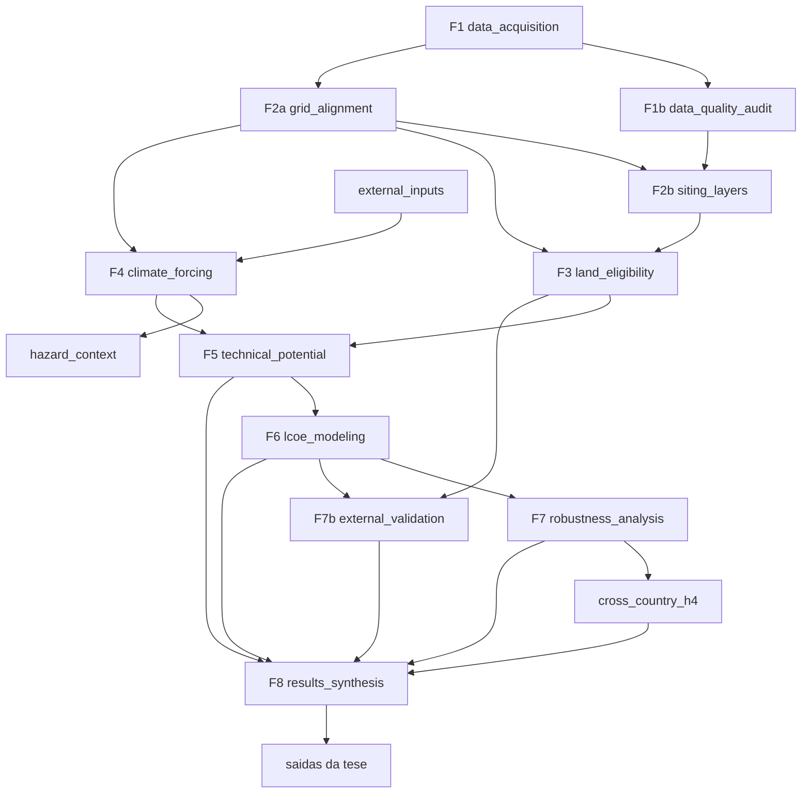

# GeoFREA v1.1 explicado

Documento didático para o autor, escrito em 2026-11-23 sobre o estado congelado na tag `v1.0` (commit `107d1b8`, METHODOLOGY 19.4.15) e atualizado em 2026-11-24 para a tag `v1.1`. As seções 1 a 11 descrevem os resultados pré-registrados da v1.0, que a v1.1 não altera; a seção 6A acrescenta as análises exploratórias da v1.1 (DEC-098, DEC-100), com a conferência numérica no script `conferir_214.py`. Todo número vem de um artefato de `GeoFREA_data` ou de um documento do repositório, e o caminho ou o identificador (DEC, L, M-, OQ) está ao lado. Onde o dado não existe, o texto diz "não disponível". A conferência numérica está no fim do relatório de entrega (script `conferir198.py`).

Convenção dos números: ponto decimal, sem separador de milhar, como nos artefatos. Janela core 2041-2070, cenário de solo central e membro de referência m0, salvo indicação.

## 1. O que o GeoFREA responde

**Pergunta central (RQ0).** Como um arcabouço computacional espacialmente explícito, que junta potencial técnico renovável, viabilidade tecno-econômica e clima futuro em vários cenários, identifica locais prioritários para instalar usinas que continuam bons em muitos futuros possíveis? E como medir essa robustez de modo defensável, tratando juntas a incerteza física do clima e a incerteza dos custos e parâmetros? A unidade de decisão é a célula de 0.05 grau (S-06), e as tecnologias são solar fotovoltaica de solo e eólica em terra (S-02), em Portugal, Índia e Brasil (S-01). Fonte: METHODOLOGY 1.1.

**Perguntas de apoio (METHODOLOGY 1.1).**

- RQ1: como quantificar o potencial técnico no espaço de forma comparável entre países.
- RQ2: como juntar restrições do território e custos que dependem do território com os parâmetros tecno-econômicos numa única métrica de viabilidade por local.
- RQ3: como as projeções climáticas de vários SSPs mudam o potencial e a viabilidade futura dos locais ainda não construídos.
- RQ4: qual abordagem de decisão sob incerteza profunda trata clima e parâmetros econômicos juntos, sem colapsá-los num escore único arbitrário.
- RQ5: se o arcabouço generaliza entre Brasil, Portugal e Índia ou produz resultados de contexto.

## 2. Como funciona

O fluxo abaixo vem da METHODOLOGY 4.1. Cada caixa é uma fase; as setas dizem qual artefato alimenta qual fase.

As fases, na ordem em que um país real é rodado:

- **F1 `data_acquisition`.** Entra a lista de camadas configuradas (fronteiras GADM, áreas protegidas, rios e lagos, cobertura do solo, relevo, população, rede elétrica, estradas, irradiação, vento, CMIP6, rajada ERA5, usinas existentes). Registra cada camada com sua proveniência e baixa o que tem fonte automática. Sai o registro de camadas (M-F1-01).
- **F1b `data_quality_audit`.** Entram as camadas do F1. Confere cobertura, valores sem dado, faixas de valores, resolução e sistema de coordenadas. Sai um relatório de auditoria; o que ele acha é registrado e nunca bloqueia a execução (M-F1b-02).
- **F2a `grid_alignment`.** Entram as camadas brutas. Leva todas à grade de análise de 0.01 grau, calculada de modo que a célula de 0.05 grau contenha exatamente 5 por 5 pixels, com distâncias e áreas geodésicas. Saem as camadas alinhadas e a definição da grade (M-F2a-01 a M-F2a-11).
- **F2b `siting_layers`.** Entram as camadas alinhadas. Monta, por tecnologia, as seis exclusões (E1 protegidas, E2 água, E3 corredor de rio, E4 declividade, E5 cobertura do solo, E6 assentamentos), as distâncias que viram custo e as camadas de recurso, sem normalizar nem ponderar nada (M-F2b-01 a M-F2b-04).
- **F3 `land_eligibility`.** Entram as camadas de F2b. Combina as exclusões em fração elegível por pixel, soma por célula de 0.05 grau e gera a tabela de células candidatas nos três cenários de solo (restritivo, central, permissivo). Sai `candidates_<tec>.parquet`; daqui em diante tudo trabalha com tabelas de células, nunca com rasters inteiros (M-F3-01 a M-F3-07).
- **`external_inputs` e F4 `climate_forcing`.** Entram os arquivos CMIP6, ISIMIP3b e ERA5. Calcula, por célula e por membro climático, os fatores de mudança de irradiância, temperatura e vento, e depois indicadores de perigo (calor extremo, chuva extrema, rajada) como contexto, sem perda calculada. Saem `forcing.parquet`, `hazard_context.parquet` e `members.yaml` (M-F4-01 a M-F4-07).
- **F5 `technical_potential`.** Entram a tabela de candidatas e os fatores de F4. Calcula capacidade por célula (área elegível, fator de uso do solo e densidade de potência), fator de capacidade por membro e energia anual. Sai a tabela de potencial por célula e membro, nos três cenários de solo (M-F5-01 a M-F5-06).
- **F6 `lcoe_modeling`.** Entram o potencial de F5 e os parâmetros. Calcula o LCOE de cada célula e membro com custo de conexão e degradação, sorteando os parâmetros incertos por hipercubo latino. Saem os resumos do LCOE (nominal, média, variância, p10, p50, p90) e a matriz de projeto. A fase de apoio `sample_size_convergence` define o número de amostras (M-F6-01 a M-F6-12, U-04).
- **F7 `robustness_analysis`.** Entram os resumos de F6. Avalia cada futuro (membro e amostra) sobre todas as células, calcula arrependimento relativo e robustez de satisfação, ranqueia, testa H1 a H5, descobre cenários com PRIM e escreve as tabelas de hipóteses (M-F7-01 a M-F7-21).
- **F7b `external_validation`.** Entram as usinas existentes (GEM) e o LCOE nominal. Mede quanto da capacidade existente está em pixels que o modelo exclui, a razão de enriquecimento nos decis de menor custo e compara o potencial nacional com estimativas publicadas. É evidência de plausibilidade, não de acurácia (M-F7b-01 a M-F7b-04).
- **`cross_country_h4`.** Entram as tabelas `h4_country` de todos os países configurados. Emite o veredito do H4 por tecnologia, que só existe quando há o perfil de cada país (D-core-056).
- **F8 `results_synthesis`.** Entram as tabelas persistidas das fases anteriores. Não recalcula nenhuma grandeza científica: agrega e produz as tabelas e figuras da tese em `outputs/thesis/` e o perfil estruturado de hipóteses por país e tecnologia (M-F8-01 a M-F8-03). O explorador E1 não faz parte da v1.0 (OQ-013).

## 3. Conceitos em linguagem simples

Os exemplos numéricos vêm da v1.0.

**Potencial técnico.** Quanta capacidade cabe no território que sobra depois das exclusões e quanta energia ela gera por ano, antes de olhar custo. Exemplo: em Portugal, a solar no cenário central tem 153.3 GW e 247.3 TWh por ano.

**Cenários de solo.** O solo disponível é incerto e por isso é uma faixa de três cenários, e não um parâmetro sorteado (U-06). Exemplo, solar de Portugal: 32.01 GW no restritivo, 153.3 GW no central e 563.8 GW no permissivo.

**Membro climático (GCM e SSP).** Um membro é uma combinação de modelo climático (GCM), trajetória de emissões (SSP) e janela de tempo; o membro de referência m0 é o clima presente. A solar usa 18 membros (6 GCMs vezes 3 SSPs) e a eólica usa 15, porque o vento do MIROC6 foi excluído (M-F4-02, item 6). As janelas são 2041-2070 (core) e 2071-2100 (sensibilidade).

**LCOE.** Custo nivelado da energia: o custo total do projeto ao longo da vida, trazido a valor presente, dividido pela energia gerada também trazida a valor presente, em USD de 2024 por MWh. Exemplo, solar de Portugal no membro de referência: p10 47.04, p50 50.38 e p90 53.5 USD/MWh entre as 3414 células.

**τ (tau).** O LCOE de referência abaixo do qual uma célula conta como economicamente viável. É o LCOE que o núcleo do F6 dá para a usina de referência do relatório IRENA 2024, com a mesma regra nos seis pares (M-F7-17). Exemplo: 54.53 USD/MWh para a solar de Portugal e 28.26 para a solar da Índia; em Portugal, 152.3 GW dos 153.3 GW têm LCOE até τ.

**cf_min.** Fator de capacidade mínimo para a célula contar como viável. Na solar é 0.115 (11.5%, percentil 5 global do IRENA 2024), que exclui 0 células em Portugal e no Brasil e 127 das 93701 da Índia; na eólica é 0, ou seja, sem piso (M-F7-20, DEC-089 b).

**LHS (hipercubo latino).** Modo de sortear os parâmetros incertos (capex, taxa de desconto, vida útil, custos de linha e de baía, fatores de traçado, degradação, eta_loss e gamma) cobrindo cada faixa de modo uniforme com poucas amostras (M-F6-02). A v1.0 usa 4000 amostras por par (D-F6-032).

**Futuro (membro e amostra).** Um futuro é o par f = (m, s): um membro climático e uma amostra de parâmetros. Exemplo: a solar de cada país tem 72000 futuros e a eólica 60000 (tabela de PRIM, seção 5c).

**Arrependimento (regret) e MR.** O arrependimento relativo de uma célula em um futuro é quanto o LCOE dela passa do menor LCOE viável daquele futuro, dividido por esse menor. O MR é o pior caso entre membros do percentil 90 sobre as amostras (M-F7-03); quanto menor, mais robusta é a célula. Exemplo, solar de Portugal: MR mediano 0.1807 entre as 3414 células, mínimo 0 e máximo 0.4524.

**Satisficing e SR.** Em vez de minimizar arrependimento, mede a fração dos futuros em que a célula é viável e custa no máximo τ (M-F7-04). Exemplo, solar de Portugal: SR mediano 0.6077.

**Top-k.** As melhores k células por um critério. Na v1.0 k é 10% do conjunto de células (M-F7-19). Exemplo: solar de Portugal, k = 342 de 3414 células.

**PRIM.** Técnica de descoberta de cenários: procura a combinação de condições (parâmetros, GCM, SSP) em que a lista nominal de melhores células deixa de valer (M-F7-08). Na v1.0 ela termina em `no_cases` nos seis pares, isto é, nenhum futuro avaliado é caso de interesse, então não há caixa para descrever.

**Pré-registro.** As regras de decisão e os limiares dos testes foram fixados e conferidos por um resumo criptográfico antes de qualquer resultado: a tag `prereg-v1` e o digest agregado `1bce505f3315fa34948cf842612a2eee4c7ec1ff9c15e919f08cc631d8f08235`. A guarda recusa rodar F6 e F7 em dado real se o digest vivo difere do da tag (M-F7-13).

## 4. Dados e premissas

### Entradas principais

A tabela traz o que os documentos registram. Onde resolução ou ano não aparece em nenhum documento lido, está "não disponível".

| Entrada | Fonte | Ano ou período | Resolução | Observação |
|---|---|---|---|---|
| Fronteiras e unidades administrativas | GADM 4.1 (M-F1-02) | 4.1 | vetor | território contíguo como máscara (M-F2a-01) |
| Áreas protegidas | WDPA, Protected Planet API v4 | não disponível | vetor | E1 (M-F1-02) |
| Lagos e rios | HydroSHEDS e HydroRIVERS | não disponível | vetor | E2 e E3 (M-F2b-01) |
| Cobertura do solo | ESA WorldCover | não disponível | 10 m | contagens por classe (M-F2a-06) |
| Relevo e declividade | Copernicus GLO-30 e FABDEM V1-2 | não disponível | 30 m | declividade pela FABDEM (M-F2a-07); licença CC BY-NC-SA 4.0 (OQ-072) |
| Assentamentos | GHS-SMOD R2023A | 2020 | 1 km | E6 (M-F2a-11) |
| Irradiação solar | Global Solar Atlas, PVOUT | média de longo prazo | não disponível | kWh/kWp/dia (M-F1-02) |
| Vento | Global Wind Atlas, Weibull A, k e densidade | não disponível | alturas 100, 150 e 200 m | M-F1-03 |
| Clima futuro | CMIP6 via Copernicus CDS, 6 GCMs | referência 1995-2014; janelas 2041-2070 e 2071-2100 | grade nativa de cada GCM | M-F1-04, S-04 |
| Rajada | ERA5 | 1995-2014 | não disponível | indicador sem perda (M-F1-05) |
| Subestações | OpenStreetMap | não disponível | pontos e polígonos | ponto de conexão (M-F2a-09) |
| Estradas | GRIP4 e OSM | não disponível | vetor | M-F2a-10 |
| Usinas existentes | Global Energy Monitor | não disponível | usina | só na F7b (M-F1-06) |
| Custos e fatores de capacidade de referência | IRENA, Renewable Power Generation Costs in 2024 | 2024 | não aplicável | capex, WACC, cf_min e τ (M-F6-07, M-F7-17) |

### Premissas que mais pesam

| Premissa | Valor na v1.0 | Tier | Decisão |
|---|---|---|---|
| τ, solar | PRT 54.53, IND 28.26, BRA 43.97 USD/MWh | derivado da referência IRENA 2024 | M-F7-17, DEC-085, DEC-089 a |
| τ, eólica | PRT 49.64, IND 36.43, BRA 31.95 USD/MWh | idem | idem |
| Taxa de desconto (WACC), solar | BRA [6.30%; 8.70%], IND [3.00%; 5.90%], PRT [3.20%; 5.20%] | Tier 2 central; largura Tier 3 | M-F6-11, DEC-072, DEC-082 a |
| Taxa de desconto (WACC), eólica | BRA [4.90%; 8.70%], IND [2.80%; 5.90%], PRT [2.70%; 4.70%] | idem | idem |
| Fator de uso do solo (LUF), solar | PRT 0.25, BRA 0.25, IND 0.1 (restritivo 0.1, 0.1, 0.05; permissivo 0.35, 0.35, 0.25) | Tier 3 | M-F5-01, `config/parameters.json` |
| Fator de uso do solo (LUF), eólica | PRT 0.15, BRA 0.15, IND 0.075 | Tier 3 | idem |
| Densidade de potência | solar 50 MW/km2; eólica 4.99 MW/km2 (restritivo 3.32, permissivo 7.12) | Tier 2 | M-F5-01 |
| eta_loss (eólica) | 0.866, faixa [0.803; 0.932] | Tier 3 | M-F5-03, `config/parameters.json` |
| cf_min | solar 0.115; eólica 0 | solar sourced, eólica juízo do autor | M-F7-20, DEC-088, L-248 |
| top-k | 10% (sensibilidades 5% e 20%) | Tier 3, juízo do autor | M-F7-19, DEC-085 d, L-248 |
| Limiares de exposição do H5b | nenhum registrado | não disponível | DEC-093, V174b, OQ-051 |
| Perda climática | nenhuma: o F5 só mede exposição | n/a | DEC-065 |

## 5. Resultados da v1.0

Todas as tabelas desta seção vêm de `outputs/<ISO>/robustness_analysis/artifacts/` e de `outputs/thesis/`, na janela core e no cenário central. O mesmo conteúdo, com a origem de cada coluna, está em `auditoria_pipeline_v1_0.md` (seção 5).

### 5a. Potencial, LCOE e potencial abaixo de τ

| País | Tec. | P central (GW) | P restritivo (GW) | P permissivo (GW) | E central (TWh/ano) | E restritivo | E permissivo |
|---|---|---|---|---|---|---|---|
| PRT | solar | 153.3 | 32.01 | 563.8 | 247.3 | 51.71 | 906.3 |
| PRT | eólica | 22.79 | 3.37 | 77.04 | 52.17 | 7.81 | 175.2 |
| IND | solar | 806.1 | 211.6 | 4890.8 | 1331.6 | 353.5 | 8000.8 |
| IND | eólica | 214.1 | 60.13 | 879.6 | 331.5 | 99.34 | 1297.3 |
| BRA | solar | 16489.5 | 4183.0 | 47080.7 | 26741.6 | 6789.5 | 76202.8 |
| BRA | eólica | 1990.7 | 372.2 | 6071.5 | 2712.2 | 506.5 | 8251.1 |

| País | Tec. | LCOE p10 | LCOE p50 | LCOE p90 (USD/MWh) | τ | capacidade com LCOE até τ (GW) | fração | candidatas | conjunto F7 | k |
|---|---|---|---|---|---|---|---|---|---|---|
| PRT | solar | 47.04 | 50.38 | 53.5 | 54.53 | 152.3 | 0.9934 | 3415 | 3414 | 342 |
| PRT | eólica | 48.38 | 63.65 | 92.27 | 49.64 | 2.033 | 0.08918 | 3332 | 3332 | 334 |
| IND | solar | 26.69 | 29.03 | 32.17 | 28.26 | 454.6 | 0.5639 | 93701 | 93490 | 9349 |
| IND | eólica | 42.68 | 71.79 | 143.02 | 36.43 | 13.58 | 0.06342 | 75535 | 75535 | 7554 |
| BRA | solar | 47.71 | 52.3 | 59.59 | 43.97 | 12.35 | 0.0007487 | 190521 | 190001 | 19001 |
| BRA | eólica | 63.44 | 144.37 | 383.54 | 31.95 | 2.01 | 0.00101 | 178289 | 171181 | 17119 |

O LCOE é a distribuição entre células do LCOE nominal no membro m0 (`nominal_lcoe_by_member_<tec>__core.parquet`). A eólica do Brasil tem a cauda mais longa: p90 de 383.54 contra p50 de 144.37.

### 5b. H1 a H5 (variante primária)

H1 a H3, com a faixa entre variantes de sensibilidade entre colchetes (origem: `T-R8_hypothesis_profiles_<ISO>.json`):

| País | Tec. | H1 C_k [faixa] | V_k | p_k² | veredito H1 | H2 O [faixa] | O_ref | veredito H2 | H3 D [faixa] | D_ref | Pi | B | veredito H3 |
|---|---|---|---|---|---|---|---|---|---|---|---|---|---|
| PRT | solar | 0.9737 [0.9474; 0.9789] | 0 | 0.01004 | parcialmente suportada, núcleo estável | 0.3197 [0.2892; 0.471] | 0.139 | não suportada | 0.009224 [0; 0.02362] | 0.7996 | 0.001057 | 0.002099 | não suportada |
| PRT | eólica | 0.9611 [0.9311; 0.979] | 0 | 0.01005 | idem | 0.4451 [0.4023; 0.47] | 0.0644 | não suportada | 0 [0; 0] | 0.7995 | -0.0003776 | 0.001991 | não suportada |
| IND | solar | 0.9024 [0.7855; 0.9072] | 0 | 0.01 | idem | 0.5027 [0.3064; 0.7611] | 0.2472 | não suportada | 3.703e-05 [0; 0.004727] | 0.7993 | -0.0003246 | 0.001071 | não suportada |
| IND | eólica | 0.89 [0.8644; 0.9131] | 0 | 0.01 | idem | 0.3391 [0.2556; 0.8022] | 0.1737 | não suportada | 0 [0; 0] | 0.8 | 0.0008376 | 0.007432 | não suportada |
| BRA | solar | 0.8532 [0.8147; 0.902] | 0.002947 | 0.01 | idem | 0.3398 [0.01291; 0.5152] | 0.1317 | não suportada | 0.0002808 [0; 0.006832] | 0.8 | -4.689e-05 | 0.00206 | não suportada |
| BRA | eólica | 0.9628 [0.9529; 0.9708] | 0 | 0.01 | idem | 0.5097 [0.4223; 0.5688] | 0.1224 | não suportada | 0 [0; 0] | 0.8 | -0.0009942 | 0.004899 | não suportada |

H4 e H5 (origem: `T-R8_hypothesis_profiles_<ISO>.json`, `h4_country` e `h5_summary`):

| País | Tec. | H4 D_clim | D_tec | rho | perfil | H5 E_0 (TWh) | G | H_0 | R_loss | R_exp | status do H5 |
|---|---|---|---|---|---|---|---|---|---|---|---|
| PRT | solar | 0 | 0 | não disponível | no_displacement | 245.8 | não disponível | não disponível | não disponível | não disponível (V174b) | não testável: sem meta nacional (OQ-010) |
| PRT | eólica | 0 | 0 | não disponível | no_displacement | 6.243 | não disponível | não disponível | não disponível | não disponível (V174b) | não testável: sem meta nacional (OQ-010) |
| IND | solar | 0.001533 | 0 | 1 | climate_dominated | 771.7 | 759.4 | 12.29 | 3.816 | não disponível (V174b) | H5a testada; H5b não disponível: nenhum canal de perigo tem limiar (OQ-051) |
| IND | eólica | 0 | 0 | não disponível | no_displacement | 36.94 | 375.5 | -338.5 | não disponível | não disponível (V174b) | meta não atingida na referência: E_0 36.9393 não passa de G 375.479 TWh/ano |
| BRA | solar | 0 | 0 | não disponível | no_displacement | 22.3 | 162.6 | -140.3 | não disponível | não disponível (V174b) | meta não atingida na referência: E_0 22.3023 não passa de G 162.579 TWh/ano |
| BRA | eólica | 0 | 0 | não disponível | no_displacement | 9.821 | não disponível | não disponível | não disponível | não disponível (V174b) | não testável: sem meta nacional (OQ-010) |

Veredito do H4 por tecnologia (comparação entre países, `T-R8_hypothesis_summary.csv`): solar, não suportado (3 países com perfil: climate_dominated 1, techno_economic_dominated 0, mixed 0, no_displacement 2); eólica, não suportado (3 países: climate_dominated 0, techno_economic_dominated 0, mixed 0, no_displacement 3).

### 5c. PRIM (caixa primária)

| País | Tec. | status | futuros | casos | taxa-base |
|---|---|---|---|---|---|
| PRT | solar | no_cases | 72000 | 0 | 0 |
| PRT | eólica | no_cases | 60000 | 0 | 0 |
| IND | solar | no_cases | 72000 | 0 | 0 |
| IND | eólica | no_cases | 60000 | 0 | 0 |
| BRA | solar | no_cases | 72000 | 0 | 0 |
| BRA | eólica | no_cases | 60000 | 0 | 0 |

### 5d. F7b, validação externa

Fração média da capacidade das usinas existentes que cai em pixels excluídos, por restrição, e fração com alguma exclusão (M-F7b-01):

| País | Tec. | usinas avaliadas | E1 | E2 | E3 | E4 | E5 | E6 | combinada (média; >0) |
|---|---|---|---|---|---|---|---|---|---|
| PRT | solar | 168 | 0.05344 | 0.00126 | 0.001729 | 0.4776 | 0.366 | 0.06266 | 0.7391; 1 |
| PRT | eólica | 361 | 0.2843 | 0.0008001 | 0.0007956 | 0.5147 | 0.2615 | 0.04136 | 0.747; 1 |
| IND | solar | 3724 | 0.01442 | 0.01013 | 0.0406 | 0.06832 | 0.6138 | 0.4786 | 0.7687; 1 |
| IND | eólica | 679 | 0.1006 | 0.01054 | 0.02969 | 0.03628 | 0.3427 | 0.7627 | 0.8369; 0.9672 |
| BRA | solar | 3946 | 0.08351 | 0.0008839 | 0.0115 | 0.1965 | 0.3203 | 0.1314 | 0.5132; 0.9916 |
| BRA | eólica | 1135 | 0.1282 | 0.000714 | 0.006023 | 0.1248 | 0.1021 | 0.03381 | 0.3319; 0.9336 |

Razão de enriquecimento (parcela da capacidade em operação no decil de menor custo sobre a parcela da área elegível do decil), M-F7b-02:

| País | Tec. | decil 1 | decil 2 | decil 10 | capacidade fora das candidatas (parcela) |
|---|---|---|---|---|---|
| PRT | solar | 4.159 | 0.8171 | 0.2677 | 0.0235 |
| PRT | eólica | 4.918 | 1.324 | 0.3664 | 0.1986 |
| IND | solar | 2.955 | 1.054 | 0.2042 | 0.109 |
| IND | eólica | 4.643 | 2.171 | 0.2025 | 0.2492 |
| BRA | solar | 7.296 | 1.413 | 0.04069 | 0.04726 |
| BRA | eólica | 9.238 | 0.621 | 0 | 0.09827 |

Comparação com potenciais publicados (M-F7b-03): só o Brasil tem valores registrados, com as definições indicadas. Eólica do Brasil: 143 GW (Amarante, 2001) e 14580.0 GW (Eurek et al., 2017), contra 1990.7 GW do F5 central. Solar do Brasil: 307 GW e 28519.0 GW (EPE, 2018), contra 16489.5 GW. Portugal e Índia ficam `pending`, sem valor (OQ-057).

### 5e. Sensibilidades

Cada par de país e tecnologia tem de 8 a 21 variantes por hipótese (janela 2071-2100, escala de 0.1 grau, sem o GCM IPSL-CM6A-LR, top-k de 5%, 10% e 20%, tolerância de 0.5k, 1k e 2k, e o perfil de γ no H2).

- **H1, H3 e H5:** o veredito da variante primária não muda em nenhuma variante, em nenhum dos seis pares (0 variantes mudando o veredito). A janela 2071-2100 e a escala de 0.1 grau dão os mesmos vereditos que a primária.
- **H2:** muda de veredito em parte das variantes, porque o veredito depende do limiar γ: 9 de 20 variantes em PRT solar, 6 de 20 em PRT eólica, 4 de 21 em IND solar, 9 de 21 em IND eólica, 10 de 21 em BRA solar e 4 de 20 em BRA eólica. A janela 2071-2100 e a escala de 0.1 grau seguem "não suportada".
- **H4:** muda o perfil em 1 de 11 variantes em PRT solar, em 2 de 11 em IND solar e em 1 de 11 em BRA solar; nos outros três pares, em 0.
- **Escala de 0.1 grau:** a escala de 0.1 grau rodou de F3 a F7 nos três países (`manifest__0p1deg.json`); em BRA a F7 levou 6233 s.

### 5f. Saídas da tese

A F8 gerou 17 saídas por país (170 arquivos), entre tabelas, figuras e `provenance.json`, em `outputs/thesis/`. T-R10 (exposição) e a coluna R_exp da T-R6 ficam "não disponível" (V174b). A T-O1 de solar e de eólica não foi construída porque o PRIM terminou em `no_cases`.

## 6. O que os resultados dizem

Leitura factual, separando o que se repete entre países do que depende do contexto (rótulos da M-F8-03, `T-R8_hypothesis_summary.csv`). Nada aqui vai além do que os artefatos mostram.

**Repete-se nos três países e nas duas tecnologias (rótulo "consistent").**

- **H1 (o ranking se mantém entre SSPs):** parcialmente suportada, núcleo estável, nos seis pares. A parcela do núcleo C_k vai de 0.8532 a 0.9737, acima do limiar de 0.60, e o valor de referência p_k² é de cerca de 0.01. A parte H1b (vulnerabilidade, V_k de pelo menos 0.20) não vale em nenhum par: V_k é 0 em cinco pares e 0.002947 em BRA solar. Em palavras: os melhores locais pelo ranking nominal em geral continuam entre os melhores sob cada SSP.
- **H2 (agregar por região administrativa muda a seleção):** não suportada nos seis pares, porque a sobreposição O entre a seleção por célula e a seleção por região fica entre 0.3197 e 0.5097, acima de γ = 0.30. Em palavras: a seleção por região coincide em boa parte com a por célula. O veredito é sensível ao limiar (seção 5e).
- **H3 (planejar por robustez muda onde construir):** não suportada nos seis pares: a parcela D da capacidade robusta fora do alcance do ranking nominal vai de 0 a 0.009224, muito abaixo de δ = 0.20. O preço da robustez Pi fica entre -0.0009942 e 0.001057 e o benefício B entre 0.001071 e 0.007432. Em palavras: a lista robusta e a lista nominal quase coincidem.
- **PRIM:** `no_cases` nos seis pares: entre os futuros avaliados, nenhum desloca a lista nominal além do limiar de 0.20.

**Depende do contexto.**

- **H4 (o eixo dominante varia entre países):** não suportada nas duas tecnologias. Em cinco dos seis pares o deslocamento é zero nos dois eixos (`no_displacement`). A exceção é a solar da Índia, com perfil Climate-Dominated (rho = 1, D_clim = 0.001533). Como a regra exige um país dominado pelo clima e outro dominado por economia, e não há país dominado por economia, o veredito é não suportado.
- **H5 (pressão do clima sobre o potencial econômico de uma meta):** não avaliável. Três pares não têm meta nacional registrada (PRT solar, PRT eólica, BRA eólica, OQ-010). Dois têm meta não atingida na referência (IND eólica e BRA solar). A solar da Índia é o único par com folga (H_0 = 12.29 TWh/ano): a perda de recurso é 3.816 vezes a folga, mas o veredito conjunto não sai porque H5b não está disponível (nenhum canal de perigo tem limiar, DEC-093).

**O que não se pode concluir.** Que o clima não importa: a robustez é medida no ranking de células, e o clima futuro entra pelos fatores de irradiância, temperatura e vento de seis GCMs. O que os dados mostram é que, com os parâmetros e limiares registrados, a ordem das células quase não muda entre futuros. Também não se pode concluir sobre perdas por eventos extremos, porque a v1.0 mede exposição e não perda (DEC-065).

<!-- 6A:inicio -->
## 6A. Análises exploratórias (v1.1)

Acrescentadas depois da v1.0, declaradas antes de serem calculadas (DEC-098, METHODOLOGY M-X-01 a M-X-05) e com uma correção de definição declarada depois do primeiro cálculo (DEC-100). São **exploratórias**: os resultados pré-registrados da v1.0 (seções 5 e 6) não mudaram e continuam sendo os resultados primários; nenhuma saída desta seção alimenta T-R1 a T-R12. As tabelas vêm de `outputs/<ISO>/exploratory_analysis/artifacts/` (janela core 2041-2070, conjunto F7 do cenário central de solo) e de `external_validation`, e aparecem na tese como T-X1 a T-X4. Cada número desta seção está ligado ao artefato de origem e conferido por script (`conferir_214.py`).

### 6A.1 H5c: custo de atingir a meta, sem τ

MC é o LCOE da célula em que a energia acumulada, da mais barata para a mais cara, atinge o nível G; AC é o LCOE médio das células até G; Delta_MC é o maior aumento relativo de MC entre os membros do conjunto central. Os níveis são a meta nacional em GW e 5, 10 e 25 por cento da energia do conjunto F7 no membro de referência `m0` (G_p). A energia da meta é a das células mais baratas do conjunto F7 em `m0` até a capacidade acumulada atingir a meta, sem τ (DEC-100). Rótulo da DEC-098: "material climate pressure on the cost of the target" quando Delta_MC é de 5% ou mais no alvo.

| par | meta (GW) | G (TWh/ano) | G / energia do conjunto F7 | conversão antiga do H5 / energia do conjunto | MC_m0 (USD/MWh) | Delta_MC máximo | rótulo |
|---|---|---|---|---|---|---|---|
| IND solar | 447 | 759.4 | 57.1% | 57.1% | 28.22 | 7.82% | material climate pressure on the cost of the target |
| IND eólica | 138 | 257.2 | 77.6% | 113.3% | 68.95 | 18.98% | material climate pressure on the cost of the target |
| BRA solar | 90 | 160.3 | 0.6% | 0.6% | 44.83 | 2.20% | no material climate pressure on the cost of the target |

A primeira versão do cálculo (COMANDO 213) convertia a meta pela regra do H5, que depende de τ; na IND eólica isso dava 113.3% da energia do conjunto e a meta ficava inalcançável no membro de referência. A DEC-100 corrigiu a definição, e a IND eólica passou a 77.6%. PRT solar, PRT eólica e BRA eólica não têm meta nacional em GW (OQ-010) e só têm os níveis G_p.

Delta_MC máximo nos níveis G_p (base nominal), por par:

| par | G_p 5% | G_p 10% | G_p 25% |
|---|---|---|---|
| PRT solar | 0.93% | 0.90% | 0.74% |
| PRT eólica | 6.72% | 7.05% | 8.23% |
| IND solar | 5.73% | 6.06% | 6.58% |
| IND eólica | 8.44% | 7.94% | 8.37% |
| BRA solar | 2.02% | 1.98% | 2.12% |
| BRA eólica | 3.26% | 3.07% | 2.43% |

### 6A.2 Vulnerabilidade própria (VUL)

`VUL_clim` é o maior aumento relativo do LCOE da célula sobre os membros do conjunto central; `VUL_tec`, o P90 sobre os sorteios de parâmetros no membro de referência; `VUL`, o máximo sobre os membros do P90. O membro `m0` não está entre os membros do conjunto central, então `VUL_clim` pode ser negativo (L-264): a célula cujo LCOE cai em todos os membros futuros não tem vulnerabilidade climática.

| par | células | VUL_clim mín. | VUL_clim mediana | VUL_clim máx. | células com VUL_clim negativo | VUL_tec mediana | Spearman de VUL_clim com o LCOE | top-k nominal no quartil superior de VUL_clim |
|---|---|---|---|---|---|---|---|---|
| PRT solar | 3414 | -2.56% | 0.29% | 1.57% | 1401 | 30.3% | -0.618 | 74.0% |
| PRT eólica | 3332 | 3.60% | 7.90% | 13.73% | 0 | 31.5% | 0.690 | 0.0% |
| IND solar | 93159 | 4.05% | 8.15% | 16.72% | 0 | 31.3% | 0.322 | 0.2% |
| IND eólica | 75535 | 2.20% | 11.55% | 318.73% | 0 | 28.0% | 0.239 | 1.0% |
| BRA solar | 190001 | -0.08% | 1.98% | 5.61% | 14 | 26.7% | -0.047 | 15.8% |
| BRA eólica | 171181 | -8.63% | 2.15% | 75.59% | 46934 | 18.7% | 0.217 | 8.9% |

Em módulo, `VUL_clim` é pequeno nas solares e `VUL_tec` é quase o mesmo em todas as células de um país, como a decomposição do H4 já indicava. O sinal da correlação de `VUL_clim` com o LCOE é negativo em PRT solar e BRA solar e positivo nos outros pares: ele difere entre países e tecnologias.

### 6A.3 V_f: por que o PRIM terminou sem casos

`V_f` é a parcela da capacidade deslocada em cada futuro. O limiar do PRIM é 0.20. Nos seis pares, nenhum futuro chega perto: o maior valor é 4.22% (BRA solar). O `no_cases` da v1.0 se explica pela distância ao limiar, e não por defeito.

| par | V_f p99 | V_f máximo | futuros com V_f ≥ limiar |
|---|---|---|---|
| PRT solar | 1.99% | 3.00% | 0 |
| PRT eólica | 0.00% | 0.00% | 0 |
| IND solar | 0.79% | 1.03% | 0 |
| IND eólica | 0.00% | 0.00% | 0 |
| BRA solar | 3.07% | 4.22% | 0 |
| BRA eólica | 3.43% | 3.90% | 0 |

### 6A.4 τ recalculado na base das células

O τ da v1.0 vem da usina de referência da IRENA (vida útil de 25 anos e O&M da IRENA). Recalculado com a vida útil e o O&M que a F6 aplica às células, ele fica menor, e a capacidade com LCOE abaixo dele cai mais do que o próprio τ. Só reportado: a robustez por satisficing não foi reavaliada (L-255).

| par | τ registrado (USD/MWh) | τ na base das células | diferença | GW com LCOE abaixo do registrado | GW abaixo do τ na base das células |
|---|---|---|---|---|---|
| PRT solar | 54.53 | 49.94 | -8.4% | 152.3 | 87.1 |
| PRT eólica | 49.64 | 44.81 | -9.7% | 2.0 | 0.5 |
| IND solar | 28.26 | 24.95 | -11.7% | 454.6 | 7.0 |
| IND eólica | 36.43 | 33.70 | -7.5% | 13.6 | 6.9 |
| BRA solar | 43.97 | 40.80 | -7.2% | 12.3 | 0.0 |
| BRA eólica | 31.95 | 30.55 | -4.4% | 2.0 | 1.0 |

### 6A.5 F7b: variante só com localização exata

A F7b primária usa todas as unidades em operação do GEM e não mudou. A variante `exact_location_only` (D-F7b-010) usa só as unidades de localização exata e vem gravada ao lado, na T-R9 (coluna `row_set`).

| par | unidades (primária) | parcela excluída combinada (primária) | unidades (variante) | parcela excluída combinada (variante) |
|---|---|---|---|---|
| PRT solar | 169 | 0.739 | 165 | 0.745 |
| PRT eólica | 361 | 0.747 | 359 | 0.746 |
| IND solar | 3727 | 0.769 | 3290 | 0.736 |
| IND eólica | 679 | 0.837 | 58 | 0.535 |
| BRA solar | 3947 | 0.513 | 601 | 0.409 |
| BRA eólica | 1144 | 0.332 | 1138 | 0.332 |

A variante muda pouco em PRT e na BRA eólica, onde quase toda unidade tem localização exata, e muda muito na IND eólica e na BRA solar, onde a maior parte da capacidade tem localização aproximada (L-261).

### 6A.6 Limitações registradas nos diagnósticos da v1.0 (L-255 a L-264)

- L-255: τ vem da usina da IRENA e a F6 precifica as células com outra vida útil e outro O&M; o domínio econômico é muito pequeno na BRA (6A.4).
- L-256: o veredito do H5 fica na borda em IND solar e BRA solar.
- L-257: o desenho de incerteza quase não move o ranking; os parâmetros de maior peso deslocam todas as células do país juntas.
- L-258: o H2 depende de poucas regiões e do limiar γ.
- L-259: a cobertura do solo de 2020 já marca usinas como construídas.
- L-260: o cenário central é mais estrito que a prática das usinas existentes em quatro critérios de elegibilidade.
- L-261: a localização do GEM é aproximada para a maior parte das unidades (6A.5).
- L-262: o WDPA do projeto não tem o ano de designação (`STATUS_YR`), então "usina antiga em área hoje restrita" não é avaliável.
- L-263: propriedades do desenho e da grade, entre elas o pixel que mistura a usina com o entorno e a shortlist por contagem de células.
- L-264: `VUL_clim` pode ser negativo (6A.2).

Todas seguem em `docs/LIMITATIONS.md`. As escolhas que mudariam resultado (elegibilidade revisada, τ na base das células, H5c e VUL como eixos primários, WDPA completo) vão para a v2, com novo pré-registro (OQ-116).

### 6A.7 O que não se pode concluir

Que o H5c substitui o H5: ele é exploratório e não muda nenhum veredito. Que `VUL` mede perda: mede o aumento relativo do LCOE sob os membros e os sorteios registrados. Que a ausência de futuros acima do limiar do PRIM mostra que o clima não importa: mostra que, com este limiar e estes membros, nenhum futuro desloca a lista nominal além dele.
<!-- 6A:fim -->

## 7. Contribuições

Declaradas na METHODOLOGY 1.4. Cada uma, com o resultado da v1.0 que a sustenta ou a razão de ainda não sustentar.

1. **Pipeline espacialmente explícito em que o impacto climático é entrada de primeira ordem no ranking de locais.** Sustentada: F4 gera 18 membros solares e 15 eólicos por célula, e F5, F6 e F7 avaliam cada um (por exemplo, 72000 futuros por par solar). A conclusão que o ranking pouco muda (H1) é resultado do pipeline, não de um teste posterior.
2. **Avaliação de robustez por local que trata clima e economia juntos e mantém os dois eixos separáveis.** Sustentada pela decomposição do H4: D_clim e D_tec são calculados em separado. O resultado é que, em cinco dos seis pares, nenhum eixo desloca o ranking, e na solar da Índia domina o clima (rho = 1).
3. **Validação empírica em três contextos nacionais distintos.** Parcialmente sustentada: as três nações rodam todas as fases e a F7b compara com usinas existentes (por exemplo, razão de enriquecimento de 9.238 no decil 1 da eólica do Brasil). Falta valor publicado de comparação para Portugal e Índia (OQ-057) e o H5 não é avaliável por falta de meta ou de limiar (OQ-010, OQ-051).
4. **Arquitetura guiada por configuração, estendível sem mudar código.** Sustentada por testes (A-05, A-06) e pelo mundo sintético ZZZ: o CI roda a fixture sintética a cada mudança (seção 8). A extensão a um quarto país não foi exercitada na v1.0.

## 8. Pontos positivos da pipeline

- **Reprodutibilidade.** Cada fase grava um manifesto por país com o SHA-256 dos artefatos e um fingerprint do código que ela executa; mudar o código muda o fingerprint e a fase fica `stale`. A referência publicada (`8d5275d999a4c87a2b19e57cd571aae67e87ce8c9e781beee52eb1045cc72ac1`) é comparada artefato a artefato: 12 fases saíram idênticas e 7 entraram como novas. O comando `--plan` mostra, sem rodar nada, o que executaria ou retomaria. A tag `v1.0` guarda os hashes dos manifestos.
- **Pré-registro e guarda.** A tag `prereg-v1` e o digest agregado impedem rodar F6 e F7 em dado real se os parâmetros decididos antes do resultado mudaram (M-F7-13). O digest agregado não mudou desde a tag.
- **Separação das incertezas.** O clima entra como membros discretos (GCM, SSP, janela), os parâmetros econômicos entram como amostras de hipercubo latino e o solo entra como faixa de três cenários, não como parâmetro sorteado (U-06, U-08). Isso evita somar tudo num escore único.
- **Testes e mundo sintético.** A suíte de unidades tem 2606 testes aprovados e 1 pulado na última execução completa. O país sintético ZZZ exercita todas as fases, e três workflows rodam a cada push: Regression, Unit tests and lint e Synthetic fixture (ZZZ).
- **Rastreabilidade das decisões.** Toda decisão do autor fica numa entrada de `docs/DECISIONS.md` (de DEC-059 a DEC-097), que nunca é editada: quando uma decisão substitui outra, a nova diz o que substitui. A DEC-097 reclassificou a DEC-095 sem apagá-la.
- **Falha alta em vez de silêncio.** Falta de parâmetro, camada ausente ou arquivo corrompido param a fase com erro nomeado (M-F2b-05); uma célula sem dado nunca é lida como solo livre (M-F3-01).

## 9. Gargalos

Tempo e memória medidos nos manifestos da v1.0 (`auditoria_pipeline_v1_0.md`, seção 1, 0.05 grau).

| Fase | PRT wall_s | IND wall_s | BRA wall_s | pico PRT (MB) | pico IND (MB) | pico BRA (MB) |
|---|---|---|---|---|---|---|
| lcoe_modeling | 90 | 1368 | 3130 | 598 | 1128 | 1566 |
| sample_size_convergence | 58 | 510 | 1037 | 684 | 1436 | 1455 |
| robustness_analysis | 456 | 9269 | 30625 | 711 | 1908 | 3174 |
| external_validation | 3 | 29 | 73 | 340 | 1642 | 3093 |
| results_synthesis | 26 | 40 | 76 | 369 | 1521 | 2434 |

- **Fase mais cara:** `robustness_analysis` (F7). No Brasil leva 30625 s (8.5 h) e usa 3174 MB. A escala de 0.1 grau reduz o custo no Brasil para 6233 s, mas não foi usada para os resultados principais.
- **Memória:** a máquina de execução tem cerca de 6 GB de RAM (L-254). No Brasil, `robustness_analysis`, `external_validation` e `results_synthesis` passam do teto de memória configurado e só terminam com os tetos desligados (`GEOFREA_MEMORY_CAPS=0`, V179c). O resultado não depende disso, porque os tetos só param ou esperam.
- **Dependência de dados e de rede:** o F1 baixa de serviços externos (Copernicus CDS, Protected Planet API, CDN do Global Wind Atlas). Na Índia, `data_acquisition` levou 617 s. O CMIP6 vem do CDS por GCM e experimento (M-F1-04).
- **Preparo pesado:** `land_eligibility` no Brasil leva 766 s e é a fase mais lenta antes de F6 nesse país.

## 10. Gaps e pontos negativos

Os que mais afetam a leitura dos resultados.

- **Fator de capacidade eólico (OQ-114, DEC-091, L-249).** O FC por célula do F5 fica acima do FC das frotas nos locais com usina: razão p de 1.12 no Brasil e 1.14 em Portugal; para a Índia, o FC de frota derivado é 19.8% (DEC-092). A diferença é atribuída à escolha de locais, a uma turbina maior na frota real, à posição da usina dentro da célula e ao curtailment, que não é modelado (L-033). Os valores absolutos de GW e TWh eólicos entram na tese com reserva; a leitura principal da eólica é o ranking.
- **τ e taxa de desconto (L-245, L-247, M-F7-17).** A taxa de desconto que iguala o LCOE do F6 ao publicado do IRENA fica acima do teto de DEC-072 em BRA solar (8.91%), IND solar (7.95%), IND eólica (7.43%) e PRT solar (5.51%, proxy regional). O τ primário fica abaixo do p5 publicado do IRENA para IND solar e IND eólica. Como τ é calibrado sem degradação e o F6 aplica degradação, o teste de satisficing é mais estrito do que τ sozinho sugere, em +0.5 a +0.9 USD/MWh para eólica e +2.2 a +5.2 para PRT solar.
- **Escopo das metas (L-246).** A meta solar da Índia para 2034-35 inclui telhado e a meta eólica não separa offshore, enquanto o potencial do GeoFREA cobre só solar de solo e eólica em terra.
- **H5 com meta registrada em 3 de 6 pares.** Existem metas para IND solar, IND eólica e BRA solar; PRT solar, PRT eólica e BRA eólica não têm meta registrada (OQ-010). Dos três pares com meta, dois já nascem com meta não atingida na referência. O H5b e a T-R10 não existem na v1.0 porque nenhum canal de perigo tem limiar com fonte (DEC-093, OQ-051).
- **Valores Tier 3 (L-248).** top-k de 10% e cf_min eólico de 0 são juízo do autor, declarados antes de qualquer resultado; as sensibilidades de 5% e 20% limitam o efeito do top-k. O fator de uso do solo é Tier 3.
- **Magnitudes contra potenciais publicados.** As duas fontes registradas para a eólica do Brasil diferem muito entre si (143 GW e 14580.0 GW) e o F5 central, 1990.7 GW, fica entre elas; na solar do Brasil, o F5 central de 16489.5 GW fica entre 307 GW e 28519.0 GW (OQ-057, M-F7b-03). Portugal e Índia ficam sem valor publicado para comparar.
- **Exposição sem perda (DEC-065).** Calor, chuva e rajada entram como contexto por célula; nenhuma função de perda, e portanto nenhum canal entra no regret.
- **Células sem LCOE (L-253).** O F6 exclui células sem zona fotovoltaica ou sem distância; em PRT solar são 1 célula (cell_id 7426615), e na Índia (84 células) e no Brasil (520 células) a mesma exclusão existe. A F7 e a F7b deixam essas células de fora e contam o fato no log.
- **Convergência da amostra em PRT solar (L-252).** O critério U-04 não foi atingido: 1 menos Jaccard de 0.0116 no tamanho 4000, que é o teto do protocolo.
- **Licença da FABDEM (OQ-072).** A declividade das três nações depende de um dado CC BY-NC-SA 4.0 (não comercial); a compatibilidade com publicação e depósito está em aberto.
- **Diagnósticos da v1.0 e análises exploratórias (L-255 a L-264).** Dez limitações novas foram registradas depois da v1.0, entre elas o τ da IRENA contra a base das células, a elegibilidade mais estrita que a prática das usinas e a localização aproximada do GEM; estão resumidas na seção 6A.6.
- **O que ficou "não disponível":** H5b e T-R10 (DEC-093), R_exp da T-R6, T-O1 de solar e eólica (PRIM sem casos), valores publicados de comparação de Portugal e Índia (OQ-057), meta nacional de PRT solar, PRT eólica e BRA eólica (OQ-010), FC de frota com fonte para a Índia além do derivado (DEC-092).

## 11. Próximos passos

Em ordem de impacto na tese.

1. **Fechar OQ-051 com limiares de exposição que tenham fonte.** Sem eles o H5b e a T-R10 não existem e o H5 não fecha. Tem de ser tratado como análise exploratória rotulada, porque a v1.0 está pré-registrada (M-F7-13, DEC-093).
2. **Registrar as metas nacionais que faltam (OQ-010).** PRT solar, PRT eólica e BRA eólica estão sem meta, o que deixa o H5 sem teste em metade dos pares.
3. **Fechar OQ-014: a justificativa de literatura para min-max regret com satisficing e PRIM (RQ4).** O texto da tese depende dela.
4. **Fechar OQ-057, com os potenciais publicados de Portugal e Índia,** para que a F7b compare as três nações.
5. **Validar o FC eólico contra a frota (OQ-114, L-249),** incluindo a base de perdas do Global Wind Atlas.
6. **Resolver a licença da FABDEM (OQ-072)** antes de qualquer publicação ou depósito dos resultados.
7. **Rodar a sensibilidade de `q_ref` (OQ-020) e a de resolução de 0.025 grau (OQ-064),** hoje fora da v1.0.
8. **Decidir o explorador E1 (OQ-013).** Fica fora da v1.0.
9. **Decidir o escopo da v2 (OQ-116) antes de qualquer novo pré-registro.** Entram na discussão a elegibilidade revista (E4, E5, E6), o τ na base das células, o H5c como H5 primário, a VUL como segundo eixo da decisão, a shortlist por capacidade, custos com variação espacial e o WDPA completo com `STATUS_YR`. O que o H5c e a VUL mostraram está na seção 6A.
