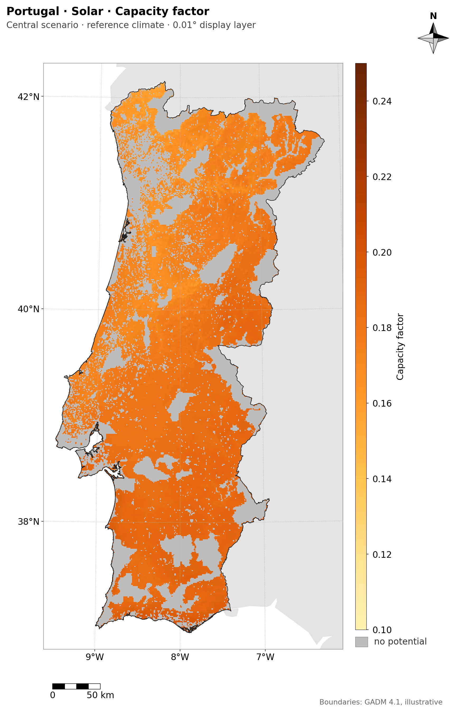
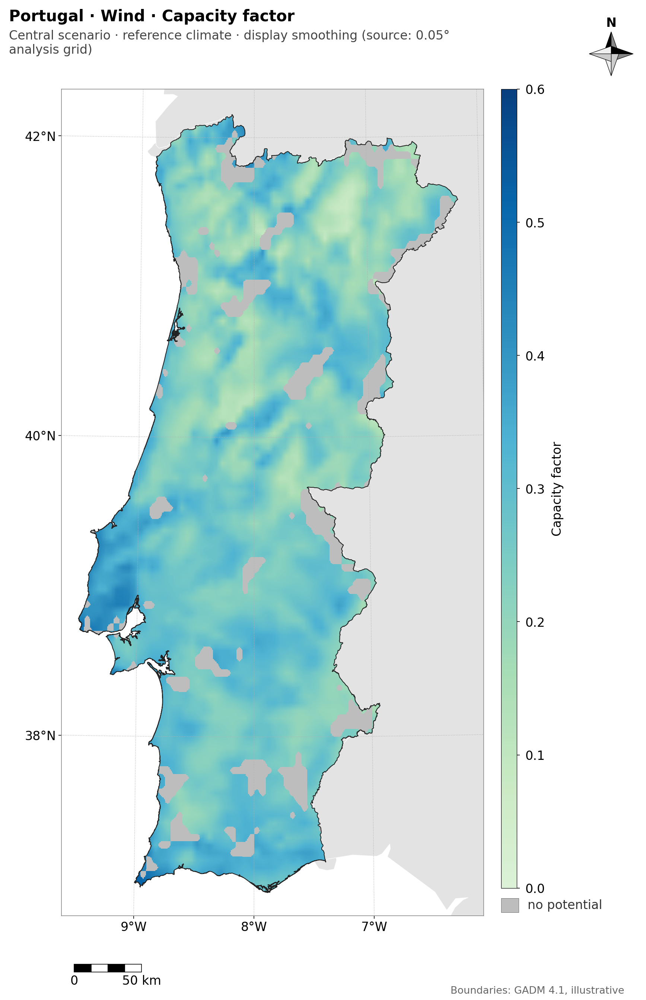
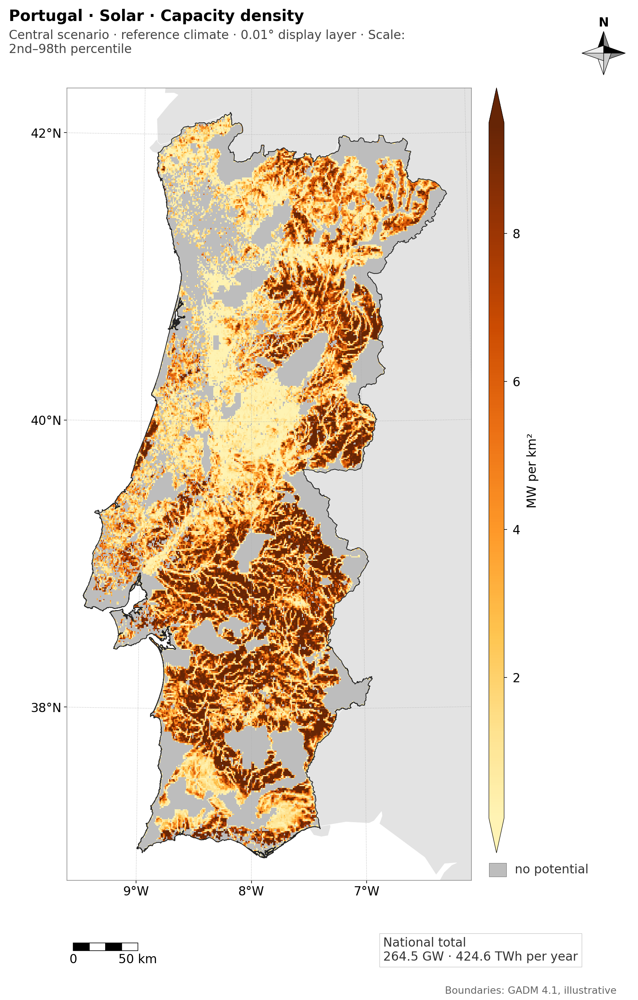
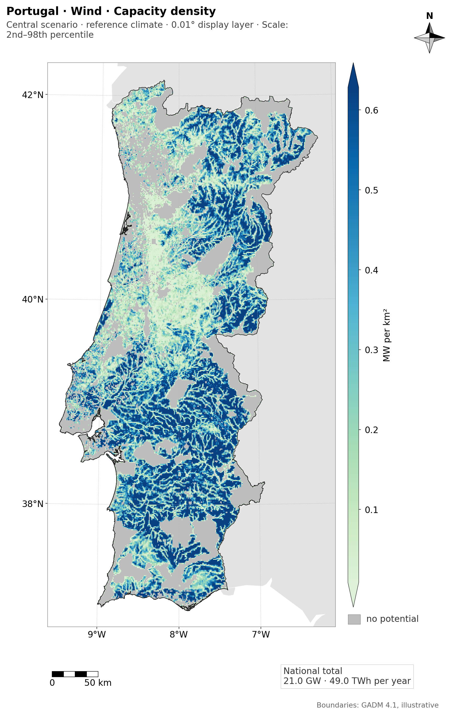

# Display layers of the real maps (COMMAND 70)

Branch `feat/display-layers-wiring`. Follows COMMAND 67b (D-core-047). Nothing in the analysis changes: no total, no LCOE, no analysis artifact.

## What changed

`potential_maps` now builds the 0.01° display layers itself (`display_layers.ensure_display_layers`), for each technology, when `figures: all`:

1. **The rule.** It counts the image pixels of one 0.05° cell on the thesis map of the country (`MapFigure.px_per_cell`). Above 4 the layers are built; otherwise none is, and a layer of an earlier build is removed. BRA (1.6 px) and IND do not ask for them; PRT (11.8 px) does.
2. **The inputs.** Pixels: the F2b resource rasters named in the registry (`resource_layers`: PVOUT, or Weibull A, k and air density at the three heights) and the F3 `eligible_fraction_<tech>.tif`. Parameters: the F5 `ResolvedTechnology` of the run (the same model, curve, `eta_loss`, `hub_height_m`, land-use factor and power density that F5 used). Analysis side: the F3 cell table and the F5 table of the reference member, central scenario.
3. **The check** (as in 67b): capacity factor aggregated back to the 0.05° cell, weighted by the eligible area, within 1% in every cell; eligible area and capacity density exact (1e-6).
4. **Refusal, by layer.** A layer that depends on a failed check is removed (`display_layers_<tech>.json` lists it in `refused`) and its map goes back to the declared smoothing of the 0.05° grid. Dependencies: the CF check covers `capacity-factor` and `energy-density`; the area check covers all layers; the capacity-density check covers `capacity-density` and `energy-density`. With a failed area check nothing is drawn.

`PotentialMapsSummary.display_layers` and `potential_maps.json` say what happened per technology.

## PRT, real data

| Technology | Layers built | Checks (max difference, limit) | Maps |
|---|---|---|---|
| Solar | 4 of 4 | CF 4e-16 (1%); eligible area 0 (1e-6); capacity density 5e-16 (1e-6) | CF, capacity density and energy density: `0.01° display layer`, 2.3 to 2.4 px per cell, no smoothing |
| Wind | 2 of 4 (`eligible-fraction`, `capacity-density`) | CF **0.0196 (1%): refused**; eligible area 0; capacity density 5e-16 | capacity density: `0.01° display layer`, no smoothing. CF and energy density: back to `display smoothing (source: 0.05° analysis grid)`, 11.4 to 11.8 px per cell |

| Solar CF | Wind CF (layer refused, smoothed 0.05°) |
|---|---|
|  |  |
|  |  |

### Why the wind CF layer fails

The CF of a cell in F5 is the model applied to the eligible-area-weighted *mean* of the Weibull A, k and air density of its pixels (F3 `aggregate_to_cells`). The 0.01° layer applies the model to each pixel and the check averages the results. The wind model is not linear in A and k, so the two differ; solar (linear in PVOUT) agrees to rounding. Over 3500 cells of PRT: median 0.03%, 95th percentile 0.4%, 99th 0.77%, and **16 cells (0.46%) above 1%**, the worst at 1.96%. This is a real property of the analysis, not an error of the layer, and the limit was not changed. A different limit (for example the 99th percentile of the cells, or 2%) is a decision for the author; see D-F5-035.

## Cleanup (step 1)

- `docs/figures/display_resolution_67b/` (8 PNG) was moved to `GEOFREA_DATA_DIR/archive/docs_figures_67b/` and removed from the repository; `display_resolution_67b.md` names the file of each image instead of linking it, and says they are archived.
- Other folders of report images created in `docs/` by COMMANDS 56 to 70, **listed, not removed**:

| Folder | PNG | Command |
|---|---|---|
| `docs/_audit/2026-10_data_diagnostics_figures/` | 9 | data diagnostics (2026-10-14) |
| `docs/phases/core/coverage_alignment_54/` | 12 | 54 |
| `docs/phases/F5/potential_maps_v2/` | 8 | 58, 60 |
| `docs/phases/F5/potential_maps_absolute/` | 2 | 58, 60 |
| `docs/phases/F5/audit_potential_65/` | 3 | 65 |
| `docs/figures/examples/` | 6 | 67, 67b (the examples of the style guide; kept by design) |
| `docs/figures/migration_68/` | 8 | 68 |
| `docs/figures/display_layers_70/` | 4 | 70 (this report) |

## Pending items (recorded in PROGRESS.json and the inventory)

- Migration of the F8 thesis figures (`results_synthesis`) and of the audit charts (`scripts/audit_potential.py`) to `viz/`.
- F6 and F7 figures: checked only on synthetic data; to check on the first real run.
- Supply curve against LCOE, after F6.
