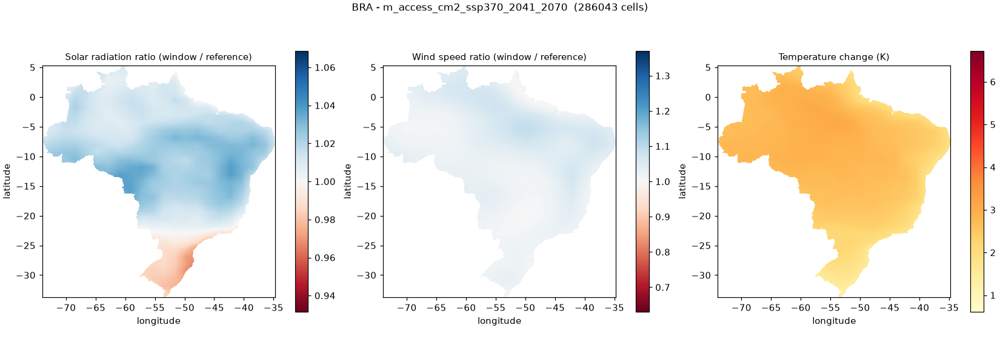
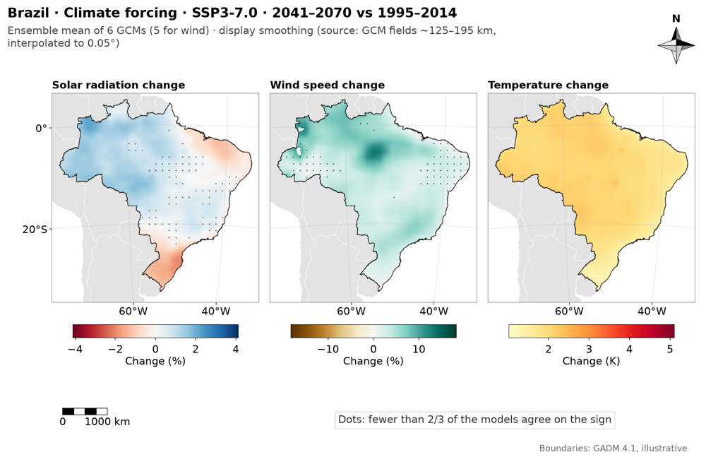
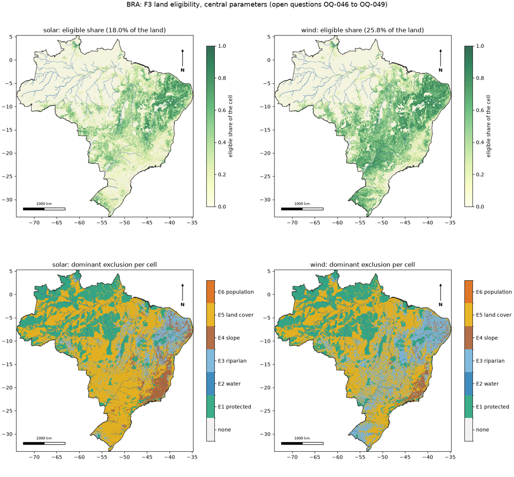
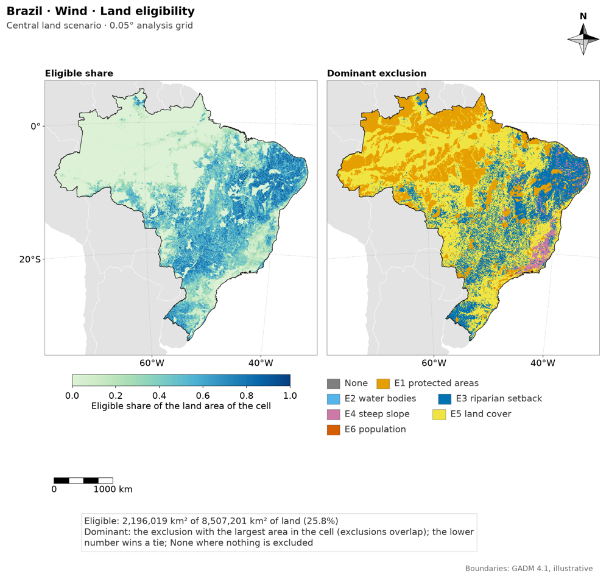
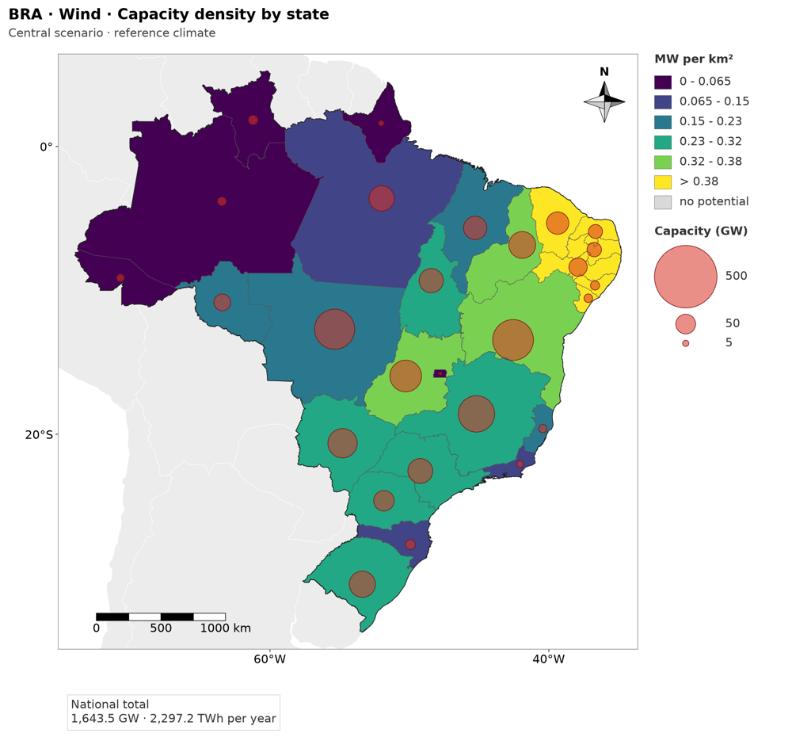
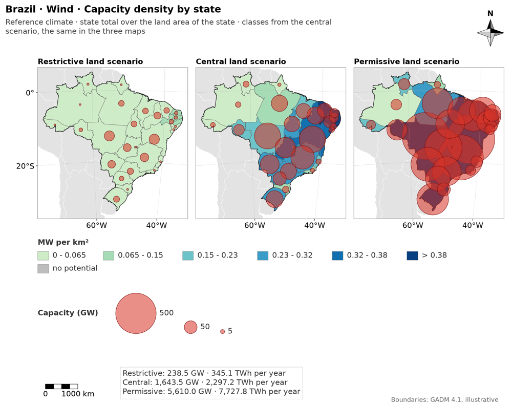
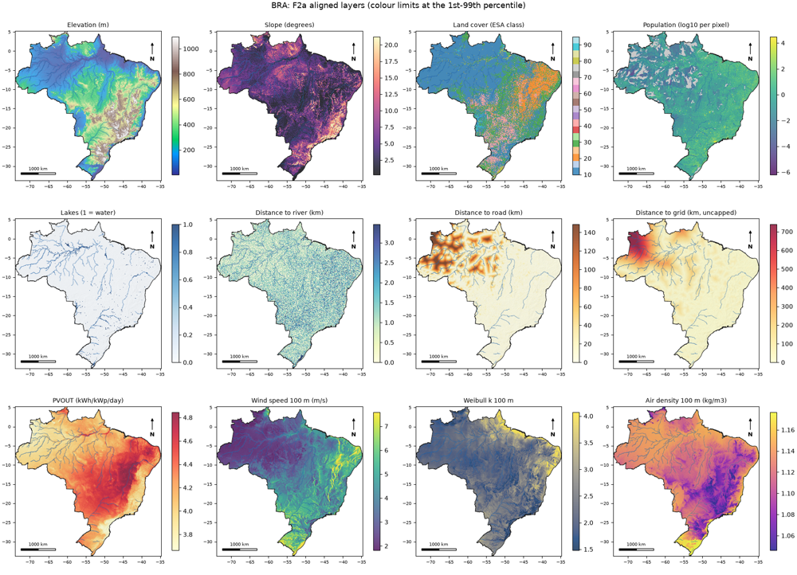
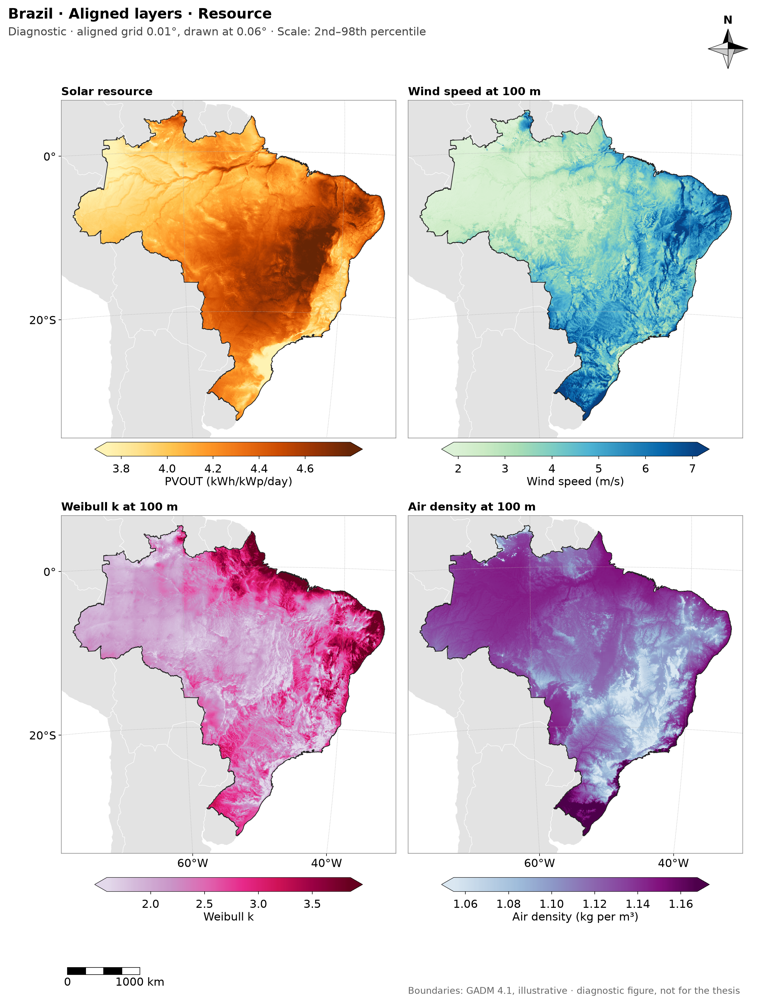

# Figure migration to MapFigure (COMMAND 68)

Branch `feat/figures-migration`, merged into `main`. Every figure the pipeline draws now goes through `viz/` (MapFigure, PanelFigure, charts) and the three real countries were redrawn. Spec v2 items T-09 to T-12 (section 4); the rules of the common style are in `docs/figures/style_guide.md`.

## 1. What changed, by family

| Family | Phase | Figures now | What the migration added |
|---|---|---|---|
| F5 potential | `potential_maps` | per technology: capacity density, energy density, capacity factor of the cells; per state a sheet of the three land scenarios with classes taken from the data and circles of the state totals (legend derived from the data); ranked bars with the range of the scenarios | standard names and metadata; the denominator is declared (land area of the state); classes shared by the three scenarios; at least 2 admin units are required (`MIN_UNITS`) |
| F4 climate forcing | `climate_maps` | one sheet per SSP and window (ensemble mean of the three variables), one grid sheet per variable (SSP x window, one shared scale), one figure per member under `members/` (supplementary) | ratios shown as percent change, temperature in K, dots where fewer than 2/3 of the models agree on the sign, note with the native resolution of the GCMs |
| F3 eligibility | `overview` | one sheet per technology with the discrete classes E1-E6 plus "eligible", one stacked-bar chart of the contribution of each exclusion, diagnostic maps of the excluded share of each rule under `layers/` | colours per technology, the "dominant" rule is documented (`land_eligibility/figures.py::DOMINANT_RULE`), the denominator is declared, fine layer checked against the cells |
| F2a layers, F4 hazard | `overview` | aligned layers (3 sheets), land cover, hazard context, distance maps | marked as diagnostic |
| F6 / F7 | `lcoe_maps`, `robustness_maps` | LCOE and robustness maps, supply curve | same style, marked diagnostic; no real run exists, so only the synthetic country exercises them |

Not migrated: F8 (`results_synthesis`) keeps its own style module (thesis tables and charts, authorised exception of the static test), and `scripts/audit_potential.py` keeps its audit charts. The static test `tests/unit/test_no_maps_outside_mapfigure.py` allows `matplotlib.pyplot` only in `viz/`, in those two places.

## 2. Figures by country and phase (after)

Every country has the same set, because the figure code takes everything from the data. The folders hold only the current set; the previous files are in `GEOFREA_DATA_DIR/archive/figures_20261026/<ISO3>/<phase>/figures/` (moved by `scripts/archive_figures.py`, never deleted).

| Country | `climate_forcing/figures` | `technical_potential/figures` | `overview/figures` (+ `layers/`) |
|---|---|---|---|
| BRA | 36 -> 45 | 18 -> 14 | 19 -> 22 |
| PRT | 36 -> 45 | 18 -> 14 | 20 -> 22 |
| IND | 36 -> 45 | 18 -> 14 | 20 -> 22 |

(`before -> after`, PNG files; each folder also has `figures_index.json`.)

File list (identical for PRT and IND with the country code changed):

- `climate_forcing/figures`: 9 sheets and `members/` with 36 member figures (one per GCM, SSP and window)
  - `BRA_F4_climate-forcing-grid_solar.png`
  - `BRA_F4_climate-forcing-grid_temperature.png`
  - `BRA_F4_climate-forcing-grid_wind.png`
  - `BRA_F4_climate-forcing_SSP1-2.6_2041-2070.png`
  - `BRA_F4_climate-forcing_SSP1-2.6_2071-2100.png`
  - `BRA_F4_climate-forcing_SSP3-7.0_2041-2070.png`
  - `BRA_F4_climate-forcing_SSP3-7.0_2071-2100.png`
  - `BRA_F4_climate-forcing_SSP5-8.5_2041-2070.png`
  - `BRA_F4_climate-forcing_SSP5-8.5_2071-2100.png`
- `technical_potential/figures`: 14 files
  - `BRA_F5_capacity-density_ranking_solar_land-scenarios_ref.png`
  - `BRA_F5_capacity-density_ranking_wind_land-scenarios_ref.png`
  - `BRA_F5_capacity-density_solar_central_ref.png`
  - `BRA_F5_capacity-density_state_solar_land-scenarios_ref.png`
  - `BRA_F5_capacity-density_state_wind_land-scenarios_ref.png`
  - `BRA_F5_capacity-density_wind_central_ref.png`
  - `BRA_F5_capacity-factor_solar_central_ref.png`
  - `BRA_F5_capacity-factor_wind_central_ref.png`
  - `BRA_F5_energy-density_ranking_solar_land-scenarios_ref.png`
  - `BRA_F5_energy-density_ranking_wind_land-scenarios_ref.png`
  - `BRA_F5_energy-density_solar_central_ref.png`
  - `BRA_F5_energy-density_state_solar_land-scenarios_ref.png`
  - `BRA_F5_energy-density_state_wind_land-scenarios_ref.png`
  - `BRA_F5_energy-density_wind_central_ref.png`
- `overview/figures`: 22 files
  - `BRA_F2a_aligned-layers_distances.png`
  - `BRA_F2a_aligned-layers_resource.png`
  - `BRA_F2a_aligned-layers_terrain-and-land.png`
  - `BRA_F2a_land-cover.png`
  - `BRA_F3_exclusion-contribution_central.png`
  - `BRA_F3_land-eligibility_solar_central.png`
  - `BRA_F3_land-eligibility_wind_central.png`
  - `BRA_F4_hazard-context.png`
  - `layers/BRA_F2b_distance_grid.png`
  - `layers/BRA_F2b_distance_road.png`
  - `layers/BRA_F3_excluded-share_E1-protected_solar_central.png`
  - `layers/BRA_F3_excluded-share_E1-protected_wind_central.png`
  - `layers/BRA_F3_excluded-share_E2-water_solar_central.png`
  - `layers/BRA_F3_excluded-share_E2-water_wind_central.png`
  - `layers/BRA_F3_excluded-share_E3-riparian_solar_central.png`
  - `layers/BRA_F3_excluded-share_E3-riparian_wind_central.png`
  - `layers/BRA_F3_excluded-share_E4-slope_solar_central.png`
  - `layers/BRA_F3_excluded-share_E4-slope_wind_central.png`
  - `layers/BRA_F3_excluded-share_E5-land-cover_solar_central.png`
  - `layers/BRA_F3_excluded-share_E5-land-cover_wind_central.png`
  - `layers/BRA_F3_excluded-share_E6-population_solar_central.png`
  - `layers/BRA_F3_excluded-share_E6-population_wind_central.png`

## 3. Before and after, Brazil (one figure per family)

| Family | Before (archived file) | After |
|---|---|---|
| F4 |  one member, one SSP, three panels, scale per panel |  |
| F3 |  eligibility of two technologies in one image |  |
| F5 |  one scenario per image, classes of each image |  |
| F2a |  twelve panels in one image |  |

The images are shrunk to 1000 px for this report; the files in `outputs/` are at the preset size (thesis, 190 mm, 300 dpi).

## 4. Time of the figure phases (seconds, this round)

| Country | `climate_maps` | `potential_maps` | `overview` |
|---|---|---|---|
| BRA | 615 | 125 | 105 |
| PRT | 290 | 60 | 79 |
| IND | 678 | 149 | 108 |

The real display layers (0.01 degree) are still not built by a phase (`build_display_layers` is tested but not wired), so the maps of the cells use the masked smoothing declared in each subtitle where a cell has fewer than 4 pixels per cell.

## 5. Checks

- Full suite green on every commit of the branch (one worktree run per commit).
- The 80 files of the round, in the content hashes of the manifest (D-core-042; the file of byte hashes `run_real_hashes.json` was removed on 2026-10-27) hash as before for the three countries: only figures were redrawn.
- PNG files carry the metadata of the figure (country, phase, variable, status), and `figures_index.json` lists them per folder.

## 6. Limits

- F6 and F7 have no real run, so their figures were checked only on the synthetic country.
- F8 is not migrated (see section 1).
- A country whose admin1 layer has a single unit cannot get the state sheet; the phase fails with the reason.
- The overview of F3 draws the layers under `layers/` with the same style but each as a diagnostic, not a thesis figure.
