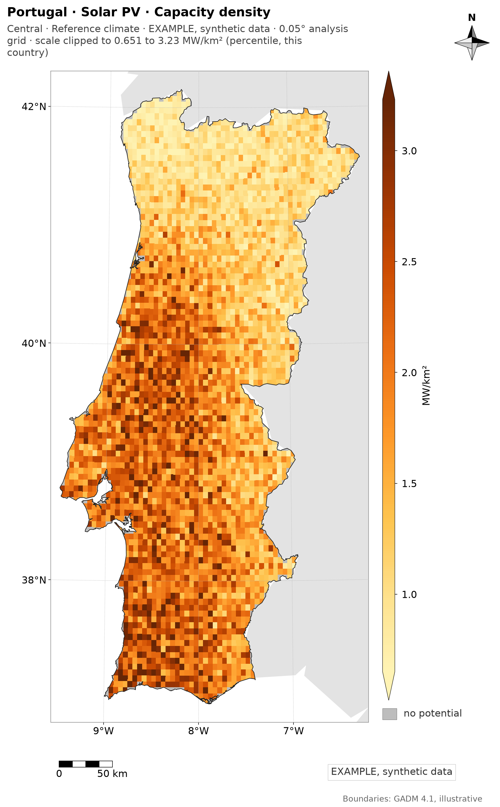
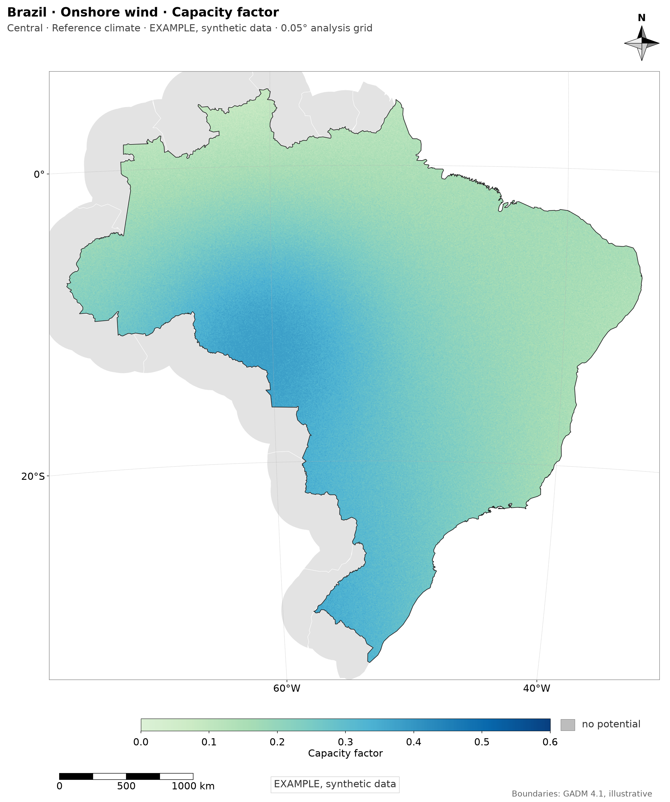
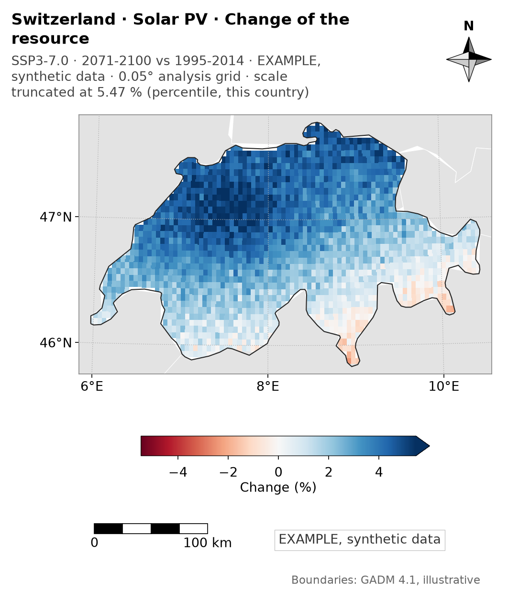
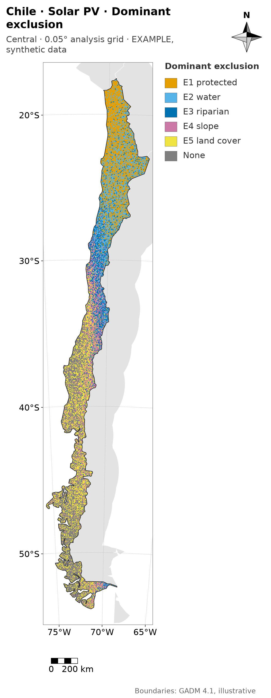
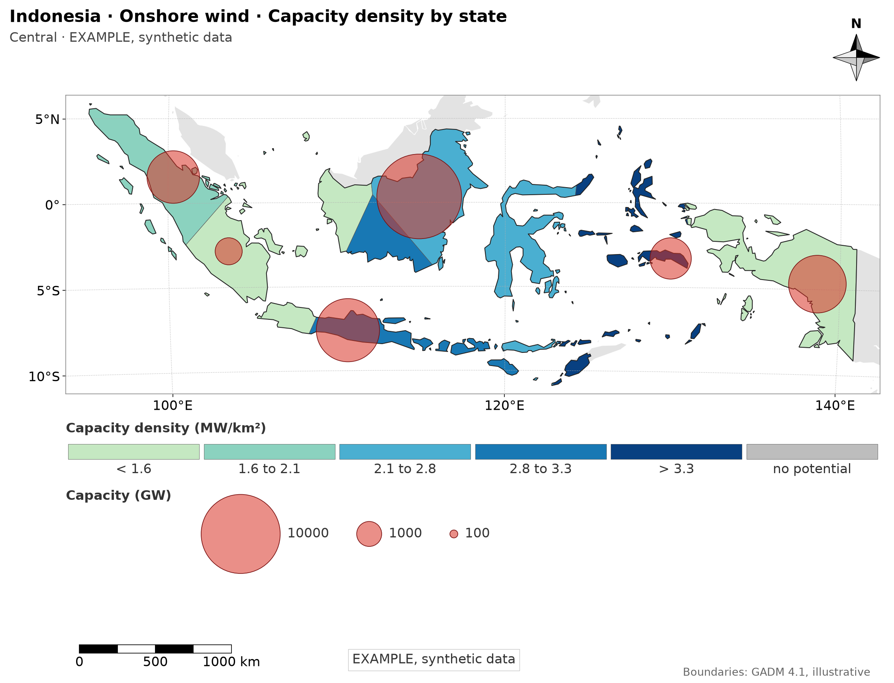
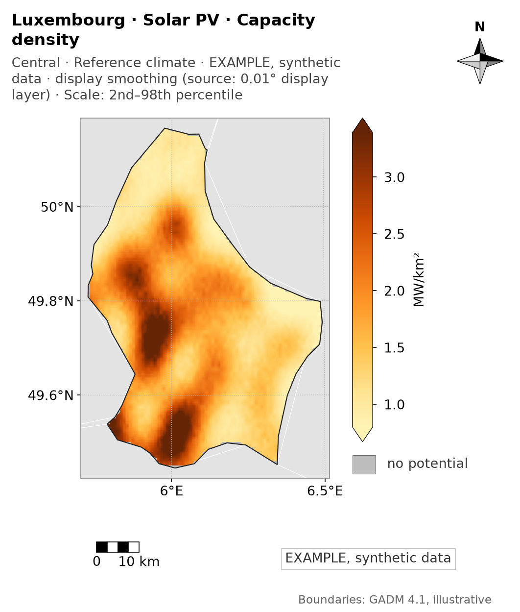

# Map style guide (COMMANDS 56 and 66)

One module draws every map: `src/geofrea/viz/mapstyle.py`, whose figure is `MapFigure` (`MapCanvas` is the earlier name, kept as an alias). No module of a phase draws a map on its own. The examples below are drawn by `scripts/make_style_guide_examples.py` from real geometries with synthetic data, not from results. **No figure under `GEOFREA_DATA_DIR/outputs/` was redrawn by COMMAND 66**; the maps of F5 change (palette, subtitle, title, file name) when their phase runs again (`docs/phases/core.md`, D-core-045).

| Density (PRT, thesis) | Capacity factor (BRA, thesis) | Change of the resource (CHE, article_single) |
|---|---|---|
|  |  |  |

| Dominant exclusion (CHL, thesis) | Density by state (IDN, thesis) | Density (LUX, article_single) |
|---|---|---|
|  |  |  |

The examples are real simplified geometries (`tests/fixtures/archetypes`) with **invented data**, marked `EXAMPLE, synthetic data` in the subtitle and in the box of totals; they say nothing about the countries.

## Layout: one fixed grid

From the top: **header** (title in bold and subtitle in grey at the left; eight-point compass rose at the right, outside the map), **map** (aspect and size from the country, no dead space), **legend** (a colour bar of the height of the map to the right of a tall map; below a wide one; named patches for classes) and **footer** (scale bar at the left, box of totals in the middle or at the right, source at the right). The elements never go looking for an empty corner, so the three countries have the same layout. When the footer does not fit on one row (a half column) the next element starts a row below (`plan_footer`); the title, the subtitle and the box of totals are wrapped to the room they have.

| Preset | Width | Title | Labels and legend | Footer |
|---|---|---|---|---|
| `thesis` | 190 mm | 10 pt | 8 pt | 6.5 pt |
| `article_single` | 90 mm | 8 pt | 6.5 pt | 5.5 pt |
| `article_double` | 180 mm | 9 pt | 7 pt | 6 pt |
| `slide` | 254 mm | 16 pt | 12 pt | 9 pt |

Fonts are in points at the final print size (the figure has its exact size; an overlay axes with 1 unit = 1 mm carries the furniture). PNG only, 300 dpi, no `bbox_inches="tight"`; one family (DejaVu Sans). The height follows the aspect of the extent (at most 230 mm). Extent from the contiguous territory of the country plus 3%; geographic aspect `1 / cos(central latitude)`; neighbours in very light grey; degrees as `40°S`. Scale bar at the central latitude, rounded to 1, 2 or 5 x 10^n km.

## Projection, clip, context (COMMAND 67)

- **Projection.** The map is drawn in a Lambert azimuthal equal-area projection centred on the centroid of the country (`make_frame`, `pyproj`), for drawing only: the areas of the analysis are computed on the sphere elsewhere. The frame is the projected country plus 3% (or the bounds of a given lon/lat `extent`); the axes are equal, in metres; the scale bar is measured in this projection (`scale_bar_length_km(width_km=...)`), rounded to 1, 2 or 5 x 10^n km; the graticule is in degrees, thin and dotted, labelled where it crosses the left and the bottom edge.
- **Raster and clip.** `canvas.draw_raster` copies a lon/lat grid into the frame cell by cell (`reproject_nearest`: each pixel takes the cell that contains its centre, nothing is interpolated; `interpolation="nearest"`, rasterised, about 200 dpi on paper) and **clips the image by the polygon of the country**, so the coast and the border are the vector line and never the staircase of the 0.05 degree cells. A cell whose centre is outside the country is simply not there. The test paints a single colour over a grid that reaches beyond Portugal and checks that no coloured pixel is more than 1.5 pixels from the outline, with a control without the clip that fails it.
- **Context.** Neighbouring countries in light grey (`#e3e3e3`) within 2.5 degrees of the border, the sea white; the part of the country without value in the grey of "no potential" (`#bdbdbd`, `fill_country`), with **its own entry** in the legend (`no_data_label`; beside the colour bar, never over it); footer `Boundaries: GADM 4.1, illustrative`. **Locator inset** (the country among its neighbours within 10 degrees, same projection) only when `locator=True`, which is for the overview figures.
- **Width.** A very tall country (Chile) gets a narrower figure, not a wide empty band at each side: `fitted_width_mm` (never below 42% of the preset width and 80 mm).

## Resolution (T-06)

The grid of the analysis stays 0.05 degree in every country. Results of the analysis (potential, capacity factor per cell, density) are drawn at that resolution and **the subtitle says so** (`resolution_note(cell_deg=0.05)` gives `0.05° analysis grid`; a finer display layer says `0.01° display layer`); a descriptive layer that exists at a finer resolution is drawn at its native resolution and says so (`resolution_note(native_m=30)`). The text goes into the PNG too (`geofrea_resolution`). Whether the results change with another cell is **OQ-064**, for after F7 (`docs/OPEN_QUESTIONS.md`).

## Display resolution (COMMAND 67b)

`MapFigure` counts the image pixels per cell (`px_per_cell`; the metadata `display_px_per_cell`). Above 4: (1) the 0.01 degree display layer of the same descriptive quantity is drawn when there is one (`display_layer=`; `0.01° display layer` in the subtitle); (2) if a cell is still above 4 pixels, or the field comes from a GCM (`coarse_source=True`), a continuous field is interpolated bilinearly with its mask (`display_smoothing="auto"`; `"off"` never) and the subtitle says `display smoothing (source: 0.05° analysis grid)`. Classes, categories and states are never smoothed. The scale note is `Scale: 2nd–98th percentile`, `Scale: fixed` or `Scale: shared` and appears only when the scale cuts values; the limits are in `geofrea_scale_limits`. Neighbours are cut by the rectangle of the map. Before and after: `docs/figures/display_resolution_67b.md`.

## Country archetypes (T-13)

`geofrea.viz.examples.archetype_country(iso)` and `archetype_figure(country, kind)` draw the five kinds of figure (`density`, `capacity_factor`, `forcing`, `eligibility`, `state`) on six real geometries, simplified (`tests/fixtures/archetypes/<ISO3>.geojson`, 6 to 104 kB, `scripts/make_archetype_fixtures.py`: GADM 4.1 mainland of PRT and BRA, Natural Earth 1:50m for the others): PRT (tall and narrow), CHL (very tall and narrow), BRA (wide), CHE (compact), IDN (fragmented, all islands), LUX (tiny). The data are synthetic: smooth trends and noise on the 0.05 degree grid and invented states (Voronoi cells). The same code, with no adjustment by country, passes the checks of `tests/unit/test_mapstyle_archetypes.py`.

## Colour: one place, one meaning

`mapstyle.colormap_for(kind, tech)` and `default_scale(kind, tech)` are the only places where a variable gets its colormap and its scale.

| Variable | Colormap | Default scale | Scope |
|---|---|---|---|
| Solar: capacity factor, density, energy | `YlOrBr` from 15% | CF fixed 0.10 to 0.25; density and energy at P2 to P98 | CF the same in every country; the others per country |
| Wind: the same | `GnBu` from 15% | CF fixed 0 to 0.60; density and energy at P2 to P98 | the same |
| Eligible share (F3) | the family of the technology | fixed 0 to 1 | shared across countries |
| Excluded share (F3) | `Reds`, only in diagnostic figures, never beside a map coloured by technology | fixed 0 to 1 | shared across countries |
| Change of solar resource, of wind resource | `RdBu`, `BrBG`, centred on 0 (or on 1 for a ratio) | symmetric, percentiles of the data | per country; `shared` between SSPs |
| Change of temperature | `YlOrRd` | percentiles | per country |
| Classes (E1 to E6, land cover) | Okabe-Ito without green (`CLASS_COLOURS`), neutral grey for "none"; named patches, never a colour bar | | |

The sea is white, the neighbours `#e3e3e3`, "no potential" `#bdbdbd`: three different things, three colours that differ by more than 8 CIE76 units (13.6 between the last two). Solar and wind are never `viridis`. **A colour never has two meanings in one figure:** `MapFigure.use_colour` and `use_cmap` record what each colour means (the sea, the neighbours, every class patch, every colour bar) and refuse a repetition with another meaning; `colour_conflicts` also compares the colours under deuteranopia and protanopia (Machado, Oliveira and Fernandes 2009, severity 1, CIE76 distance at least 8).

## Scales

`ScaleSpec(mode, limits, percentiles, scope)`: `fixed` (physical limits), `percentile` (of the values drawn) or `shared` (`shared_limits` over the maps that are compared: scenarios, SSPs, countries; a small multiple must share). `scope` is `per_country` or `shared_across_countries`. A logarithmic or power norm is chosen by skewness (P98 / P50 above 20). The colour bar `extend` follows the data against the limits that were used (an arrow where, and only where, values go beyond). **A clip is declared:** the subtitle ends with `scale truncated at 10 MW/km² (fixed, this country)` or `scale clipped to 0.1 to 0.25 (fixed, shared across countries)`; mode, scope and limits are also in the PNG.

## Titles and labels

Title `Country · Technology · Variable`; subtitle `Scenario · Climate` (`format_subtitle`), the country by its name in English or Portuguese (`country_name`, `lang="en"|"pt"`; the title never has the ISO3 code), the technology left out when the map has none. Box of totals `Total: X GW · Y TWh/yr · mean CF Z% · eligible area W km²` (`totals_text`). Footer source `Boundaries: GADM 4.1, illustrative`. **Forbidden in every text of a map** (`validate_label`, tested with a regex): open-question and decision ids (`OQ-046`, `D-F5-031`, `L-047`), raw model names (`m_access_cm2_ssp370_2041_2070`, `ssp370`), snake_case identifiers, counts of cells, and the known typos (`LABEL_TYPOS`; a test greps `src/` for them). Units are `MW/km²` and `GWh/km²/yr`, never `per cell` for a density. The names are in `config/country_names.yaml` (outside the configuration fingerprint); a country that is not there needs `country=`.

## File names, metadata and index

`figure_filename(iso, phase, variable, technology, scenario, climate)` writes `{ISO3}_{phase}_{variable}_{technology}_{scenario}_{climate}.png`, leaving out the fields that do not apply (never `na`, never empty), with the ISO3 code always there (three countries never collide) and readable slugs, no hash:

- `BRA_F3_excluded-share_E5-land-cover_wind.png`
- `BRA_F4_forcing_ACCESS-CM2_SSP3-7.0_2041-2070.png`
- `PRT_F5_capacity-factor_wind_central_ref.png`

`save_png` writes in the text chunks of the PNG (`PIL.Image.text`): `Title`, `Description` (the subtitle), `geofrea_commit`, `geofrea_config_hash` (SHA-256 of `config/parameters.json`, 12 digits), `geofrea_date`, `geofrea_preset`, `geofrea_scale_mode`, `geofrea_scale_scope`, `geofrea_scale_limits`, `geofrea_scale_norm`, `geofrea_scale_extend` and what the caller adds (`{"grid": "0.05 degree analysis grid", "data_source": "..."}`). There is no sidecar per figure: `write_figures_index(folder)` writes one `figures_index.json` (file, size, SHA-256, title, subtitle, metadata, and the list of names off the standard).

## Use

```python
from geofrea.viz import mapstyle as ms

canvas = ms.raster_map(
    grid, grid_extent, country_geometry,   # grid: 2-D array, NaN = no data; geometry in lon/lat
    iso="PRT", technology="Onshore wind", variable="Capacity factor",
    label="Capacity factor", kind="capacity_factor", tech="wind",
    scenario="Central", climate="Reference climate",
    total_text=ms.totals_text(capacity_gw=264.5, energy_twh=400.0, mean_cf=0.17, eligible_km2=31_000),
    preset="thesis", neighbours=neighbours_gdf,
)
ms.save_png(
    canvas, out / ms.figure_filename("PRT", "F5", "capacity-factor", "wind", "central", "ref"),
    {"grid": "0.05 degree analysis grid", "data_source": "F5 potential_wind__central"},
)
ms.write_figures_index(out)
```

`new_map(...)` gives the axes (`canvas.ax`), the legend slot (`canvas.cax`) and the header and footer without drawing data, for classes or choropleths: draw on `canvas.ax` and call `draw_classed_legend(canvas, ms.qualitative_legend(title, labels, none_label))`. For maps that are compared, compute `limits = ms.shared_limits(arrays, spec)` and pass `shared=limits` (with a `ScaleSpec` of scope `shared_across_countries`).

## Classed maps, circles and the resolution of the potential maps (COMMAND 60)

`draw_choropleth`, `draw_classed_legend` (`ClassedLegend`), `circle_radius_mm`, `draw_circles` and `nice_values_below` draw the choropleth with classes and the circles whose **area** is proportional to a total (the largest, 9 mm of radius, is the reference total of the quantity; the legend shows three round values). The classes come from the data (`absolute_maps.class_breaks`), the same in every map of a variable; the legend lists the intervals (the last one open) and a "no potential" entry.

**Resolution.** The cell of the analysis is 0.05 degree and the maps of F5 draw one pixel per cell with `interpolation="nearest"`: nothing is interpolated, smoothed or resampled. The coarse look of a small country is the real resolution of the analysis, not a defect of the figure. Per cell the maps show the density (MW per km2, GWh per km2 per year) over the land area of the cell; per state, the density over the land area of the state, and the circles are the totals. Neighbours come from Natural Earth 1:50m (`scripts/acquire_natural_earth.py`).

## Limits of this version

- One map per figure; the overview and F4 figures with several panels need a panel layout that is not written, nor the ensemble mean with the hatching of the agreement of the sign (T-09), the relief shading (T-06.5) and the administrative outlines of a coarse country (T-06.6). The geometry of the archetypes outside GADM is Natural Earth (CHL, CHE, IDN, LUX).
- The producers of F5 write the old file names until their phase runs again; the grid and data source are not yet passed to `save_png` by the phases.
- Text widths used to size the furniture before drawing are an estimate (0.62 em per character, 0.68 for the bold title); the tests measure the real boxes.
- Fonts depend on the DejaVu Sans that ships with matplotlib.

## Tests

- `tests/unit/test_mapstyle.py`: extent, aspect, degrees, norms, scale-bar lengths, layout side, PNG size and dpi, fonts; **overlap** (the real boxes of the title block, legend, tick labels, compass, scale bar, totals and source do not meet each other, stay inside the figure and out of the map, in the four presets and the three synthetic countries); the furniture has the same offsets in a tall, a wide and a small country; footer packing; a long total in a half column; perceptual-hash regression of the three synthetic maps (`tests/fixtures/mapstyle/hashes.json`; to refreeze after an intended change: `GEOFREA_UPDATE_MAPSTYLE_BASELINES=1 pytest tests/unit/test_mapstyle.py`, then look at the examples).
- `tests/unit/test_mapstyle_classed.py`: circles, legends, overlap and regression of the state maps.
- `tests/unit/test_mapstyle_palette.py`: colormap per variable, no `viridis` for technologies, the colormaps that appear together differ for every vision, class colours without green apart under deuteranopia and protanopia, one colour never with two meanings, fixed, percentile and shared scales, extend, the clip declared in the subtitle and in the metadata.
- `tests/unit/test_mapstyle_titles.py`: title pattern and country names, refusal of ids, cell counts and typos in every text, totals box, languages, grep of the typos over `src/`.
- `tests/unit/test_mapstyle_files.py`: file names (the three examples of the spec, no `na`, no empty field, no hash), PNG text chunks, no sidecar, `figures_index.json`.
- `tests/unit/test_mapstyle_geo.py`: the LAEA frame (centre, round trip, equal area, scale bar in the projection, graticule in degrees), the nearest reprojection copies the cell that contains each pixel, the clip (no data pixel outside the coast, no hole inside, control without clip), no smoothing, the entry and the grey of "no potential", neighbours within the buffer only, the locator inset only when asked, the resolution in the subtitle and the metadata, the narrow figure of a tall country.
- `tests/unit/test_mapstyle_archetypes.py`: for each of the six archetypes and the five kinds of figure (30 figures): no overlap between the real boxes of the title, legend, colour bar, tick labels, compass, scale bar, totals, source, entry and inset; nothing cut; the country fills its frame; no band between the map and its legend; furniture at the standard place and at the same offsets in all six countries; perceptual-hash golden (`tests/fixtures/archetypes/hashes.json`, refrozen with `GEOFREA_UPDATE_MAPSTYLE_BASELINES=1`); the synthetic Portugal without a staircase on the coast.

## Several maps on one sheet and charts (COMMAND 68)

`viz/panels.py::PanelFigure` puts several maps of one country on one sheet in the grid of `MapFigure` (shared or per-panel legends, circle legend, colour bar, dots for sign agreement). `viz/charts.py` draws the bar charts and curves that go with the maps (header, fonts and footer of a map; no compass, no scale bar). The figures of the diagnostic phases (F2a layers, F6, F7) carry the status `diagnostic` in their PNG metadata. See `docs/figures/migration_68.md`.

## Figures that answer the questions of the thesis (COMMAND 69; spec v2 T-15)

Drawn by the phase `potential_maps` (`technical_potential/question_figures.py`) when `figures: all`, in `technical_potential/figures/`, registered as its artifacts (`question_figure_keys`), with `status = thesis` in the PNG metadata. The country comparison is drawn after the countries of a run, once, into `outputs/comparison/figures/` (code `ALL` in the name); it uses the tables of every country that has them and the log names the ones left out.

| Figure | Name | Reading |
|---|---|---|
| Supply curve against the capacity factor (item 1), one for the capacity and one for the energy, per technology | `<ISO3>_F5_supply-curve-capacity_<tech>_land-scenarios_ref.png` | The cells from the highest capacity factor down, the cumulative value on the vertical axis, one line per land scenario with its total in the legend. **No resource cut**: every candidate cell is on the curve (the cut is the `CF_min` of group 4, applied downstream). The version against the LCOE comes after F6. |
| Interval of land availability (item 3) | `<ISO3>_F5_land-availability_land-scenarios_ref.png` | Three panels (eligible area, capacity, energy), one row per technology: the dot is the central scenario, the line goes from the restrictive to the permissive one, the three numbers are written beside the row. |
| Change of the capacity factor by SSP and window (item 4, map) | `<ISO3>_F5_change-capacity-factor_<tech>_central_ssp-window.png` | The ensemble mean of the GCMs of each SSP (rows) and window (columns) against the reference climate, in percent, one scale for all the maps, dots where fewer than 2/3 of the GCMs agree on the sign. The capacity of a cell does not depend on the climate member, so the energy of the cell changes by the same percentage: this is the change of the potential. |
| Change of the national energy (item 4, total) | `<ISO3>_F5_change-energy_central_ssp-window.png` | One row per SSP and window, one series per technology: the mean of the GCMs (dot) and the range from the smallest to the largest GCM (line), like for like (same cells in the reference and in the member). |
| Comparison of the countries (item 2) | `ALL_F5_comparison_<tech>_land-scenarios_ref.png` | The same four metrics for every country on the same axes: eligible share of the area, capacity density, energy-weighted capacity factor, change of the energy in the last window by SSP. The metrics are per **area of the cells of the country**, so that a large country does not dominate; the capacity-factor axis is the same for the countries (decision 5 of the author). |
| Supply curves of the countries per area | `ALL_F5_supply-curve-per-area_<tech>_land-scenarios_ref.png` | The central curve of every country in MW per km² of the cells of the country on one capacity-factor axis, with the restrictive and the permissive curves as thin lines. |

Tools added to `viz/charts.py`: charts with several axes (`new_chart(grid=(rows, columns), panel_titles=...)`), `curves` (lines with a legend, the colour meaning of a line can be given), `interval_rows` (dot and line per row, offset series, a note per row). The scale bar of a map has a minimum length: when the map is so narrow that the bar is shorter than its two end labels, the next rounded length (1, 2 or 5) is used.

Tests: `tests/unit/test_question_figures.py` (order and total of the curves, the thinning, the axis, the range of the land scenarios, the mean and the range of the GCMs, the sheet of the change with its note and scale, the keys and names, the comparison with a missing country, the per-area denominator) and the end-to-end of the synthetic country.
