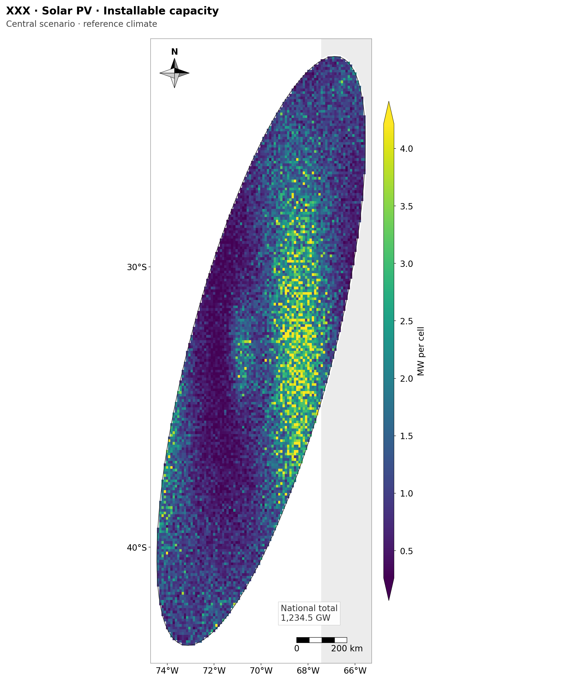
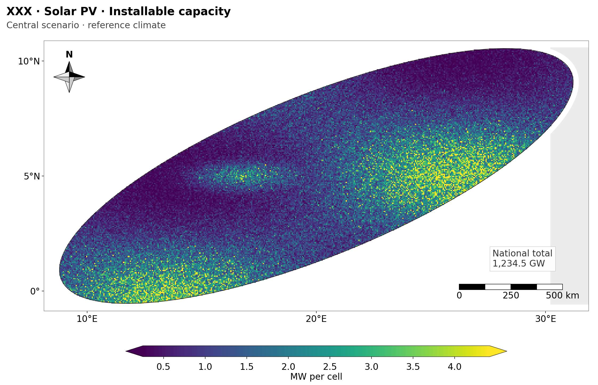
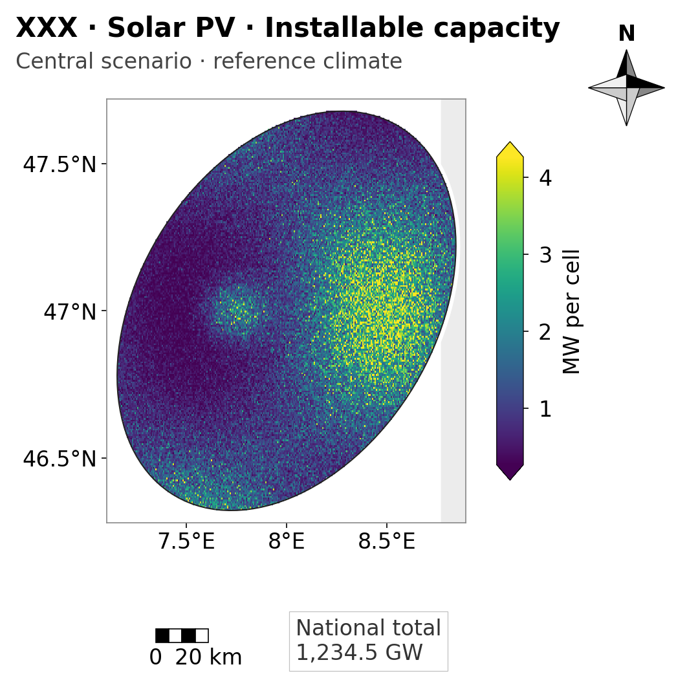

# Map style guide (COMMAND 56)

One module draws every map: `src/geofrea/viz/mapstyle.py`. This guide says what it does and why; the examples are drawn by `scripts/make_style_guide_examples.py` from invented countries (`src/geofrea/viz/examples.py`), not from results. No existing figure uses the module yet (`docs/figures/inventory.md`).

| Tall country, 190 mm | Wide country, 190 mm | Small country, 90 mm |
|---|---|---|
|  |  |  |

## Rules

| # | Rule | In the module |
|---|---|---|
| a | Print sizes in millimetres: 190 mm (full page) and 90 mm (half column). The height follows the aspect of the extent (at most 230 mm: a very tall country gets a narrower map in the same width). The legend goes to the right of a tall map (height over width above 1) and below a wide one. | `FULL_WIDTH_MM`, `HALF_WIDTH_MM`, `compute_layout`, `legend_position` |
| b | Fonts are set at the final print size: title 10 pt, labels 8 pt, legend 8 pt, one sans family (DejaVu Sans). The figure has its exact print size (an overlay axes with 1 unit = 1 mm), so a point is a point. Degrees read `40°S`, `50°W`. | `TITLE_PT`, `LABEL_PT`, `LEGEND_PT`, `format_degrees` |
| c | Geographic aspect for lon/lat maps: `1 / cos(central latitude)`. `imshow` resets the aspect to 1, so `raster_map` passes it to `imshow`. | `geographic_aspect`, `map_height_over_width` |
| d | The extent comes from the geometry of the country plus 3% on each side. The geometry is first reduced to the contiguous territory (METHODOLOGY 15.2.0: largest polygon plus the polygons touching it or within 1 km), so an ocean island (Trindade, Fernando de Noronha) never stretches the map. | `country_extent`, `contiguous_geometry` |
| e | Compass rose (8 triangles) and scale bar go to the corner of the map with the least occupancy: for each of the four corners, the share of the box that holds data pixels and the share that lies inside the country polygon; the larger counts. A corner is free at or below 1%. Elements may share a free corner (stacked). With no free corner the element goes outside the map (the compass at the right of the header, the others in a footer strip) and never over data. The scale bar is calculated at the central latitude, rounded to 1, 2 or 5 x 10^n km (the closest to 20% of the map width, so between 12% and 32%). | `place_furniture`, `occupancy`, `draw_compass`, `draw_scale_bar`, `scale_bar_length_km` |
| f | Neighbouring countries in very light grey (`#ececec`), the sea white. | `new_map(neighbours=...)` |
| g | One colormap per kind of variable, the same in every country: `viridis` for potential and energy, `magma` for capacity factor, `RdBu` (or `BrBG`) centred on zero for climate deltas (ratios centred on 1 with `diverging_center=1`). | `COLORMAPS`, `colormap_for` |
| h | Continuous variables: limits at the 2nd and 98th percentiles; a logarithmic norm when P98 / P50 is above 20 (a power norm with exponent 0.5 if the lower limit is not positive, as when many cells are zero); the colour bar gets `extend` arrows where values lie outside. Diverging variables are symmetric about the centre. | `robust_norm`, `NormInfo` |
| i | PNG only, 300 dpi, exact print size (no `bbox_inches="tight"`): 190 mm is 2244 px. | `save_png` |
| j | Titles are short: `<ISO> · <Technology> · <Variable>` (10 pt, bold). The scenario and the climate go on a second, smaller line (8 pt). The national total goes in a discreet text box in a free corner of the map, not in the title. | `format_title`, `new_map(subtitle=, total_text=)` |

## Use

```python
from geofrea.viz import mapstyle as ms

canvas = ms.raster_map(
    grid, grid_extent, country_geometry,          # grid: 2-D array, NaN = no data; geometry in lon/lat
    iso="BRA", technology="Solar PV", variable="Installable capacity",
    label="MW per cell", kind="potential",
    subtitle="Central scenario · reference climate",
    total_text="National total\n19,189 GW", width_mm=ms.FULL_WIDTH_MM,
    neighbours=neighbours_gdf,
)
ms.save_png(canvas, "potential.png")
```

`new_map(...)` gives the axes (`canvas.ax`), the legend slot (`canvas.cax`) and the title and furniture without drawing data, for classes or choropleth maps: draw on `canvas.ax` and fill `canvas.cax` with a legend.

## Limits of this version

- One map per figure. The overview and F4 figures with several panels (inventory section 1, items 2-4 and 1) need a panel layout that is not written.
- The 3% margin is applied to the contiguous territory; admin1 boundaries are not drawn by `new_map` (a choropleth draws its own units).
- Text widths used to size the furniture before drawing are an estimate (0.62 em per character); the tests measure the real boxes.
- Fonts depend on the DejaVu Sans that ships with matplotlib. A machine with another font set draws other pixel widths, so the visual regression allows a small difference (see below).

## Tests

`tests/unit/test_mapstyle.py` (44 tests):

- Extent without the far island, with 3%; aspect; degree labels; norms (linear, log, power, diverging, extend); colormaps; rounded scale-bar lengths; layout (right for tall, below for wide); PNG pixels and dpi; fonts.
- **Overlap**: for the tall, the wide and the small synthetic country, the real boxes of the compass, the scale bar and the total box (measured from the drawn artists, in millimetres) do not intersect the title, the legend (colour bar with its tick labels and name) or each other; those over the map have no data pixel and no polygon area under them; everything stays inside the figure.
- **Visual regression**: no `pytest-mpl` or `imagehash` is installed, so the test uses a 256-bit difference hash of the PNG (PIL and numpy) against `tests/fixtures/mapstyle/hashes.json` and allows 12 differing bits and 2 px of size. A removed compass changes the hash (checked). To refreeze after an intended change of the look: `GEOFREA_UPDATE_MAPSTYLE_BASELINES=1 pytest tests/unit/test_mapstyle.py`, then look at the three examples.
