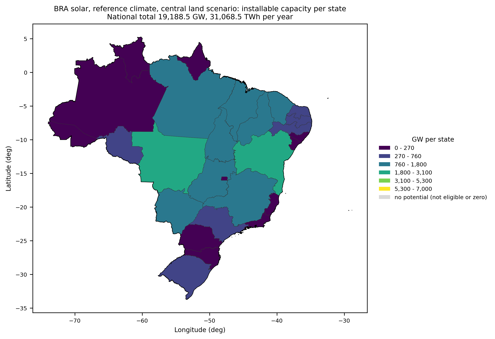
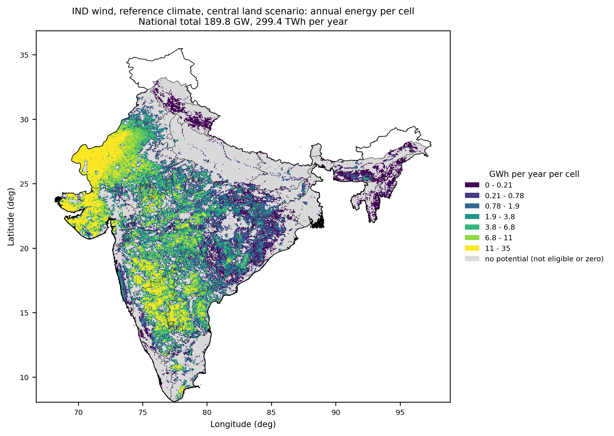

# Maps of the technical potential in capacity and energy (D-F5-029, 2026-10-19)

Written for Douglas. Phase `potential_maps`, METHODOLOGY 15.1.0 (M-F5-07). Results are those of the real run of 2026-10-19 on the F5 tables of 2026-10-18 (reference climate `m0`).

## 1. Audit before the change (read only)

* **Where the maps were made.** The phase `potential_maps` (`src/geofrea/technical_potential/maps.py`) wrote two COG rasters per technology (`potential_density_<tech>.tif`, `capacity_factor_<tech>.tif`) and two PNG (`potential_density_<tech>__ref__na__na.png`, `capacity_factor_<tech>__ref__na__na.png`). The one-map-per-potential-file figures of `technical_potential/figures_run_report/` were made by the checking script of the real run (not a phase, not in the repository, not artifacts).
* **What exists per cell.** `potential_<tech>__<scenario>.parquet`: `cell_id`, `member`, `P_MW`, `CF`, `E_MWh` (the capacity is the same in every member of a cell); `cells_<tech>__<scenario>.parquet` of F3: `cell_id`, `row`, `col`, `lat_c`, `lon_c`, `cell_area_km2`, `eligible_area_km2`, `admin1_id` and others; `admin1_units.parquet` (identifier, name, number of cells, area); the national totals of each member and scenario in `potential_aggregates_<tech>.parquet` (`P_GW`, `E_TWh`). The polygons of the admin1 units are the GADM level-1 layer of F1 (`admin1`).
* **How the old maps classified colour.** They did not: `imshow` of the raster with a continuous colour bar (viridis for density, magma for the capacity factor) between the minimum and the maximum, on longitude and latitude axes (EPSG:4326, equal aspect), 150 dpi, no boundaries, cells without a value transparent (white), no distinction between a cell with zero potential and a cell outside the country. With a distribution as skewed as these (BRA solar: seven quantile classes from 15 to 390 MW per cell, a 26-fold range), a continuous bar between the extremes gives most cells the same colour.

## 2. What was implemented

In the phase `potential_maps` (`technical_potential/absolute_maps.py`, called by `build_potential_maps`; not a script):

* **Per cell**, central land scenario, reference climate: capacity (MW per cell) and annual energy (GWh per year per cell). 7 classes by quantiles of the cells with a value above zero.
* **Per state** (admin1 unit of F3), in the three land scenarios: capacity (GW per state) and energy (TWh per year per state). 6 classes by Fisher-Jenks natural breaks (`mapclassify`) of the state totals of the three scenarios taken together; the same classes in the three maps of a variable, so the colours compare between scenarios.
* The limits are computed per country, technology and variable (no fixed limits), rounded to 2 significant figures (the last one upwards, so the largest value is inside), and a class that collapses with its neighbour after the rounding is dropped and recorded (`notes` and `collapsed` in the limits file). No class collapsed in any of the 48 maps of this run.
* Look: viridis (perceptually uniform and colour-blind safe); cells of the country without potential (not a candidate or zero) in light grey; sea and outside the country white; thin boundaries of the states and of the country; legend with the intervals and the unit; title with country, technology, land scenario, climate and the national total in GW and TWh per year; longitude-latitude axes as in the other maps of the phase; 300 dpi, PNG.
* **Check that blocks.** In every scenario the sum of the cells and the sum of the states must equal the F5 national total of `m0` within 0.1% (capacity and energy), or the phase raises `AbsoluteMapsError` and writes no map of that technology.
* **Registration.** The 8 maps and the limits file of each technology are artifacts of `potential_maps` (`produces`, keys in `absolute_map_names`), when `settings.yaml` `figures` is `all`. The classification is in `config/experiments.yaml` `absolute_maps` (method and number of classes per level, significant figures, palette, dpi), which is in the configuration fingerprint of the phase (D-core-041): changing it makes the phase run again. The phase now requires the three scenarios of F5, the aggregates, `land_eligibility` and `layer_registry`.

## 3. Files (48 maps + 6 limits files)

In `GEOFREA_DATA_DIR/outputs/<ISO3>/technical_potential/figures/` (the phase folder, as in the other maps):

| Country | Technology | Files |
|---|---|---|
| PRT | solar | 8 PNG + `potential_breaks_solar.json` |
| PRT | wind | 8 PNG + `potential_breaks_wind.json` |
| IND | solar | 8 PNG + `potential_breaks_solar.json` |
| IND | wind | 8 PNG + `potential_breaks_wind.json` |
| BRA | solar | 8 PNG + `potential_breaks_solar.json` |
| BRA | wind | 8 PNG + `potential_breaks_wind.json` |

Names (`<map>__<window>__<ssp>__<gcm>.png`, `ref` and `na`): `potential_capacity_mw_cell_<tech>_central`, `potential_energy_gwh_cell_<tech>_central`, `potential_capacity_gw_state_<tech>_<scenario>` and `potential_energy_twh_state_<tech>_<scenario>` for `<scenario>` in central, restrictive, permissive; `potential_breaks_<tech>.json` (limits, intervals, counts, the F5 totals and the sum checks).

Count: 3 countries x 2 technologies x (2 per cell + 6 per state) = **48 maps**, all present (checked by file).

## 4. Class limits (upper limit of each class; the first class starts at 0)

| Country | Technology | Map | Method | Classes | Upper limits | Values above zero |
|---|---|---|---|---|---|---|
| PRT | solar | per cell, capacity (MW per cell) | quantile | 7 of 7 | 9.1, 23, 45, 76, 110, 160, 280 | 3,446 |
| PRT | solar | per cell, energy (GWh per year per cell) | quantile | 7 of 7 | 14, 36, 69, 120, 180, 260, 460 | 3,446 |
| PRT | solar | per state, capacity (GW per state) | fisher_jenks | 6 of 6 | 7.1, 14, 32, 51, 64, 110 | 54 |
| PRT | solar | per state, energy (TWh per year per state) | fisher_jenks | 6 of 6 | 12, 21, 49, 75, 100, 170 | 54 |
| PRT | wind | per cell, capacity (MW per cell) | quantile | 7 of 7 | 0.93, 2.4, 4.2, 6.6, 9, 11, 19 | 3,496 |
| PRT | wind | per cell, energy (GWh per year per cell) | quantile | 7 of 7 | 1.9, 4.7, 9.1, 14, 20, 28, 51 | 3,496 |
| PRT | wind | per state, capacity (GW per state) | fisher_jenks | 6 of 6 | 0.58, 2.1, 3.1, 4.9, 6.2, 11 | 54 |
| PRT | wind | per state, energy (TWh per year per state) | fisher_jenks | 6 of 6 | 1.3, 3.1, 6.1, 9, 15, 24 | 54 |
| IND | solar | per cell, capacity (MW per cell) | quantile | 7 of 7 | 1.3, 2.5, 4.4, 7.3, 12, 25, 150 | 54,168 |
| IND | solar | per cell, energy (GWh per year per cell) | quantile | 7 of 7 | 2, 4, 7, 12, 20, 41, 250 | 54,168 |
| IND | solar | per state, capacity (GW per state) | fisher_jenks | 6 of 6 | 39, 120, 230, 320, 420, 1,400 | 97 |
| IND | solar | per state, energy (TWh per year per state) | fisher_jenks | 6 of 6 | 63, 190, 370, 540, 720, 2,400 | 97 |
| IND | wind | per cell, capacity (MW per cell) | quantile | 7 of 7 | 0.26, 0.77, 1.6, 3, 4.8, 6.8, 12 | 61,366 |
| IND | wind | per cell, energy (GWh per year per cell) | quantile | 7 of 7 | 0.21, 0.78, 1.9, 3.8, 6.8, 11, 35 | 61,366 |
| IND | wind | per state, capacity (GW per state) | fisher_jenks | 6 of 6 | 2.7, 13, 28, 58, 85, 200 | 91 |
| IND | wind | per state, energy (TWh per year per state) | fisher_jenks | 6 of 6 | 6.8, 22, 45, 110, 150, 320 | 91 |
| BRA | solar | per cell, capacity (MW per cell) | quantile | 7 of 7 | 15, 39, 72, 110, 150, 210, 390 | 180,040 |
| BRA | solar | per cell, energy (GWh per year per cell) | quantile | 7 of 7 | 23, 60, 110, 180, 250, 340, 690 | 180,040 |
| BRA | solar | per state, capacity (GW per state) | fisher_jenks | 6 of 6 | 270, 760, 1,800, 3,100, 5,300, 7,000 | 81 |
| BRA | solar | per state, energy (TWh per year per state) | fisher_jenks | 6 of 6 | 1,000, 2,500, 3,800, 5,300, 8,600, 12,000 | 81 |
| BRA | wind | per cell, capacity (MW per cell) | quantile | 7 of 7 | 2, 5.1, 8, 10, 13, 15, 23 | 181,276 |
| BRA | wind | per cell, energy (GWh per year per cell) | quantile | 7 of 7 | 1.2, 3.8, 6.9, 11, 16, 26, 120 | 181,276 |
| BRA | wind | per state, capacity (GW per state) | fisher_jenks | 6 of 6 | 43, 130, 240, 310, 430, 730 | 81 |
| BRA | wind | per state, energy (TWh per year per state) | fisher_jenks | 6 of 6 | 100, 240, 360, 560, 820, 1,300 | 81 |

Per-state limits are shared by the three scenarios of a variable. Because they are computed on the three scenarios together, the central map uses the lower classes and the permissive map the upper ones (the legend keeps all classes).

## 5. Sum checks

National totals of F5 (`m0`, all present cells) and the largest relative difference found between them and the sum of the cells and the sum of the states, over the three scenarios and the two quantities (the tolerance is 0.1%):

| Country | Technology | Central | Restrictive | Permissive | Largest relative difference |
|---|---|---|---|---|---|
| PRT | solar | 264.5 GW / 424.7 TWh | 70.6 GW / 113.6 TWh | 631.2 GW / 1,012.9 TWh | 2.7e-16 |
| PRT | wind | 21.1 GW / 49.0 TWh | 2.9 GW / 6.9 TWh | 75.3 GW / 172.6 TWh | 1.9e-16 |
| IND | solar | 728.4 GW / 1,208.2 TWh | 235.4 GW / 391.0 TWh | 3,106.6 GW / 5,150.3 TWh | 2.9e-16 |
| IND | wind | 189.8 GW / 299.4 TWh | 58.8 GW / 94.6 TWh | 630.3 GW / 981.1 TWh | 1.9e-16 |
| BRA | solar | 19,188.5 GW / 31,068.5 TWh | 4,802.6 GW / 7,796.5 TWh | 46,390.4 GW / 75,033.8 TWh | 2.3e-16 |
| BRA | wind | 1,643.5 GW / 2,297.3 TWh | 238.5 GW / 345.0 TWh | 5,610.0 GW / 7,727.8 TWh | 2.4e-16 |

All 12 combinations pass (differences of the order of 1e-16, the rounding of the sums); the same comparison is recomputed outside the code in the tests of ZZZ and ZZZ2.

## 6. Two examples

BRA, solar, central scenario, capacity per state (Fisher-Jenks, 6 classes shared by the three scenarios):

IND, wind, central scenario, annual energy per cell (7 quantile classes of the cells above zero):

In the Indian map there are white areas inside the outline (the north and the north-east): they are parts of the admin1 layer that have no cell in the F3 tables, not cells with zero potential, which are grey. Why those parts have no cell was not investigated here.

## 7. Run

Phase `potential_maps` for the three countries (`--rerun potential_maps`): PRT 78 s and 768 MB peak; IND 232 s and 1456 MB; BRA 255 s and 2488 MB. Only the `m0` rows of the potential tables are read.

## 8. Tests

`tests/unit/test_absolute_maps.py` (14): rounding to significant figures and the last limit upwards; limits positive, strictly increasing and holding the largest value for both methods; zeros, NaN and negatives not classified; quantile classes of about equal size; Fisher-Jenks separates two groups; collapsed classes recorded; fewer distinct values than classes; labels; the configuration accepts only known methods and palettes; on a two-state country, 8 maps and the limits file per technology, the states add up to the total, a total that differs by 1% stops the maps, an admin1 unit not in the layer is an error. `tests/synthetic/` (ZZZ and ZZZ2, 4 tests, with `absolute_maps_checks.py`): 8 maps and the limits file present, 300 dpi, monotone limits, the sums by state recomputed from the tables on disk, the files registered as artifacts of `potential_maps`.
