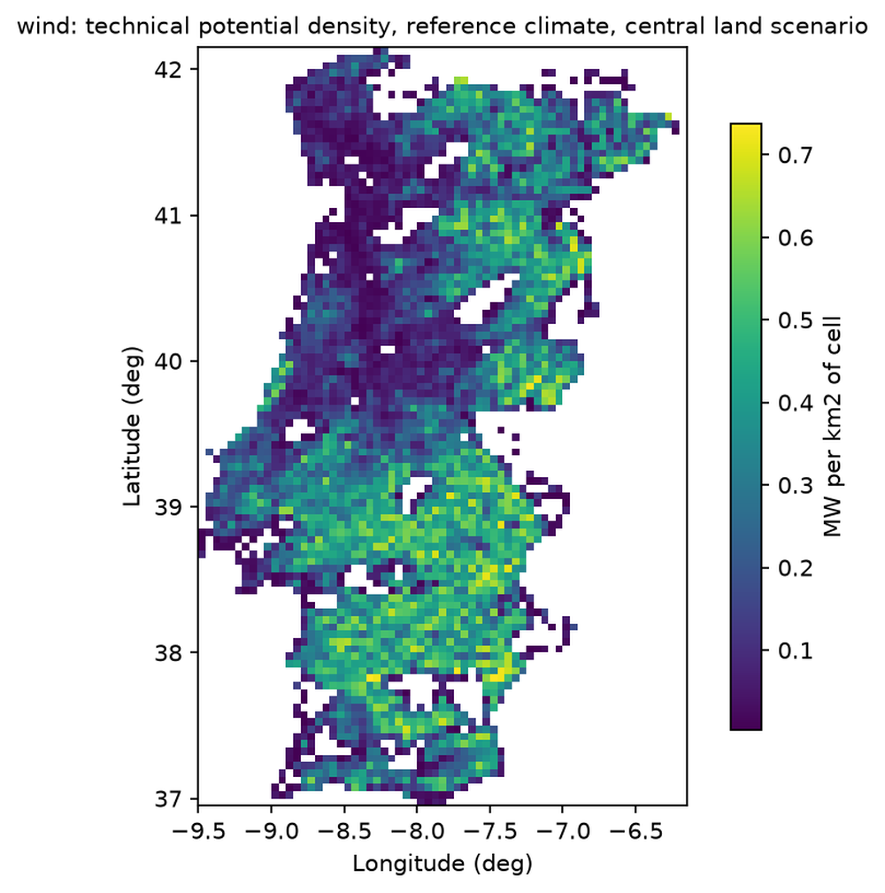
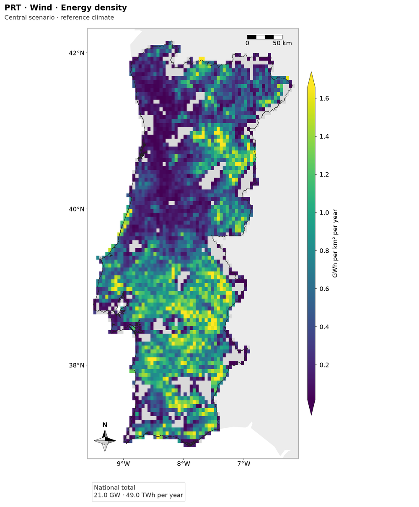
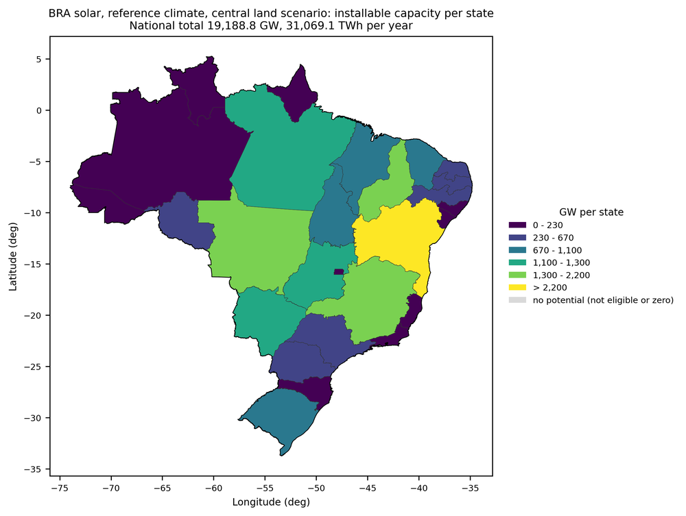
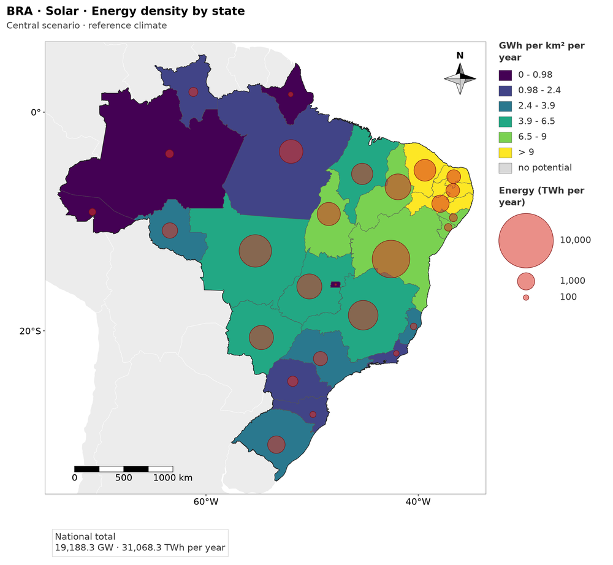
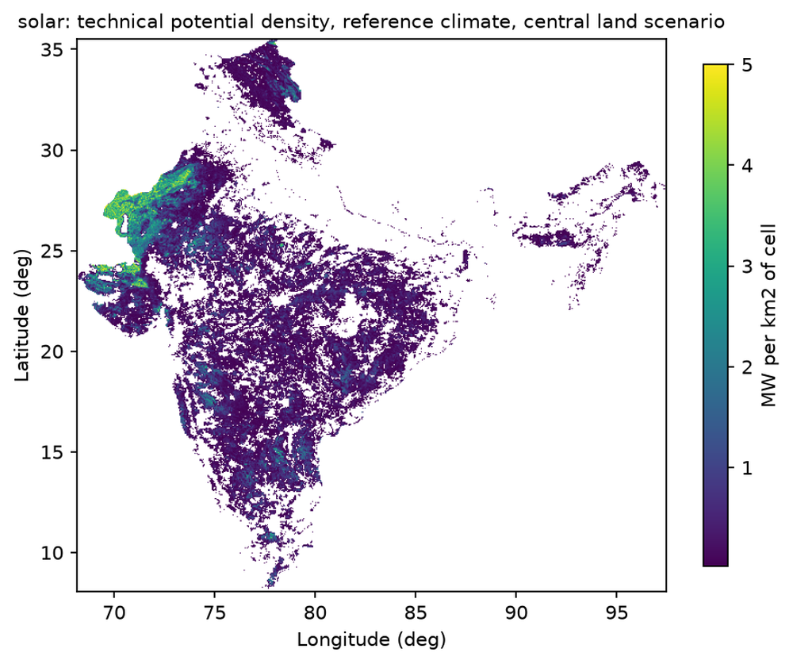
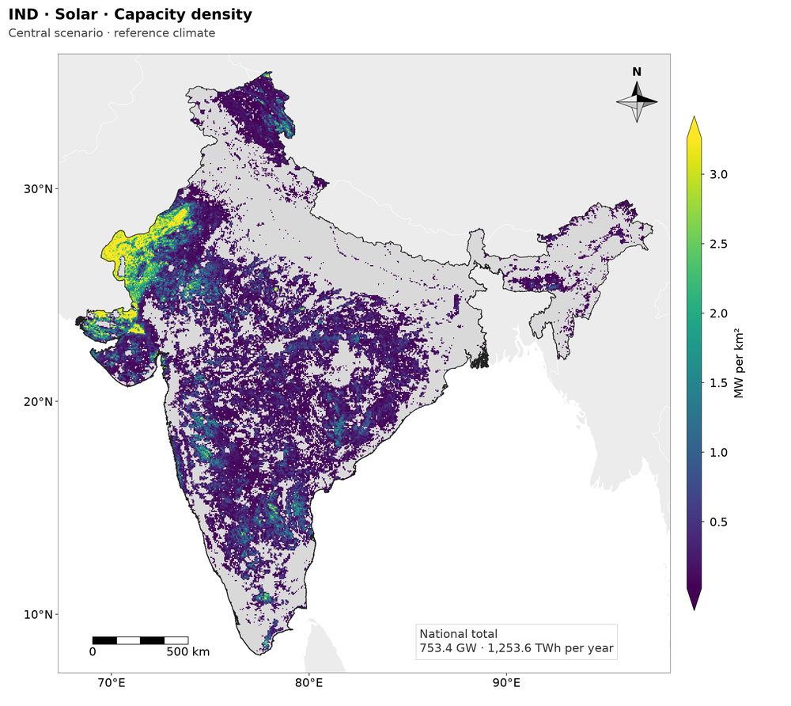

# Maps of the technical potential, version 2 (D-F5-032, COMMAND 60)

Written for Douglas. Phase `potential_maps`, METHODOLOGY 15.2.2 (M-F5-07). Results are those of the real run of 2026-10-20 (F1 to F5 of PRT, IND and BRA with the code of COMMAND 58, 59 and 60; reference climate `m0`). It replaces the maps of `potential_maps_absolute.md` (D-F5-029 and D-F5-030), which stay in that file as the record of the earlier version.

## 1. Resolution of what the maps draw (action 1)

| Layer | Where it is defined | Resolution | What the map does |
|---|---|---|---|
| Eligible share of a cell | F3 `cells_<tech>__<scenario>.parquet` (`eligible_area_km2` over `cell_area_km2`); the sub-pixel shares of the exclusions are computed finer and summed into the cell | 0.05 degree (`scale.cell_deg`), the lattice of F2a-F3 | not drawn by itself |
| Capacity factor | F5 `potential_<tech>__<scenario>.parquet` (`CF`, one value per cell and member) | 0.05 degree | map `capacity_factor_<tech>`: one pixel per cell |
| Potential (MW, MWh per year) | F5, same table (`P_MW`, `E_MWh`) | 0.05 degree | density maps: `P_MW / cell_area_km2` and `E_MWh / 1000 / cell_area_km2`, one pixel per cell |
| Land area of a cell | F3 `cell_area_km2` (the area of the cell **inside the territory**, so a coastal cell is smaller than 0.05 x 0.05 degree) | cell | denominator of every density |

The finest resolution in which the eligible share and the capacity factor are both defined is therefore the cell of 0.05 degree, and that is the resolution of every map. `interpolation="nearest"` on a raster whose pixel is a cell: nothing is interpolated, smoothed or resampled (`resolution` and `density_cells.<map>.interpolation` in `potential_breaks_<tech>.json` say so). **The coarse look of PRT is the real resolution of the analysis** (about 90 x 70 cells of 0.05 degree over a country of 3.3 x 5.2 degrees); a finer picture would need a finer cell in F2a to F5, which changes the results and costs time and memory, and it is not a change of the figure. The note is in `docs/figures/style_guide.md`.

## 2. The set of maps per country and technology (action 2)

Central scenario and reference climate, except the state maps, which are drawn for the three land scenarios. 10 files per technology and country (60 in all), all PNG at 300 dpi, 190 mm wide:

| File (`outputs/<ISO>/technical_potential/figures/`) | What |
|---|---|
| `potential_capacity_density_<tech>_central__ref__na__na.png` | capacity density, MW per km2 of land, per cell, continuous |
| `potential_energy_density_<tech>_central__ref__na__na.png` | energy density, GWh per km2 per year, per cell, continuous |
| `potential_capacity_density_state_<tech>_<scenario>__ref__na__na.png` (3) | choropleth of the capacity density of each state; circles: its capacity (GW) |
| `potential_energy_density_state_<tech>_<scenario>__ref__na__na.png` (3) | choropleth of the energy density of each state; circles: its energy (TWh per year) |
| `capacity_factor_<tech>__ref__na__na.png` | capacity factor, per cell |
| `potential_breaks_<tech>.json` | class limits, colour limits, circle scale, resolution, F5 totals and sum checks |

- **Continuous maps (2a).** Viridis for capacity and energy (the colormap of the style for potential), colour limits at the 2nd and 98th percentiles of the cells with a value above zero, arrows where values fall outside, a logarithmic or power norm only when P98 / P50 is above 20 (it was not in any of the 12 maps: all are `linear`, `density_cells.<map>.norm`). Cells of the country without potential (not a candidate, or zero) in light grey, the sea white, the neighbours very light grey.
- **State maps (2b).** The density of a state is its total over the **land area of the state** (the sum of the `cell_area_km2` of its cells), not the total, which the size of the state dominates. Six classes by Fisher-Jenks natural breaks, the last one open ("> limit"). The totals are **circles whose area is proportional to the total** (radius with the square root), semi-transparent, over a point inside the largest part of each state, drawn largest first; the legend shows three round values (1, 2 or 5 times a power of ten, each a tenth of the one before) and the largest circle is 9 mm in radius.
- **Same scale in the three land scenarios (2c).** The limits come from the state densities of the **central** scenario alone (`absolute_maps.per_state.basis: central`, last class open, as in COMMAND 54), the same six classes in the restrictive, central and permissive map of a variable; the circle scale uses one reference, the largest state total of the three scenarios, so the circles are comparable between scenarios as well.
- **Maps per cell in MW and GWh (2d).** They left the main set. `absolute_maps.per_cell: true` in `config/experiments.yaml` draws them again (classed, 7 quantiles, `potential_capacity_mw_cell_<tech>_central...` and `potential_energy_gwh_cell_<tech>_central...`); the default is `false`. `produces` of the phase follows the flag.

## 3. The common style on every map (action 3)

All maps are drawn with `viz/mapstyle.py`: extent from the contiguous territory plus 3% (far islands out), the geographic aspect, the 8-point compass rose and the scale bar in the emptiest corner (or in the margin), the neighbouring countries, short titles `<ISO> · <Technology> · <Variable>` with the scenario and the climate on a second line, the national total in a small box, PNG at 300 dpi at print size. The sources of the data are in the limits file and in this record, not on the figure.

- **Neighbours.** Natural Earth 1:50m admin-0 (public domain), acquired by `scripts/acquire_natural_earth.py` into `raw/natural_earth/_global/` (zip sha256 in `manifest.json`), cut to the window of the map and without the territory itself. If the file is missing the maps are drawn without neighbours and the log says so (it does not stop the phase: the neighbours are decoration, no result reads them).
- **Additions to the style module** (`docs/figures/style_guide.md`): `ClassedLegend` and `draw_classed_legend` (a legend of classes with a "no potential" entry and a legend of circle sizes, in the strip to the right of a tall map or in a row below a wide one, which `legend_space` sizes), `draw_choropleth`, `circle_radius_mm`, `draw_circles`, `nice_values_below`, and the optional `legend_side_mm` and `legend_below_mm` of `new_map`.
- **A defect of the module found and fixed.** The furniture was placed on the first layout and moved by a translation when a footer strip made the map smaller (a map limited by the height of the sheet, like a tall country). A compass placed in the upper left corner then ended above the map and under the title. The placement is now repeated on the layout the map is drawn on, until the strip stops growing (`new_map`); the three baselines of COMMAND 56 are unchanged.

## 4. Sum checks (action 4)

The blocking check is the one of D-F5-029, unchanged: in every scenario the sum of the cells and the sum of the states must equal the F5 national total of `m0` within 0.1% (capacity and energy), or the phase raises `AbsoluteMapsError` and writes nothing. The largest relative difference found in the real run:

| Country | Solar | Wind |
|---|---|---|
| PRT | 2.0e-16 | 1.9e-16 |
| IND | 3.6e-16 | 1.8e-16 |
| BRA | 1.9e-16 | 3.3e-16 |

National totals of the three scenarios (GW, TWh per year) are in `potential_breaks_<tech>.json` (`national_totals_f5`).

## 5. Before and after (action 5)

The "before" figures are those the phase wrote at the start of this command (the run of 2026-10-20 with the code of COMMAND 56); the "after" figures are those of the real run of the same day.

### PRT, wind, central scenario

| Before: `potential_density_wind` (MW per km2 of cell, own colours, 150 dpi, no neighbours, scale or compass) | After: `potential_energy_density_wind_central` (GWh per km2 per year) |
|---|---|
|  |  |

The capacity density, `potential_maps_v2/PRT_wind_after_capacity_density.png`, has the same pattern in MW per km2. The pixelation is the resolution of the cell, as before; what changed is the density in the units of the thesis (GWh per km2 per year), the robust colour limits (the old map used the minimum and the maximum, so a few cells with a high value flattened the rest; the new limits are 0.017 to 1.658 GWh per km2 per year), the grey of the cells without potential and the furniture.

### BRA, solar, by state, central scenario

| Before: `potential_capacity_gw_state_solar_central` (GW per state, six Fisher-Jenks classes of the totals; the size of the state decides the colour) | After: `potential_energy_density_state_solar_central` (GWh per km2 per year, circles: TWh per year) |
|---|---|
|  |  |

In the old map the three largest states are the darkest because they are the largest. In the new one the colour is the density: the north-east (above 6.5 GWh per km2 per year, the coastal states of the semi-arid region above 9) is the highest, the Amazon states are the lowest (below 1), and the size of the circle says where the large totals are (Bahia, Mato Grosso, Minas Gerais, Para). The map of the capacity density by state is `potential_maps_v2/BRA_solar_state_after_capacity_density.png`. The extent has no oceanic island: the map reaches 75.2 W to 33.6 W, the easternmost point of the mainland is at 34.8 W and Fernando de Noronha (32.4 W) and Trindade (29.3 W) are out.

### IND, solar, density per cell, central scenario

| Before: `potential_density_solar` | After: `potential_capacity_density_solar_central` |
|---|---|
|  |  |

The territory is the contiguous one of METHODOLOGY 15.2.0 (the north block and Arunachal Pradesh are in the map; where the layers have no data they are grey: the wind of those blocks, OQ-062 closed in D-F1-030, and the solar potential, which is there). Capacity density 0.021 to 3.257 MW per km2 (limits of the colour scale), energy density 0.032 to 5.596 GWh per km2 per year.

National totals after the run (central scenario, GW and TWh per year): PRT solar 264.5 and 424.6, wind 21.1 and 49.0; IND solar 753.4 and 1,253.6, wind 189.8 and 299.5; BRA solar 19,188.3 and 31,068.3, wind 1,643.5 and 2,297.2. They differ from those of D-F5-031 (PRT solar 264.6 and 424.9; IND solar 753.3 and 1,253.4; BRA solar 19,188.8 and 31,069.1) by 0.1% or less, because the shares of the protected areas and of the lakes of F3 now follow the grid-independent computation (D-F3-020) and, with the cache of those shares keyed by the code that computes them (D-F3-021), the run of F3 really used it.

## 6. Figures of the earlier versions (action 6)

The figures of the phase that are not part of the set were **moved, not deleted**, to `GEOFREA_DATA_DIR/archive/figures_20261020/<ISO3>/technical_potential/figures/` by `scripts/archive_potential_figures.py` (the old density map, the six maps of GW and TWh per state and the two of MW and GWh per cell of each technology: 18 files per country, 54 in all). The folder `figures/` of each country holds 20 files: the 2 x 9 of the set and the 2 limits files.

## 7. Tests (action 7)

- `tests/unit/test_mapstyle_classed.py` (23): the circle scale (the area is proportional to the value, zero has no circle, a tiny value is still visible), the round legend values, the room of the legend; on a state map of each synthetic country, with the far island inside one of the states: **no overlap** of the real boxes of the legend, the title, the compass, the scale bar and the total, **no circle** on any of them or on the legend, everything inside the figure, the extent without the island, the circle scale, the legend with every class, the "no potential" entry and the sizes; the perceptual-hash regression of the three state maps (`state_tall`, `state_wide`, `state_small` in `tests/fixtures/mapstyle/hashes.json`).
- `tests/unit/test_absolute_maps.py` (18): the class limits, the sums against F5, the state density over the land area of the state (recomputed outside the code), the per-cell maps only with the flag, the blocking check, the admin1 error.
- `tests/unit/test_technical_potential_maps.py` and the synthetic ZZZ and ZZZ2 end-to-end tests: files of each `figures` mode, the limits file, the registration of the artifacts.
- The 44 tests of `test_mapstyle.py` pass unchanged (baselines of COMMAND 56 included).

## 8. Run

Phase `potential_maps` of the real run of 2026-10-20: **PRT 47 s, BRA 104 s, IND 123 s** (the phase alone, 20 maps and 2 limits files per country). The first version of the same run took 463, 1,257 and 2,633 s, almost all of it in the search for the contiguous territory (about a minute for IND), which it repeated for every map; the second version finds it once per country (`MapContext`). The files are written by the phase (`produces` lists them, per technology, when `figures` is `all`; the maps per cell only with `per_cell`).
