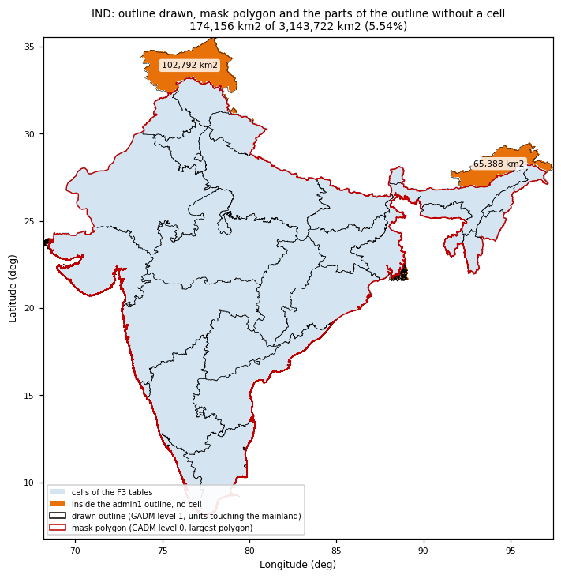
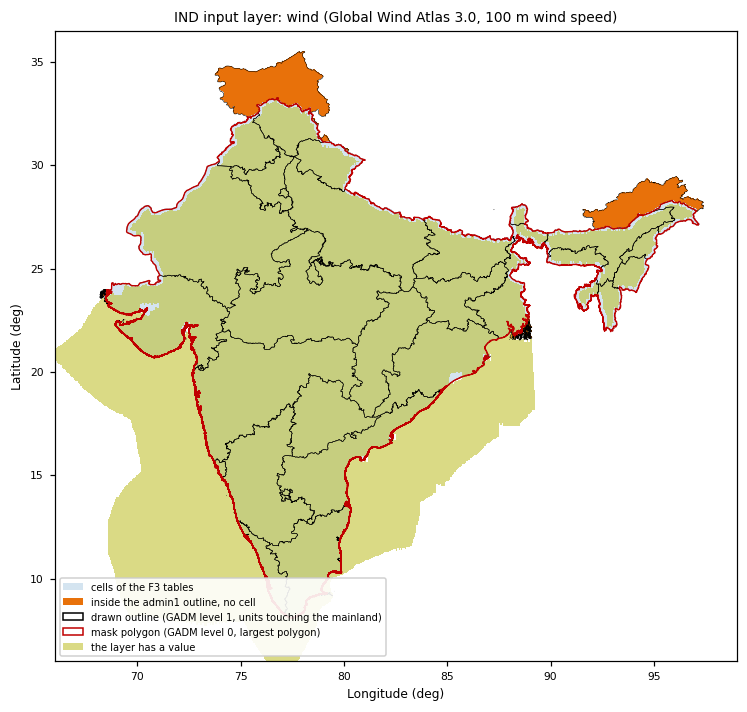
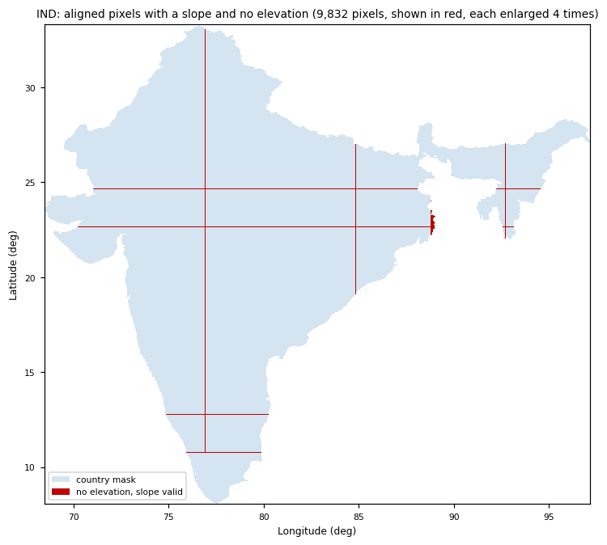
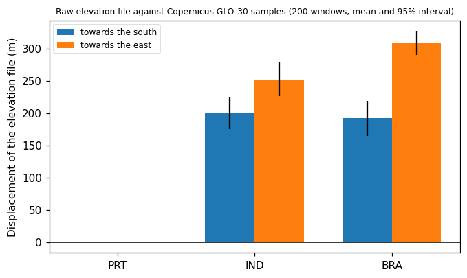

# Coverage of the outline and alignment of elevation and slope (COMMAND 54, 2026-10-19)

Written for Douglas. Everything here was measured read only on the outputs of 2026-10-18 and the raw files; nothing in the pipeline or in `GEOFREA_DATA_DIR` was changed by the diagnostics. The scripts are in the scratch directory of the session (not in the repository). The change of step 3 (classes of the per-state maps) is a separate commit (`436902d`, METHODOLOGY 15.1.1, D-F5-030).

## 1. White areas of the maps of India

### 1.1 What removes the cells

A cell exists in the F3 tables if and only if it holds a pixel of the F2a country mask, and the mask is the rasterisation of **one polygon: the largest polygon of GADM 4.1 level 0** (`gadm41_<ISO>_0_mainland.shp`, made by `get_mainland_gdf`, `countries.yaml` `mainland_only: true`, OQ-039). Both statements were checked, not assumed:

| Check | PRT | IND | BRA |
|---|---|---|---|
| Pixels of the F2a grid layer valid / pixels of the mask polygon rasterised on the same grid / pixels that differ | 93,149 / 93,149 / 0 | 2,610,287 / 2,610,287 / 0 | 7,100,137 / 7,100,137 / 0 |
| Cells of the F3 table / cells that hold a pixel of the F2a mask / difference | 3,937 / 3,937 / 0 | 105,952 / 105,952 / 0 | 285,999 / 285,999 / 0 |

The **outline drawn** on the maps (D-F5-029) is a different geometry: the GADM 4.1 level-1 units that touch the mainland polygon, **whole** (`gadm41_<ISO>_1_mainland.shp`, `_mainland_level1` of the GADM fetcher). A unit keeps all its polygons, including the ones the "largest polygon" rule removed from level 0. The white areas are the parts of those units that are outside the mask polygon.

### 1.2 Area without cells, per country and per region (km2, geodesic, on a 0.005 degree lattice)

| Country | Outline drawn | Mask polygon | Outline with no cell | of which outside the mask | of which inside the mask (slivers) |
|---|---|---|---|---|---|
| PRT | 88,753 | 88,685 | 19.6 (0.02%) | 5.6 | 14.0 |
| IND | 3,143,722 | 2,965,152 | **174,156 (5.54%)** | **174,049** | 107 |
| BRA | 8,509,046 | 8,506,821 | 2,119 (0.02%) | 1,971 | 147 |

In all three countries the whole area outside the mask but inside the outline lies in other polygons of GADM 4.1 level 0 (0 km2 is absent from level 0). The slivers inside the mask are the cells that have a 0.005 degree sub-pixel of the polygon but no 0.01 degree pixel whose centre is inside it (the rule of the F2a rasterisation); they are 0.004% of IND.

Regions of IND over 100 km2 (the other 269 parts, each under 100 km2, add up to 922 km2):

| Region | km2 | Box (W, S, E, N) | Admin1 unit | In GADM level 0 | Why it is not in the mask |
|---|---|---|---|---|---|
| North: Jammu and Kashmir, Ladakh | 102,792 | 73.77, 32.35, 79.30, 35.50 | Jammu and Kashmir | another polygon of level 0 | not the largest polygon (disputed territory) |
| North-east: Arunachal Pradesh | 65,388 | 91.56, 26.90, 97.42, 29.47 | Arunachal Pradesh | another polygon of level 0 | same |
| Sundarbans delta (five parts) | 3,250 | 88.0-89.1, 21.6-22.6 | West Bengal | other polygons | islands, OQ-039 |
| Rann of Kutch | 732 | 68.2-68.5, 23.6-24.0 | Gujarat | other polygon | island, OQ-039 |
| Uttarakhand (two parts) | 957 | 78.9-79.3, 31.2-31.5; 80.1-80.2, 30.6-30.8 | Uttarakhand | other polygons | enclaves (disputed) |
| Himachal Pradesh | 117 | 78.5-78.65, 32.1-32.25 | Himachal Pradesh | other polygon | enclave (disputed) |

So 168,181 km2 (96.6% of the missing area) are two large disputed-territory blocks and 5,868 km2 are islands and enclaves.

BRA and PRT: the regions over 100 km2 are coastal islands that the rule removes by design: BRA Amapa 490, Maranhao 340 and 163, Sao Paulo 335, Rio de Janeiro 173 km2; PRT has none over 100 km2.

### 1.3 What the input layers say in those regions

Share of 1,500 random points of each region that have a value (read from the raw files):

| Layer | North (J&K, Ladakh) | North-east (Arunachal) |
|---|---|---|
| Elevation (raw file) | 86% | 99.6% |
| Population (WorldPop) | 99.5% | 99.7% |
| Solar (PVOUT, global) | 100% | 100% |
| Wind (GWA, 100 m) | **0.1%** | **0.1%** |
| Land-cover tile (ESA WorldCover) present | 69% | 100% |
| Copernicus GLO-30 tile (slope) present | **19%** | **60%** |

Maps of the footprint of each layer over the same frame (orange: outline without a cell; red: mask polygon): [land cover](coverage_alignment_54/coverage_IND_layer_land_cover_tiles.png), [elevation file](coverage_alignment_54/coverage_IND_layer_elevation_raw.png), [GLO-30 tiles of the slope](coverage_alignment_54/coverage_IND_layer_slope_glo30_tiles.png), [population](coverage_alignment_54/coverage_IND_layer_population.png), [protected areas](coverage_alignment_54/coverage_IND_layer_protected.png), [wind](coverage_alignment_54/coverage_IND_layer_wind_gwa.png). The wind layer is the clearest: the Global Wind Atlas file stops at the mask polygon on land (it also covers the sea around the peninsula, which is not used).

The missing GLO-30 and land-cover tiles and the empty wind raster are consequences of the same polygon: F1 selects the tiles that overlap the mainland polygon and the Global Wind Atlas file is downloaded for it. The layers do not remove cells; the polygon does.

### 1.4 Sources and versions

| Geometry | Source | Version and file | Check |
|---|---|---|---|
| Mask (`borders`) | GADM, country level 0, reduced to its largest polygon | GADM 4.1, `gadm41_<ISO>_0.shp` -> `gadm41_<ISO>_0_mainland.shp` | SHA-256 of the level-0 file equals `gadm_level0_sha256` of `countries.yaml` in the three countries (IND `6d53f0bd...`) |
| Drawn outline and admin1 units of F3 | GADM, level 1, units that touch the mainland polygon, whole | GADM 4.1, `gadm41_<ISO>_1.shp` -> `gadm41_<ISO>_1_mainland.shp` | units kept of the units in the file: PRT 18 of 20, IND 39 of 41, BRA 27 of 27 (IND: Andaman and Nicobar and Lakshadweep; PRT: Azores and Madeira) |
| Other | Natural Earth is only the declared fallback of F1 and was not used (the registry says `GADM 4.1`) | | |

(Level 0 of GADM 4.1 holds 862 polygons for PRT, 765 for IND and 1,007 for BRA; the largest one is the mask.)

### 1.5 Classification

**(i) disputed border / polygons of different geometry between sources**, with no missing tile or layer as a cause: 174,049 km2 of IND (5.5% of the outline, 99.94% of the area without cells) are territory that GADM 4.1 itself keeps in other polygons of level 0 and that the "largest polygon" rule leaves out; the 107 km2 of slivers are the (iii) "other" and are negligible. (ii) is a consequence, not a cause (the tiles are absent because the polygon excluded them). In PRT and BRA the cause is the same rule applied to islands (OQ-039, by design), 0.02% of the outline.

### 1.6 Proposal (not implemented)

One geometry for the mask **and** the outline: **GADM 4.1 level 0, largest polygon** (`gadm41_<ISO>_0_mainland.shp`, SHA-256 in `countries.yaml`), which is what already decides the cells. Concretely:

* the outline of the maps is the boundary of that polygon;
* the admin1 units of F3 and of the maps are clipped to it (`units ∩ mask`), keeping their ids and names; the cell-to-unit assignment (largest overlap) already works on cells inside the mask;
* the territory outside it is declared once, with its area, in LIMITATIONS (L-045, written now): IND 174,049 km2 (Jammu and Kashmir and Ladakh north block 102,792; Arunachal 65,388; islands and enclaves 5,868).

The white areas then disappear without changing a result. The alternative, to include the two disputed blocks (+168,181 km2, +5.7% of the mask), is not recommended without a decision of yours on the border: the Global Wind Atlas file has no wind there (0.1% valid), 31% and 81% of the land-cover and GLO-30 tiles of the north are not acquired, and F1, F2a to F8 would run again for India.

## 2. Elevation with no value where the slope has one, and the displacement between the two

### 2.1 Where each comes from

| | Elevation | Slope |
|---|---|---|
| Source | `raw/elevation/<ISO>/<ISO>_elevation.tif`, "Copernicus DEM 30m (local bundled file, pre-downloaded)", 0.005 degree pixel (IND 6,311 x 5,539, BRA 8,231 x 8,582, PRT 662 x 1,034) | Copernicus GLO-30 tiles of F1 (`raw/copernicus_dem30/<ISO>/`, 1 x 1 degree, 3,600 x 3,600 samples; IND 332, BRA 815, PRT 19 tiles) |
| How | `reproject_to_grid`, bilinear, to the 0.01 degree F2a grid | `slope_class_counts` (D-F2a-016): slope of each 30 m sample, counted into the 1 degree bins of the grid pixel that contains the sample centre |

So the slope is **not** derived from the aligned DEM: it comes from the 30 m tiles, the elevation from another file. The aligned rasters of both are on the **same** grid (same CRS EPSG:4326, same transform, same shape and extent: IND 2,875 x 2,525 pixels, bounds 68.45-97.20 E and 8.05-33.30 N, BRA 3,925 x 3,905, PRT 340 x 525), checked with `rasterio` in the three countries. F3 uses `slope_counts` and the aligned elevation; the `slope_aligned` raster is not read by F3.

### 2.2 Pixels with a slope and no elevation

| Country | Pixels of the mask | Valid slope, no elevation | Area (km2) | Share of the pixels with slope | Cause |
|---|---|---|---|---|---|
| PRT | 93,149 | 0 | 0 | 0 | n/a |
| IND | 2,610,287 | **9,832** | 11,205 | 0.38% | the raw elevation file is nodata (-9999) there |
| BRA | 7,100,137 | **6,620** | 8,080 | 0.09% | same |

In all of them GLO-30 has data (1,296 samples per pixel, the same as elsewhere), and no pixel has elevation without slope. They are **straight lines one raw pixel (0.005 degree) wide**, seams of the file: in IND horizontal lines at latitude 24.62 (1,932 pixels), 22.65 (1,929), 12.76 (538) and 10.77 (393), vertical lines at longitude 76.90 (2,229, from north to south across the country), 84.80 (787) and 92.68 (499), and a few short ones in the Sundarbans; in BRA a horizontal line at latitude -8.38 (3,853 pixels) and vertical lines at -64.19 (1,495) and -68.11 (1,274). Only 6 patches (IND) and 3 (BRA) of connected pixels, none of one pixel. Maps: [IND](coverage_alignment_54/elevation_gaps_IND.png), [BRA](coverage_alignment_54/elevation_gaps_BRA.png).

A cell has no elevation when all its eligible pixels are on such a line (OQ-060, D-F3-018: 36 central wind cells and 14 solar cells in IND).

### 2.3 Displacement, measured in 200 random cells per country

Method: random cells with eligible area, at least 80% valid pixels in a 13 x 13 pixel window and a standard deviation of the elevation of at least 5 m; the two images are standardised (mean 0, standard deviation 1) and compared for integer shifts of up to 3 pixels, with a parabola for the fraction. The GLO-30 samples are assigned to pixels with the rule of the slope (`slope_class_counts`), so the slope and this comparison share one lattice. Sign: `a[r, c]` matches `b[r + dr, c + dc]`, so a positive `dr` (south) and `dc` (east) mean that the features of `a` are shifted to the **north and to the west** of where `b` has them.

| Comparison | PRT | IND | BRA |
|---|---|---|---|
| Raw elevation file against GLO-30, on the 0.005 degree lattice of the file (pixels; metres) | 0.00 south, 0.00 east (0 m, 0 m) | **0.36 south, 0.45 east (200 m, 237 m)** | **0.35 south, 0.56 east (192 m, 290 m)** |
| 95% interval, IND | | south 0.32-0.40, east 0.41-0.50 | |
| Aligned elevation against the raw file averaged on the aligned lattice (the alignment step, pixels of 0.01 degree) | -0.03 / 0.03 | -0.01 / 0.01 (12-15 m) | 0.03 / -0.03 |
| Aligned elevation against GLO-30 on the aligned lattice (pixels of 0.01 degree) | 0.00 / 0.00 | **0.12 south, 0.18 east** | **0.12 south, 0.18 east** |
| Share of windows with zero integer shift (last row) | 99% | 96% | 98% |

Reading: the raw elevation files of IND and BRA are displaced by about **0.35 to 0.56 of a 0.005 degree pixel (190-290 m) to the north-west** against GLO-30, the product they are said to come from; the file of PRT is not. The alignment to the 0.01 degree grid adds nothing (12-15 m). The size, close to half a pixel, is what a pixel-is-point against pixel-is-area registration error would give; that is a conjecture, not verified. The 30 m slope of the same cells has the right position (it is built on GLO-30 directly).

The shift between the slope used and the slope recomputed from the aligned DEM, the other measurement asked for, could not be resolved: a 1 km elevation grid and 30 m slopes have different magnitudes and the estimate of the shift has a noise of about 0.2 pixel (the control, the slope recomputed from the GLO-30 pixel means against the slope used, which should give zero, gives 0.01 pixel in IND, -0.12 and 0.01 in BRA and 0.04 and 0.22 in PRT, with intervals of about +-0.2). The direct comparison of the elevation with GLO-30 above is the decisive one.

**Systematic displacement: yes in IND and BRA** (about 0.2-0.3 km), so OQ-061 is open.

### 2.4 Effect

The displacement is 0.2-0.3 km on a surface used for the 3000 m limit and the density check; both are insensitive to it. The seams remove elevation from 0.4% (IND) and 0.1% (BRA) of the pixels and make the cells of OQ-060 (36 + 14 central cells in IND, 1 + 1 in BRA). Neither changes a number of the potential beyond the 0.01% already reported.

## 3. Classes of the per-state maps (step 3, done)

D-F5-030, METHODOLOGY 15.1.1: Fisher-Jenks limits of the central scenario, applied to the three scenarios, last class open ("> limit"). All six classes are now used in the central map (the example of BRA solar: 230, 670, 1,100, 1,300, 2,200 GW and "> 2,200"). Details and the limits of every country in `docs/phases/F5/potential_maps_absolute.md`; commit `436902d`, 1,434 tests pass on it.

## 4. What is open

* **OQ-061** (new): the bundled elevation files of IND and BRA (displacement and seams). Options in `docs/OPEN_QUESTIONS.md`.
* **L-045** (new): the territory of IND outside the analysis, with its area. It records the fact; the choice of one geometry for mask and outline (section 1.6) waits for your verdict and is not implemented.
* L-046 (new): the displacement and the seams of the elevation, until OQ-061 is decided.
